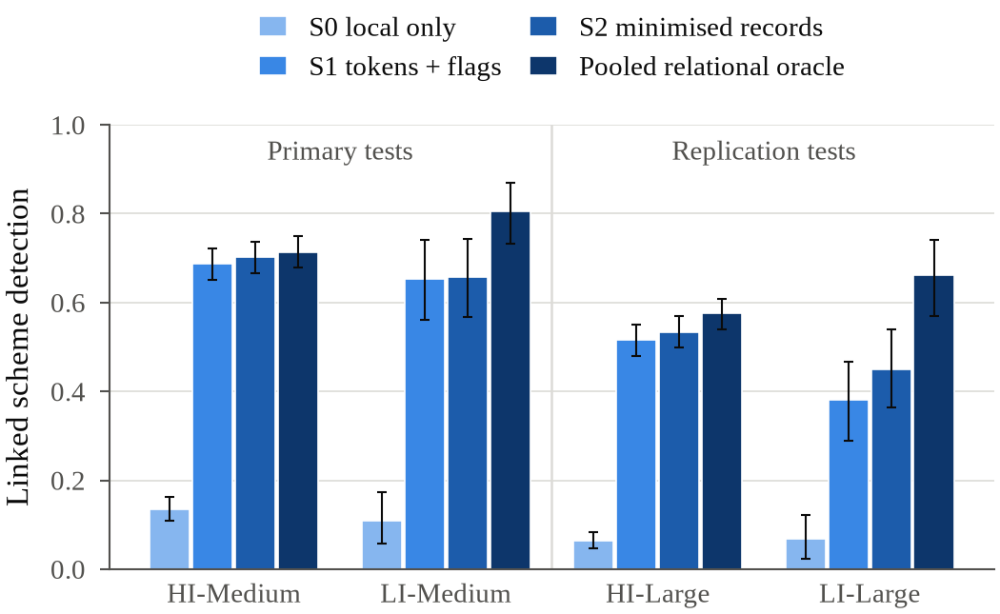
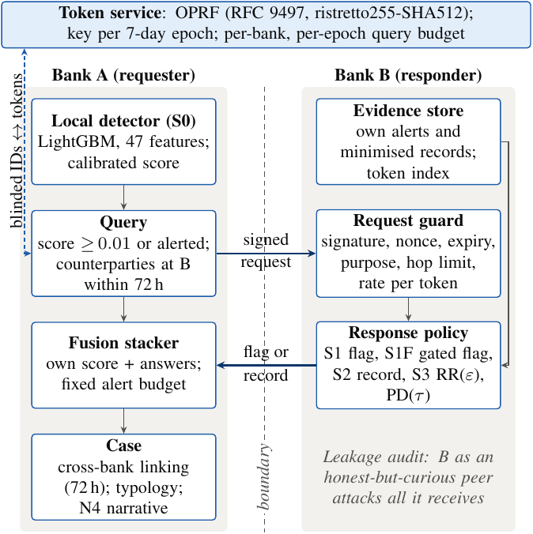

# FinMesh

**Privacy-preserving evidence sharing for cross-bank anti-money laundering, with a pre-registered evaluation.**

[](https://github.com/allu0786ansari/FinMesh/actions/workflows/ci.yml)

[](LICENSE)
[](docs/data_License.md)

A laundering scheme usually touches several banks, and each bank's monitoring sees only its own part of it. In FinMesh, banks answer each other's queries about counterparty accounts with **minimised evidence**: an alert flag, a probability bucket and bucketed behaviour counters. Each query is addressed by a token from an **oblivious pseudorandom function (OPRF)**, so no account number is exchanged.

The project measures two things together: how much cross-bank detection improves at each sharing level, and how much a curious receiving bank can infer from what it is sent. Every hypothesis was **pre-registered** and decided once on **sealed test data**. Later improvements were confirmed on two further test windows that had never been opened.

Everything runs on IBM's public synthetic [AMLworld](https://www.kaggle.com/datasets/ealtman2019/ibm-transactions-for-anti-money-laundering-aml) data (HI and LI variants). No real bank data is used.

---

## Paper

**Privacy-Preserving Evidence Sharing for Cross-Bank Anti-Money Laundering: A Pre-Registered Evaluation**
Allaudin Ansari, Ravi Sah, M. Jagadeesh (SRM Institute of Science and Technology)

| | |
| --- | --- |
| [`docs/paper/preview.pdf`](docs/paper/preview.pdf) | Compiled draft (IEEE conference format) |
| [`docs/paper/main.tex`](docs/paper/main.tex) | LaTeX source; figures in `figures/`, tables in `tables/` |
| [`docs/paper/paper.docx`](docs/paper/paper.docx) | Editable Word version |
| [`docs/paper/VERIFICATION.md`](docs/paper/VERIFICATION.md) | Every factual statement in the paper, mapped to the result page or code it comes from |
| [`docs/paper/README.md`](docs/paper/README.md) | How to rebuild the figures, tables, Word file and Overleaf package |

---

## Key results

Linked scheme detection is the share of laundering schemes whose accounts end up in one case within 72 hours. It is measured on four sealed tests, at a fixed alert budget of one alert per 1,000 accounts per day. S0 is local monitoring only; S2 adds minimised evidence records.

| Sealed test | S0 (local only) | S2 (evidence records) | Gain, 95% CI | Share of pooled relational model's gain |
| --- | --- | --- | --- | --- |
| HI-Medium (week 18) | 0.136 | 0.702 | +0.566 [0.529, 0.606] | 0.98 |
| LI-Medium (week 18) | 0.109 | 0.657 | +0.549 [0.449, 0.634] | 0.79 |
| HI-Large, fresh window (A25) | 0.063 | 0.534 | +0.471 [0.433, 0.508] | 0.92 |
| LI-Large, fresh window (A25) | 0.067 | 0.450 | +0.383 [0.289, 0.478] | 0.64 |

<p align="center"></p>

- **Robust gain.** The gain stays positive without the suspected simulator artefact features (+0.438 HI-Large, +0.210 LI-Large). It also stays positive with a stronger transaction-level detector as the local baseline (+0.433, +0.355). On AMLworld's published split, that detector beats both published gradient-boosting baselines on all four sets.
- **A leak found, fixed and confirmed.** The attack-based audit found that a plain alert flag reveals high fan-in on low-illicit data: an advantage of 0.043 [0.031, 0.059] on LI-Large. A gated flag, chosen on validation by a pre-registered rule, brings this down to 0.004 [0.000, 0.007] and keeps 93–100% of the flag's detection value.
- **Less analyst work.** With sharing, an analyst reviews 18 alerts per linked scheme instead of 153 (HI-Large), and 140 instead of 944 (LI-Large). Cases are also more complete: on HI-Large, the largest case holds 0.77 of a scheme's accounts, against 0.47 without sharing.
- **Grounded case narratives.** Free-text narratives from small local language models missed the grounding target (0.86 and 0.92 against 0.95). A select-then-template design met it on both fresh tests (1.00 and 0.95).
- **Reported as not met:**
  - Typology attribution on the fresh tests.
  - The pre-registered token re-identification target. The OPRF reduces token re-identification 8–9× relative to shared-key hashing, short of the 10× target.

Full results: [`docs/eval/test/RESULTS.md`](docs/eval/test/RESULTS.md) (week 18), [`docs/eval/a25/RESULTS_LARGE.md`](docs/eval/a25/RESULTS_LARGE.md) (fresh windows), [`docs/eval/a25/ANALYSIS.md`](docs/eval/a25/ANALYSIS.md) (interpretation).

---

## How it works

<p align="center"></p>

1. **Local detection (S0).** Every 6-hour window, each bank scores its active accounts with LightGBM (47 behaviour, graph, history and neighbourhood features) and raises a fixed number of alerts.
2. **Tokens.** For a suspicious account, the bank tokenises the account's counterparties at other banks through an OPRF token service (RFC 9497, ristretto255-SHA512). The service uses a key per 7-day epoch and a per-bank query budget.
3. **Evidence request.** A signed, single-use request with a declared purpose and a hop limit goes to the bank holding the counterparty. That bank's guard checks it, then its policy answers at the configured sharing level.
4. **Fusion and linking.** A per-bank logistic stacker combines the bank's own score with the answers under the same alert budget. Alerts are linked into cases across banks.
5. **Case narrative.** An attributor proposes a typology. A local model selects up to four evidence fields, and fixed templates write the text.

| Level | What the responding bank returns |
| --- | --- |
| S0 | Nothing (local monitoring only) |
| S1 | Alert flag and time bucket |
| S1F | Gated flag: the flag only when the requester's own probability bucket is at least 2 |
| S2 | Minimised record: probability bucket, top-3 autoencoder deviations, bucketed counters (fan-in/out, counts, amounts, pass-through, cross-bank share, new-counterparty share, minimum delay) |
| S3 | S2 released through k-ary randomised response (ε ∈ {0.5, 1, 2, 4, 8}) |
| PD | Progressive disclosure: S1, plus the S2 record only when the requester's bucket is at least τ |
| S4 | S2 plus an 8-dimensional embedding; upper reference for leakage |

---

## Evaluation protocol

| Step | Where |
| --- | --- |
| Research design and threat model | [`docs/proposal/FinMesh_Proposal_v2.md`](docs/proposal/FinMesh_Proposal_v2.md) |
| Pre-registration: hypotheses, metrics, operating points, statistics | [`docs/protocol/preregistration.md`](docs/protocol/preregistration.md) |
| Gates G0–G3, each with its evidence and decision | [`docs/gates/`](docs/gates/) |
| Every amendment, dated, with its reason | [`docs/proposal/CHANGES.md`](docs/proposal/CHANGES.md) |
| Sealed-test plan: run order, one opening per experiment, dataset and seed | [`docs/protocol/test_plan.md`](docs/protocol/test_plan.md) |
| Fresh replication (A25): rules fixed before the runs | [`docs/protocol/improvement_plan_A25.md`](docs/protocol/improvement_plan_A25.md) |
| Run logs with the exact commands, week by week | [`docs/runlog/`](docs/runlog/) |

Test labels stay sealed: each configuration's scores are stored with a SHA-256 digest before the labels are opened, and every opening is logged (`uv run finmesh sealed-log --dataset <set>`). Every result file is stamped with the code commit, data manifest hash, parameters and seed. Missed targets are reported as findings.

---

## Repository layout

```
finmesh/              the package: every experiment runs in-process here
  data/               AMLworld ingestion, scheme linking, windows, splits, visibility, fixture
  features/           per-bank behaviour, graph, history and neighbourhood features
  models/             LightGBM detector, calibration, autoencoder
  matching/           OPRF (RFC 9497) and token service with per-epoch budgets
  sharing/            evidence records, signed requests and guard, sharing levels, LDP (S3)
  fusion/             local incidents and the fusion (triage) stacker
  federation/         FedAvg and DP-SGD with privacy accounting (supporting track)
  attribution/        typology attributor and case narratives (local LLM via Ollama)
  training/           experiment runners X1–X6, audit attacks, benchmark, sealed runs
  eval/               metrics, bootstrap, gates, sealed test, provenance, reports
  services/           demo path: token service and bank nodes over HTTP, orchestration,
                      analyst console, privacy ledger, X7 (latency, faults, probes)
  paper/              builds the paper's figures and tables from committed result pages
  schemas/            frozen feature sets, evidence schema, token budgets, DP settings
docs/
  paper/              the paper (LaTeX, PDF preview, Word), verification record
  eval/               every result page (validation; test/ for sealed tests; a25/)
  gates/ protocol/ proposal/ runlog/ data_profile/   design, decisions and evidence
tests/                unit, contract and integration tests (integration needs real data)
scripts/              local CI, scale check, week runners
docker/               the pipeline's stage runner (reproduce.sh) for the containers
Dockerfile, compose.yaml   runtime and full images; demo, pipeline, LLM, paper and CI profiles
```

Data never enters git. Everything large lives under `data/` (ignored), or wherever `FINMESH_DATA` points.

---

## Getting started

**Requirements:** Python 3.11–3.13 (3.12 recommended), [uv](https://docs.astral.sh/uv/) and git. You need about 8 GB of RAM and 5 GB of free disk; everything was run on an 8 GB laptop under WSL. [Ollama](https://ollama.com) is needed only for the narrative experiments.

```bash
git clone https://github.com/allu0786ansari/FinMesh.git
cd FinMesh
uv sync                                        # locked dependencies into .venv
uv run finmesh check                           # environment and data status
uv run finmesh fixture                         # small synthetic dataset for a smoke run
uv run finmesh week1 --dataset FIXTURE-Small   # ingest and profile it end to end
uv run pytest                                  # 409 tests
```

### Real data

1. Download AMLworld: `uv sync --extra kaggle`, then `uv run finmesh download --dataset HI-Medium`. This needs a Kaggle API token; a browser download is described in [`docs/runlog/week-01.md`](docs/runlog/week-01.md).
2. Follow the run logs in order. Each one lists the exact commands and expected outputs:
   - [`week-01`](docs/runlog/week-01.md) to [`week-17`](docs/runlog/week-17.md) cover validation and engineering.
   - [`week-18`](docs/runlog/week-18.md) covers the sealed tests.
   - [`a25`](docs/runlog/a25.md) covers the fresh Large windows.
3. `uv run finmesh --help` lists every command.

### Paper figures and tables

```bash
uv run finmesh paper-assets      # rebuilds every result figure and table from the committed pages; no data needed
```

### Containers

The whole pipeline runs in Docker: two images (a slim runtime image for the demo path and console, and a full image for the research pipeline), with your checkout and data folder mounted. The guide, including which commit each stage runs on, is [`docs/containers.md`](docs/containers.md).

```bash
cp .env.example .env                                         # set FINMESH_UID/GID to the output of `id`
make docker-build                                            # finmesh:local and finmesh:full
make docker-smoke                                            # X7, then the fixture pipeline, in minutes
docker compose --profile pipeline run --rm pipeline data     # a stage: data, validation, primary, replication, paper ...
docker compose --profile llm up -d ollama                    # local model server for the narrative stages
docker compose --profile console up --build                  # analyst console at 127.0.0.1:8050
make docker-ci                                               # the CI checks inside the container
```

### Development

```bash
bash scripts/ci_local.sh    # what GitHub CI runs: ruff, mypy, pytest with coverage ≥ 80%, gitleaks
```

---

## Security and privacy ground rules

- Data, keys and demo secrets never enter git. `data/` is ignored, and CI runs a secret scan on every push.
- Bank-side sharing code never names key material. Only allow-listed message types cross a node boundary, and no message field carries an account, amount or raw score. A contract test checks this.
- Services and the console bind to `127.0.0.1` only.
- The sealed test is read only through the logged opener, and no setting is tuned on validation after a freeze.

---

## Limitations

- AMLworld is synthetic, and performance on real bank data is not shown.
- The low-illicit windows contain few cross-bank test schemes (78 and 91), so their intervals are wide.
- The threat model is honest-but-curious peers. Collusion, poisoning and compromised hosts are out of scope.
- S1, S2 and PD are minimised but not differentially private. Only S3 carries a formal guarantee.
- The narrative faithfulness ratings come from one automated rater, not a blind human panel.

---

## Citation

```bibtex
@misc{ansari2026finmesh,
  title        = {Privacy-Preserving Evidence Sharing for Cross-Bank Anti-Money Laundering:
                  A Pre-Registered Evaluation},
  author       = {Ansari, Allaudin and Sah, Ravi and Jagadeesh, M.},
  year         = {2026},
  howpublished = {\url{https://github.com/allu0786ansari/FinMesh}},
  note         = {Manuscript}
}
```

## Authors

- **Allaudin Ansari**, UG student, SRM Institute of Science and Technology, Kattankulathur, Chennai
- **Ravi Sah**, UG student, SRM Institute of Science and Technology, Kattankulathur, Chennai
- **M. Jagadeesh**, Assistant Professor, Department of Computing Technologies, SRM Institute of Science and Technology, Kattankulathur, Chennai

## Licence and acknowledgements

- **Licences:** the code is under the [MIT licence](LICENSE). The AMLworld datasets are by IBM, under [CDLA-Permissive-2.0](docs/data_License.md); see the [data card](docs/data_card.md).
- **AI assistance:** parts of the software and documentation were prepared with an AI system (Claude, Anthropic). The authors designed the study, reviewed all code and text, and take responsibility for the content.
