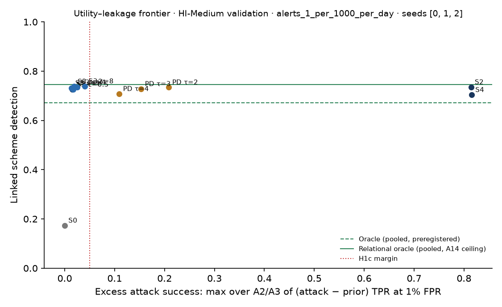

# Leakage audit A1–A3 on validation · HI-Medium

Seed 0. An honest-but-curious peer attacks everything it receives. A2 and A3 use a strong adversary: a gradient-boosted classifier trained on the true attributes of half the queried accounts (split by account), tested on the other half, against a prior-only attack that sees what the adversary knew before asking (its own accounts in the request, its score bucket, the window and the two banks). Intervals bootstrap the queried accounts. H1c margin (A15): upper 95% bound of (attack − prior) TPR at 1% FPR at most 0.05.

Targets: 177,609 (adversary, counterparty, window) triples; test half 88,742. Prevalence: A2 third-member relationship 0.357; A3 amount in top decile 0.100; A3 fan-in in top decile 0.064; A3 pass-through account 0.003.

## A2 third-member relationship

| Level | TPR at 0.1% FPR | TPR at 1% FPR | AUC | Attack − prior, TPR at 1% | Within margin |
| --- | --- | --- | --- | --- | --- |
| prior | 0.0128 [0.0068, 0.0181] | 0.0313 [0.0255, 0.0372] | 0.5599 [0.5552, 0.5644] | — | — |
| S1 | 0.0166 [0.0095, 0.0241] | 0.0354 [0.0281, 0.0429] | 0.5659 [0.5608, 0.5706] | 0.0040 [0.0011, 0.0066] | yes |
| S2 | 0.1542 [0.1424, 0.1658] | 0.2506 [0.2400, 0.2603] | 0.7598 [0.7559, 0.7633] | 0.2193 [0.2118, 0.2281] | no |
| S4 | 0.1723 [0.1618, 0.1823] | 0.2659 [0.2569, 0.2765] | 0.7633 [0.7590, 0.7668] | 0.2346 [0.2261, 0.2450] | no |
| S3[eps=0.5] | 0.0153 [0.0078, 0.0227] | 0.0359 [0.0286, 0.0433] | 0.6020 [0.5965, 0.6073] | 0.0046 [0.0008, 0.0082] | yes |
| S3[eps=1] | 0.0152 [0.0083, 0.0226] | 0.0365 [0.0288, 0.0437] | 0.6012 [0.5953, 0.6068] | 0.0051 [0.0012, 0.0087] | yes |
| S3[eps=2] | 0.0155 [0.0084, 0.0226] | 0.0377 [0.0299, 0.0458] | 0.6027 [0.5975, 0.6078] | 0.0064 [0.0024, 0.0100] | yes |
| S3[eps=4] | 0.0148 [0.0080, 0.0215] | 0.0371 [0.0291, 0.0443] | 0.6054 [0.6000, 0.6109] | 0.0058 [0.0020, 0.0088] | yes |
| S3[eps=8] | 0.0155 [0.0085, 0.0219] | 0.0363 [0.0290, 0.0436] | 0.6069 [0.6013, 0.6115] | 0.0050 [0.0014, 0.0086] | yes |
| PD[tau=2] | 0.0330 [0.0248, 0.0393] | 0.0854 [0.0775, 0.0932] | 0.6208 [0.6161, 0.6255] | 0.0541 [0.0489, 0.0585] | no |
| PD[tau=3] | 0.0247 [0.0170, 0.0312] | 0.0653 [0.0564, 0.0730] | 0.5974 [0.5918, 0.6021] | 0.0339 [0.0283, 0.0371] | yes |
| PD[tau=4] | 0.0202 [0.0131, 0.0264] | 0.0549 [0.0470, 0.0628] | 0.5868 [0.5815, 0.5913] | 0.0236 [0.0197, 0.0268] | yes |

S4 − S2, TPR at 1% FPR: 0.0153 [0.0085, 0.0212].

## A3 amount in top decile

| Level | TPR at 0.1% FPR | TPR at 1% FPR | AUC | Attack − prior, TPR at 1% | Within margin |
| --- | --- | --- | --- | --- | --- |
| prior | 0.0271 [0.0091, 0.0464] | 0.0452 [0.0242, 0.0657] | 0.5840 [0.5724, 0.5937] | — | — |
| S1 | 0.0402 [0.0144, 0.0646] | 0.0608 [0.0346, 0.0850] | 0.5885 [0.5746, 0.6000] | 0.0156 [0.0075, 0.0239] | yes |
| S2 | 0.1436 [0.1170, 0.1663] | 0.2469 [0.2229, 0.2663] | 0.7603 [0.7516, 0.7670] | 0.2017 [0.1891, 0.2158] | no |
| S4 | 0.1429 [0.1224, 0.1652] | 0.2553 [0.2303, 0.2744] | 0.7606 [0.7519, 0.7677] | 0.2101 [0.1967, 0.2236] | no |
| S3[eps=0.5] | 0.0404 [0.0144, 0.0656] | 0.0618 [0.0349, 0.0871] | 0.5956 [0.5828, 0.6067] | 0.0166 [0.0069, 0.0256] | yes |
| S3[eps=1] | 0.0417 [0.0146, 0.0665] | 0.0588 [0.0327, 0.0831] | 0.5982 [0.5855, 0.6095] | 0.0136 [0.0051, 0.0237] | yes |
| S3[eps=2] | 0.0404 [0.0144, 0.0653] | 0.0625 [0.0356, 0.0860] | 0.5948 [0.5810, 0.6072] | 0.0173 [0.0083, 0.0265] | yes |
| S3[eps=4] | 0.0407 [0.0143, 0.0652] | 0.0620 [0.0351, 0.0858] | 0.5968 [0.5835, 0.6086] | 0.0168 [0.0073, 0.0262] | yes |
| S3[eps=8] | 0.0402 [0.0135, 0.0652] | 0.0643 [0.0401, 0.0870] | 0.5980 [0.5852, 0.6089] | 0.0191 [0.0110, 0.0283] | yes |
| PD[tau=2] | 0.0804 [0.0552, 0.1063] | 0.1462 [0.1212, 0.1673] | 0.6477 [0.6351, 0.6584] | 0.1010 [0.0924, 0.1108] | no |
| PD[tau=3] | 0.0586 [0.0354, 0.0830] | 0.1090 [0.0840, 0.1326] | 0.6201 [0.6067, 0.6316] | 0.0638 [0.0553, 0.0731] | no |
| PD[tau=4] | 0.0491 [0.0260, 0.0720] | 0.0903 [0.0653, 0.1145] | 0.6094 [0.5974, 0.6210] | 0.0451 [0.0376, 0.0540] | no |

S4 − S2, TPR at 1% FPR: 0.0084 [0.0005, 0.0130].

## A3 fan-in in top decile

| Level | TPR at 0.1% FPR | TPR at 1% FPR | AUC | Attack − prior, TPR at 1% | Within margin |
| --- | --- | --- | --- | --- | --- |
| prior | 0.0248 [0.0187, 0.0299] | 0.0702 [0.0636, 0.0801] | 0.6615 [0.6537, 0.6693] | — | — |
| S1 | 0.0227 [0.0178, 0.0285] | 0.0782 [0.0685, 0.0883] | 0.6663 [0.6577, 0.6746] | 0.0080 [0.0013, 0.0119] | yes |
| S2 | 0.8656 [0.8537, 0.8783] | 0.8844 [0.8727, 0.8944] | 0.9677 [0.9632, 0.9710] | 0.8142 [0.7981, 0.8253] | no |
| S4 | 0.8663 [0.8529, 0.8776] | 0.8855 [0.8739, 0.8962] | 0.9678 [0.9631, 0.9712] | 0.8152 [0.7984, 0.8292] | no |
| S3[eps=0.5] | 0.0195 [0.0148, 0.0260] | 0.0874 [0.0778, 0.0983] | 0.8622 [0.8565, 0.8694] | 0.0172 [0.0067, 0.0248] | yes |
| S3[eps=1] | 0.0206 [0.0154, 0.0265] | 0.0840 [0.0738, 0.0952] | 0.8614 [0.8557, 0.8676] | 0.0138 [0.0029, 0.0214] | yes |
| S3[eps=2] | 0.0199 [0.0161, 0.0272] | 0.0888 [0.0795, 0.0982] | 0.8612 [0.8552, 0.8676] | 0.0186 [0.0070, 0.0255] | yes |
| S3[eps=4] | 0.0236 [0.0184, 0.0295] | 0.0952 [0.0866, 0.1049] | 0.8623 [0.8564, 0.8682] | 0.0250 [0.0129, 0.0323] | yes |
| S3[eps=8] | 0.0243 [0.0169, 0.0308] | 0.1108 [0.1001, 0.1214] | 0.8601 [0.8534, 0.8670] | 0.0406 [0.0277, 0.0505] | no |
| PD[tau=2] | 0.0926 [0.0827, 0.1029] | 0.1434 [0.1322, 0.1556] | 0.7253 [0.7185, 0.7338] | 0.0732 [0.0637, 0.0808] | no |
| PD[tau=3] | 0.0387 [0.0331, 0.0464] | 0.0980 [0.0877, 0.1088] | 0.6852 [0.6769, 0.6934] | 0.0278 [0.0191, 0.0339] | yes |
| PD[tau=4] | 0.0326 [0.0262, 0.0398] | 0.0883 [0.0784, 0.0988] | 0.6779 [0.6693, 0.6856] | 0.0181 [0.0112, 0.0231] | yes |

S4 − S2, TPR at 1% FPR: 0.0011 [-0.0012, 0.0036].

## A3 pass-through account

| Level | TPR at 0.1% FPR | TPR at 1% FPR | AUC | Attack − prior, TPR at 1% | Within margin |
| --- | --- | --- | --- | --- | --- |
| prior | 0.0036 [0.0000, 0.0122] | 0.0182 [0.0036, 0.0335] | 0.5027 [0.4697, 0.5392] | — | — |
| S1 | 0.0000 [0.0000, 0.0000] | 0.0182 [0.0037, 0.0352] | 0.5224 [0.4847, 0.5608] | 0.0000 [-0.0159, 0.0149] | yes |
| S2 | 0.0547 [0.0211, 0.0882] | 0.0620 [0.0317, 0.0974] | 0.4495 [0.4080, 0.4983] | 0.0438 [0.0105, 0.0844] | no |
| S4 | 0.0000 [0.0000, 0.2818] | 0.2920 [0.2249, 0.3516] | 0.6490 [0.6011, 0.6879] | 0.2737 [0.2056, 0.3309] | no |
| S3[eps=0.5] | 0.0000 [0.0000, 0.0068] | 0.0146 [0.0000, 0.0279] | 0.4243 [0.3903, 0.4605] | -0.0036 [-0.0207, 0.0156] | yes |
| S3[eps=1] | 0.0036 [0.0000, 0.0129] | 0.0109 [0.0000, 0.0261] | 0.4274 [0.3918, 0.4685] | -0.0073 [-0.0230, 0.0111] | yes |
| S3[eps=2] | 0.0146 [0.0000, 0.0409] | 0.0292 [0.0038, 0.0633] | 0.4622 [0.4188, 0.5022] | 0.0109 [-0.0136, 0.0372] | yes |
| S3[eps=4] | 0.0073 [0.0000, 0.0181] | 0.0219 [0.0031, 0.0467] | 0.4621 [0.4215, 0.5003] | 0.0036 [-0.0154, 0.0376] | yes |
| S3[eps=8] | 0.0146 [0.0000, 0.0405] | 0.0146 [0.0000, 0.0406] | 0.4479 [0.4089, 0.4914] | -0.0036 [-0.0256, 0.0270] | yes |
| PD[tau=2] | 0.2117 [0.1538, 0.2837] | 0.2263 [0.1688, 0.2997] | 0.6152 [0.5715, 0.6597] | 0.2080 [0.1538, 0.2715] | no |
| PD[tau=3] | 0.1642 [0.1152, 0.2182] | 0.1715 [0.1226, 0.2283] | 0.5768 [0.5356, 0.6254] | 0.1533 [0.1031, 0.2103] | no |
| PD[tau=4] | 0.1168 [0.0722, 0.1707] | 0.1277 [0.0811, 0.1881] | 0.5416 [0.4897, 0.5848] | 0.1095 [0.0680, 0.1741] | no |

S4 − S2, TPR at 1% FPR: 0.2299 [0.1594, 0.2926].

## H1c on validation

- S1 and S3 (ε ≤ 2) within the margin on every assessable A2/A3 target: **yes**
- Per level (all assessable targets within): S1 yes, S2 no, S4 no, S3 ε=0.5 yes, S3 ε=1 yes, S3 ε=2 yes, S3 ε=4 yes, S3 ε=8 no, PD τ=2 no, PD τ=3 no, PD τ=4 no
- Targets without enough positives in the test half to assess: none
- S4 above S2 (CI of the difference above 0), per target: {'A2_third_party': True, 'A3_amount_top': True, 'A3_fan_in_top': False, 'A3_pass_through': True}
- S3 TPR at 1% FPR by ε (monotone expected): A2 third-member relationship: 0.5→0.0359, 1→0.0365, 2→0.0377, 4→0.0371, 8→0.0363; A3 amount in top decile: 0.5→0.0618, 1→0.0588, 2→0.0625, 4→0.0620, 8→0.0643; A3 fan-in in top decile: 0.5→0.0874, 1→0.0840, 2→0.0888, 4→0.0952, 8→0.1108; A3 pass-through account: 0.5→0.0146, 1→0.0109, 2→0.0292, 4→0.0219, 8→0.0146

## A1 token re-identification

Targets: the tokens of every other member's evidence records. Candidates: every account at another member that the adversary's customers traded with up to the end of validation. Hashing: all candidates tokenised offline, unmetered. OPRF: candidates tokenised within the spare per-epoch budget (deployed 250,000; sized to twice the largest legitimate use, 74,510), every query logged. Expected re-identification with candidates queried in random order.

| Adversary | Target tokens | Candidates | Legitimate queries | Hashing | OPRF, deployed budget | OPRF, sized budget | Attack queries (sized) |
| --- | --- | --- | --- | --- | --- | --- | --- |
| 0 | 58,682 | 432,745 | 35,422 | 0.4117 | 0.2041 | 0.0372 | 39,088 |
| 1 | 58,874 | 434,202 | 34,972 | 0.4143 | 0.2052 | 0.0377 | 39,538 |
| 2 | 59,511 | 435,281 | 34,225 | 0.4166 | 0.2065 | 0.0386 | 40,285 |
| 3 | 60,711 | 435,836 | 28,371 | 0.4156 | 0.2113 | 0.0440 | 46,139 |
| 4 | 59,973 | 435,674 | 31,813 | 0.4119 | 0.2063 | 0.0404 | 42,697 |
| 5 | 57,823 | 433,597 | 36,773 | 0.4147 | 0.2040 | 0.0361 | 37,737 |
| 6 | 59,277 | 430,266 | 33,549 | 0.4076 | 0.2050 | 0.0388 | 40,961 |
| 7 | 58,629 | 529,315 | 37,255 | 0.4750 | 0.1909 | 0.0334 | 37,255 |

Pooled: hashing 0.4209, OPRF deployed 0.2042, OPRF sized 0.0383. Hashing ÷ OPRF (sized): 10.99 (PT2 asks for at least 10).

Mechanism check on real tokens: {'checked': 200, 'hash_matches': 200, 'oprf_matches': 200}.
