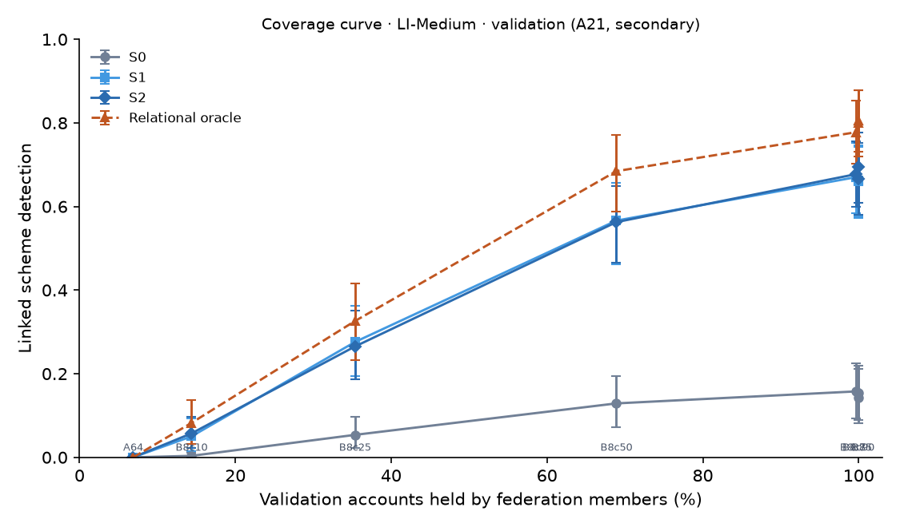

# Coverage curve · LI-Medium · validation

**Secondary analysis (A21); decides no hypothesis.** Each row is X1 on one federation (S0–S4, propagation, pooled oracles; seeds 0–2; no sweeps or audit). `B8c{p}`: banks added largest first, as real partnerships recruit, until they hold p% of accounts, then grouped into 8 members; accounts at other banks are outside the federation. B8 (every bank) and A64 (64 largest banks, one member each) are the end points. The scheme denominator is the same in every row (all validation schemes), so detection is end to end.

## Linked detection by coverage [95% CI]

| Federation | Target | Validation accounts covered | Multi-member schemes | S0 | S1 | S2 | S4 | Propagation | Relational oracle |
| --- | --- | --- | --- | --- | --- | --- | --- | --- | --- |
| A64 | 64 banks | 6.9% | 22 of 93 | 0.0000 [0.0000, 0.0000] | 0.0000 [0.0000, 0.0000] | 0.0000 [0.0000, 0.0000] | 0.0000 [0.0000, 0.0000] | 0.0000 [0.0000, 0.0000] | 0.0000 [0.0000, 0.0000] |
| B8c10 | 10% | 14.4% | 29 of 93 | 0.0036 [0.0000, 0.0108] | 0.0502 [0.0143, 0.0932] | 0.0573 [0.0215, 0.0968] | 0.0538 [0.0179, 0.0968] | 0.0932 [0.0394, 0.1505] | 0.0824 [0.0323, 0.1362] |
| B8c25 | 25% | 35.4% | 50 of 93 | 0.0538 [0.0215, 0.0968] | 0.2760 [0.1935, 0.3620] | 0.2652 [0.1863, 0.3513] | 0.2509 [0.1685, 0.3334] | 0.3118 [0.2186, 0.4014] | 0.3262 [0.2330, 0.4158] |
| B8c50 | 50% | 68.9% | 74 of 93 | 0.1290 [0.0717, 0.1935] | 0.5663 [0.4624, 0.6560] | 0.5627 [0.4659, 0.6487] | 0.5412 [0.4409, 0.6308] | 0.6165 [0.5161, 0.7097] | 0.6846 [0.5878, 0.7706] |
| B8c75 | 75% | 99.7% | 89 of 93 | 0.1577 [0.0932, 0.2258] | 0.6703 [0.5842, 0.7527] | 0.6774 [0.5985, 0.7563] | 0.6416 [0.5555, 0.7240] | 0.7670 [0.6882, 0.8352] | 0.7778 [0.7025, 0.8530] |
| B8c90 | 90% | 100.0% | 89 of 93 | 0.1434 [0.0823, 0.2115] | 0.6595 [0.5735, 0.7419] | 0.6667 [0.5806, 0.7527] | 0.6452 [0.5591, 0.7276] | 0.7348 [0.6452, 0.8136] | 0.7993 [0.7203, 0.8781] |
| B8 | 100% | 100.0% | 89 of 93 | 0.1541 [0.0895, 0.2187] | 0.6631 [0.5771, 0.7455] | 0.6953 [0.6093, 0.7778] | 0.6523 [0.5663, 0.7312] | 0.7491 [0.6702, 0.8280] | 0.8065 [0.7312, 0.8781] |

## The sharing gain by coverage

| Federation | S2 − S0 linked [95% CI] | S2 share of the relational-oracle gain [95% CI] |
| --- | --- | --- |
| A64 | 0.0000 [0.0000, 0.0000] | — |
| B8c10 | 0.0538 [0.0179, 0.0932] | 0.6818 [0.4089, 1.08] |
| B8c25 | 0.2115 [0.1325, 0.2904] | 0.7763 [0.5964, 0.9606] |
| B8c50 | 0.4337 [0.3297, 0.5305] | 0.7806 [0.6622, 0.8750] |
| B8c75 | 0.5197 [0.4265, 0.6057] | 0.8382 [0.7486, 0.9355] |
| B8c90 | 0.5233 [0.4301, 0.6129] | 0.7978 [0.6963, 0.9071] |
| B8 | 0.5412 [0.4479, 0.6380] | 0.8297 [0.7366, 0.9214] |

Every point on the pre-registered curve is present.
