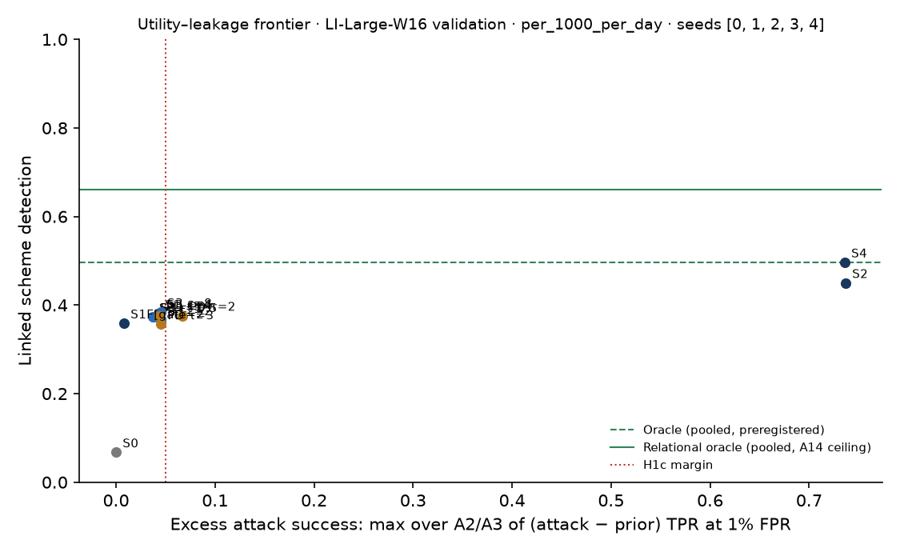

# Leakage audit A1–A3 on test · LI-Large-W16

> **Sealed test (week 18).** Every model trained on the training partition; every calibration, threshold, fusion and attribution parameter fitted on validation and frozen; test scored label-free, then opened once per seed through the logged seal (`finmesh sealed-log`). Wording below that says *validation* in a column or check name refers to the frozen rule; every number is on **test**.

Seed 0. An honest-but-curious peer attacks everything it receives. A2 and A3 use a strong adversary: a gradient-boosted classifier trained on the true attributes of half the queried accounts (split by account), tested on the other half, against a prior-only attack that sees what the adversary knew before asking (its own accounts in the request, its score bucket, the window and the two banks). Intervals bootstrap the queried accounts. H1c margin (A15): upper 95% bound of (attack − prior) TPR at 1% FPR at most 0.05.

Targets: 195,900 (adversary, counterparty, window) triples; test half 98,164. Prevalence: A2 third-member relationship 0.351; A3 amount in top decile 0.100; A3 fan-in in top decile 0.091; A3 pass-through account 0.002.

## A2 third-member relationship

| Level | TPR at 0.1% FPR | TPR at 1% FPR | AUC | Attack − prior, TPR at 1% | Within margin |
| --- | --- | --- | --- | --- | --- |
| prior | 0.0255 [0.0184, 0.0320] | 0.0695 [0.0632, 0.0765] | 0.5831 [0.5785, 0.5878] | — | — |
| S1 | 0.0302 [0.0218, 0.0390] | 0.0937 [0.0841, 0.1049] | 0.6058 [0.6000, 0.6117] | 0.0242 [0.0190, 0.0295] | yes |
| S2 | 0.2306 [0.2203, 0.2415] | 0.3206 [0.3079, 0.3296] | 0.7929 [0.7891, 0.7969] | 0.2511 [0.2413, 0.2585] | no |
| S4 | 0.2411 [0.2299, 0.2519] | 0.3438 [0.3347, 0.3525] | 0.7969 [0.7932, 0.8010] | 0.2742 [0.2658, 0.2812] | no |
| S3[eps=0.5] | 0.0277 [0.0199, 0.0364] | 0.0914 [0.0813, 0.1009] | 0.6077 [0.6017, 0.6136] | 0.0218 [0.0152, 0.0286] | yes |
| S3[eps=1] | 0.0269 [0.0185, 0.0354] | 0.0921 [0.0825, 0.1009] | 0.6079 [0.6026, 0.6137] | 0.0226 [0.0161, 0.0283] | yes |
| S3[eps=2] | 0.0262 [0.0178, 0.0348] | 0.0897 [0.0804, 0.0995] | 0.6075 [0.6020, 0.6134] | 0.0201 [0.0140, 0.0259] | yes |
| S3[eps=4] | 0.0268 [0.0188, 0.0358] | 0.0906 [0.0824, 0.1009] | 0.6075 [0.6019, 0.6134] | 0.0210 [0.0169, 0.0269] | yes |
| S3[eps=8] | 0.0268 [0.0186, 0.0360] | 0.0923 [0.0835, 0.1030] | 0.6103 [0.6044, 0.6163] | 0.0228 [0.0178, 0.0302] | yes |
| PD[tau=2] | 0.0317 [0.0228, 0.0398] | 0.1010 [0.0921, 0.1100] | 0.6265 [0.6207, 0.6324] | 0.0314 [0.0259, 0.0368] | yes |
| PD[tau=3] | 0.0311 [0.0227, 0.0406] | 0.0938 [0.0855, 0.1046] | 0.6070 [0.6013, 0.6128] | 0.0243 [0.0195, 0.0300] | yes |
| PD[tau=4] | 0.0288 [0.0208, 0.0375] | 0.0936 [0.0850, 0.1037] | 0.6066 [0.6009, 0.6123] | 0.0241 [0.0193, 0.0298] | yes |
| S1F[gate=2] | 0.0284 [0.0206, 0.0375] | 0.0722 [0.0643, 0.0809] | 0.5847 [0.5798, 0.5903] | 0.0027 [0.0004, 0.0046] | yes |

S4 − S2, TPR at 1% FPR: 0.0231 [0.0188, 0.0291].

## A3 amount in top decile

| Level | TPR at 0.1% FPR | TPR at 1% FPR | AUC | Attack − prior, TPR at 1% | Within margin |
| --- | --- | --- | --- | --- | --- |
| prior | 0.0253 [0.0085, 0.0447] | 0.0430 [0.0213, 0.0654] | 0.5687 [0.5569, 0.5800] | — | — |
| S1 | 0.0364 [0.0098, 0.0623] | 0.0525 [0.0261, 0.0797] | 0.5770 [0.5644, 0.5894] | 0.0095 [0.0025, 0.0177] | yes |
| S2 | 0.2208 [0.1875, 0.2470] | 0.2718 [0.2483, 0.2941] | 0.7909 [0.7827, 0.7985] | 0.2288 [0.2184, 0.2420] | no |
| S4 | 0.2342 [0.2056, 0.2531] | 0.2720 [0.2483, 0.2937] | 0.7907 [0.7822, 0.7980] | 0.2290 [0.2173, 0.2420] | no |
| S3[eps=0.5] | 0.0334 [0.0096, 0.0582] | 0.0473 [0.0239, 0.0720] | 0.5605 [0.5512, 0.5689] | 0.0043 [-0.0024, 0.0120] | yes |
| S3[eps=1] | 0.0337 [0.0091, 0.0585] | 0.0481 [0.0243, 0.0742] | 0.5630 [0.5516, 0.5725] | 0.0051 [-0.0021, 0.0133] | yes |
| S3[eps=2] | 0.0337 [0.0092, 0.0582] | 0.0487 [0.0227, 0.0736] | 0.5677 [0.5575, 0.5768] | 0.0057 [-0.0022, 0.0142] | yes |
| S3[eps=4] | 0.0343 [0.0094, 0.0592] | 0.0454 [0.0230, 0.0703] | 0.5661 [0.5545, 0.5770] | 0.0024 [-0.0044, 0.0102] | yes |
| S3[eps=8] | 0.0342 [0.0099, 0.0589] | 0.0471 [0.0226, 0.0713] | 0.5656 [0.5543, 0.5758] | 0.0041 [-0.0023, 0.0118] | yes |
| PD[tau=2] | 0.0861 [0.0639, 0.1101] | 0.0983 [0.0744, 0.1235] | 0.6216 [0.6087, 0.6326] | 0.0553 [0.0477, 0.0631] | no |
| PD[tau=3] | 0.0398 [0.0141, 0.0662] | 0.0554 [0.0298, 0.0823] | 0.5798 [0.5676, 0.5918] | 0.0124 [0.0052, 0.0215] | yes |
| PD[tau=4] | 0.0360 [0.0091, 0.0620] | 0.0526 [0.0270, 0.0792] | 0.5768 [0.5641, 0.5891] | 0.0096 [0.0024, 0.0176] | yes |
| S1F[gate=2] | 0.0361 [0.0093, 0.0621] | 0.0510 [0.0264, 0.0793] | 0.5749 [0.5623, 0.5870] | 0.0080 [0.0020, 0.0171] | yes |

S4 − S2, TPR at 1% FPR: 0.0002 [-0.0031, 0.0016].

## A3 fan-in in top decile

| Level | TPR at 0.1% FPR | TPR at 1% FPR | AUC | Attack − prior, TPR at 1% | Within margin |
| --- | --- | --- | --- | --- | --- |
| prior | 0.0591 [0.0484, 0.0698] | 0.2148 [0.2042, 0.2257] | 0.6930 [0.6851, 0.7002] | — | — |
| S1 | 0.0766 [0.0641, 0.0920] | 0.2577 [0.2406, 0.2740] | 0.7507 [0.7420, 0.7601] | 0.0429 [0.0307, 0.0589] | no |
| S2 | 0.9187 [0.9090, 0.9285] | 0.9516 [0.9450, 0.9584] | 0.9875 [0.9854, 0.9895] | 0.7368 [0.7255, 0.7499] | no |
| S4 | 0.9202 [0.9103, 0.9302] | 0.9507 [0.9446, 0.9580] | 0.9870 [0.9849, 0.9891] | 0.7359 [0.7237, 0.7503] | no |
| S3[eps=0.5] | 0.0619 [0.0491, 0.0783] | 0.2531 [0.2324, 0.2722] | 0.7394 [0.7301, 0.7482] | 0.0382 [0.0220, 0.0549] | no |
| S3[eps=1] | 0.0553 [0.0432, 0.0683] | 0.2516 [0.2303, 0.2703] | 0.7398 [0.7293, 0.7485] | 0.0368 [0.0169, 0.0560] | no |
| S3[eps=2] | 0.0692 [0.0549, 0.0823] | 0.2601 [0.2372, 0.2781] | 0.7417 [0.7317, 0.7526] | 0.0452 [0.0285, 0.0620] | no |
| S3[eps=4] | 0.0711 [0.0567, 0.0854] | 0.2595 [0.2393, 0.2791] | 0.7461 [0.7373, 0.7550] | 0.0447 [0.0261, 0.0623] | no |
| S3[eps=8] | 0.0686 [0.0533, 0.0815] | 0.2600 [0.2416, 0.2774] | 0.7478 [0.7384, 0.7565] | 0.0451 [0.0298, 0.0628] | no |
| PD[tau=2] | 0.1025 [0.0880, 0.1149] | 0.2822 [0.2628, 0.2994] | 0.7675 [0.7588, 0.7764] | 0.0674 [0.0527, 0.0844] | no |
| PD[tau=3] | 0.0801 [0.0656, 0.0956] | 0.2602 [0.2439, 0.2793] | 0.7528 [0.7440, 0.7619] | 0.0453 [0.0325, 0.0620] | no |
| PD[tau=4] | 0.0786 [0.0633, 0.0940] | 0.2587 [0.2396, 0.2771] | 0.7521 [0.7431, 0.7617] | 0.0439 [0.0291, 0.0620] | no |
| S1F[gate=2] | 0.0606 [0.0444, 0.0738] | 0.2187 [0.2051, 0.2308] | 0.6982 [0.6897, 0.7063] | 0.0038 [0.0003, 0.0072] | yes |

S4 − S2, TPR at 1% FPR: -0.0009 [-0.0037, 0.0014].

## A3 pass-through account

| Level | TPR at 0.1% FPR | TPR at 1% FPR | AUC | Attack − prior, TPR at 1% | Within margin |
| --- | --- | --- | --- | --- | --- |
| prior | 0.0000 [0.0000, 0.0000] | 0.0178 [0.0043, 0.0360] | 0.5655 [0.5205, 0.6017] | — | — |
| S1 | 0.0000 [0.0000, 0.0000] | 0.0178 [0.0043, 0.0360] | 0.5677 [0.5284, 0.6036] | 0.0000 [0.0000, 0.0000] | yes |
| S2 | 0.0667 [0.0000, 0.1067] | 0.0844 [0.0414, 0.1263] | 0.6265 [0.5835, 0.6683] | 0.0667 [0.0202, 0.1133] | no |
| S4 | 0.1022 [0.0647, 0.1514] | 0.1156 [0.0730, 0.1673] | 0.6173 [0.5767, 0.6605] | 0.0978 [0.0568, 0.1436] | no |
| S3[eps=0.5] | 0.0000 [0.0000, 0.0000] | 0.0089 [0.0000, 0.0262] | 0.5214 [0.4847, 0.5636] | -0.0089 [-0.0267, 0.0104] | yes |
| S3[eps=1] | 0.0000 [0.0000, 0.0000] | 0.0089 [0.0000, 0.0270] | 0.5329 [0.4899, 0.5706] | -0.0089 [-0.0313, 0.0101] | yes |
| S3[eps=2] | 0.0000 [0.0000, 0.0000] | 0.0044 [0.0000, 0.0160] | 0.5258 [0.4892, 0.5654] | -0.0133 [-0.0318, 0.0052] | yes |
| S3[eps=4] | 0.0000 [0.0000, 0.0000] | 0.0133 [0.0000, 0.0327] | 0.5080 [0.4635, 0.5478] | -0.0044 [-0.0271, 0.0193] | yes |
| S3[eps=8] | 0.0000 [0.0000, 0.0000] | 0.0089 [0.0000, 0.0341] | 0.5393 [0.5020, 0.5772] | -0.0089 [-0.0334, 0.0191] | yes |
| PD[tau=2] | 0.0356 [0.0137, 0.0664] | 0.0489 [0.0225, 0.0858] | 0.6014 [0.5687, 0.6313] | 0.0311 [0.0045, 0.0623] | no |
| PD[tau=3] | 0.0000 [0.0000, 0.0000] | 0.0178 [0.0043, 0.0360] | 0.5583 [0.5194, 0.5960] | 0.0000 [0.0000, 0.0000] | yes |
| PD[tau=4] | 0.0000 [0.0000, 0.0000] | 0.0178 [0.0043, 0.0360] | 0.5661 [0.5225, 0.6075] | 0.0000 [0.0000, 0.0000] | yes |
| S1F[gate=2] | 0.0000 [0.0000, 0.0000] | 0.0133 [0.0035, 0.0356] | 0.5716 [0.5304, 0.6068] | -0.0044 [-0.0140, 0.0000] | yes |

S4 − S2, TPR at 1% FPR: 0.0311 [-0.0197, 0.0755].

## H1c on test

- S1 and S3 (ε ≤ 2) within the margin on every assessable A2/A3 target: **no**
- Per level (all assessable targets within): S1 no, S2 no, S4 no, S3 ε=0.5 no, S3 ε=1 no, S3 ε=2 no, S3 ε=4 no, S3 ε=8 no, PD τ=2 no, PD τ=3 no, PD τ=4 no, S1F[gate=2 yes
- Targets without enough positives in the test half to assess: none
- S4 above S2 (CI of the difference above 0), per target: {'A2_third_party': True, 'A3_amount_top': False, 'A3_fan_in_top': False, 'A3_pass_through': False}
- S3 TPR at 1% FPR by ε (monotone expected): A2 third-member relationship: 0.5→0.0914, 1→0.0921, 2→0.0897, 4→0.0906, 8→0.0923; A3 amount in top decile: 0.5→0.0473, 1→0.0481, 2→0.0487, 4→0.0454, 8→0.0471; A3 fan-in in top decile: 0.5→0.2531, 1→0.2516, 2→0.2601, 4→0.2595, 8→0.2600; A3 pass-through account: 0.5→0.0089, 1→0.0089, 2→0.0044, 4→0.0133, 8→0.0089

## A1 token re-identification

Targets: the tokens of every other member's evidence records. Candidates: every account at another member that the adversary's customers traded with up to the end of validation. Hashing: all candidates tokenised offline, unmetered. OPRF: candidates tokenised within the spare per-epoch budget, every query logged; expected re-identification with candidates queried in random order. Budgets: the protocol's (87,926; A16 sizes it to twice the largest legitimate use on test), twice the largest legitimate use in this run (97,252), and the week-6 placeholder (250,000).

| Adversary | Target tokens | Candidates | Legitimate queries | Hashing | OPRF, protocol budget | OPRF, sized in this run | OPRF, 250,000 |
| --- | --- | --- | --- | --- | --- | --- | --- |
| 0 | 93,992 | 450,986 | 39,459 | 0.3796 | 0.0408 | 0.0486 | 0.1772 |
| 1 | 92,326 | 450,066 | 41,972 | 0.3783 | 0.0386 | 0.0465 | 0.1749 |
| 2 | 97,060 | 545,934 | 34,365 | 0.4229 | 0.0415 | 0.0487 | 0.1670 |
| 3 | 97,212 | 450,640 | 34,143 | 0.3777 | 0.0451 | 0.0529 | 0.1809 |
| 4 | 97,525 | 452,047 | 33,075 | 0.3796 | 0.0461 | 0.0539 | 0.1822 |
| 5 | 90,049 | 451,236 | 48,626 | 0.3776 | 0.0329 | 0.0407 | 0.1685 |
| 6 | 97,809 | 450,764 | 33,841 | 0.3769 | 0.0452 | 0.0530 | 0.1808 |
| 7 | 92,372 | 450,902 | 42,194 | 0.3784 | 0.0384 | 0.0462 | 0.1744 |

Pooled: hashing 0.3840, OPRF at the protocol budget 0.0412, sized in this run 0.0489. Hashing ÷ OPRF at the protocol budget: **9.32** (PT2 asks for at least 10).

Mechanism check on real tokens: {'checked': 200, 'hash_matches': 200, 'oprf_matches': 200}.

## A4 linkability across epochs

Validation lies inside one 7-day epoch, so key rotation is simulated at its midpoint. Each second-half record an adversary received is ranked among up to 99 first-half records from the same responder by similarity of the record's fields (and embedding at S4); hit@1 is how often the true account comes first. S3 records are released afresh after a rotation (memoised per record and epoch), so they are re-noised independently in each half. Positive control: without rotation, equal tokens link every pair (hit@1 = 1).

| Level | Queries | Chance hit@1 | Hit@1 [95% CI] | Mean reciprocal rank |
| --- | --- | --- | --- | --- |
| S2 | 5,648 | 0.0100 | 0.3725 [0.3603, 0.3846] | 0.4479 |
| S4 | 5,648 | 0.0100 | 0.4262 [0.4145, 0.4379] | 0.4866 |
| S3 ε=0.5 | 5,648 | 0.0100 | 0.0099 [0.0073, 0.0129] | 0.0511 |
| S3 ε=1 | 5,648 | 0.0100 | 0.0097 [0.0074, 0.0129] | 0.0513 |
| S3 ε=2 | 5,648 | 0.0100 | 0.0108 [0.0081, 0.0135] | 0.0521 |
| S3 ε=4 | 5,648 | 0.0100 | 0.0104 [0.0080, 0.0131] | 0.0524 |
| S3 ε=8 | 5,648 | 0.0100 | 0.0108 [0.0080, 0.0138] | 0.0547 |
| PD τ=2 | 113 | 0.0101 | 0.5310 [0.4425, 0.6108] | 0.5703 |
| PD τ=3 | 6 | 0.0653 | 0.8333 [0.5000, 1.00] | 0.8472 |
| PD τ=4 | 0 | — | — | — |

## A5 membership inference on S4 disclosures

Can a peer tell whether an account-window was in another member's autoencoder training sample from what S4 discloses (top deviations, magnitude buckets, embedding)? 80,000 rows, half members; strong adversary trained on half and tested on 39,839. Chance: TPR equals FPR, AUC 0.5. The global DP model's membership inference is X5 (weeks 10–12).

TPR at 0.1% FPR 0.0012 [0.0005, 0.0020]; TPR at 1% FPR 0.0090 [0.0070, 0.0112]; AUC 0.5035 [0.4983, 0.5100].

## A6 query leakage

What does being asked reveal? The request carries the requester's score bucket in the clear (by design: PD needs it). Here a responder predicts whether its own candidate account-window is laundering from its own score, then from its own score plus the requests it received about it. Measured, not prevented.

118,751 candidate account-windows; 0.7295 were asked about at least once, 0.8310 of the laundering ones.

| Responder sees | AUC | TPR at 0.1% FPR | TPR at 1% FPR |
| --- | --- | --- | --- |
| own | 0.6690 [0.6554, 0.6826] | 0.0329 [0.0216, 0.0410] | 0.0730 [0.0608, 0.0854] |
| own+requests | 0.6645 [0.6522, 0.6777] | 0.0305 [0.0233, 0.0395] | 0.0861 [0.0737, 0.0993] |

Gain from requests, TPR at 1% FPR: 0.0132 [0.0037, 0.0246].
