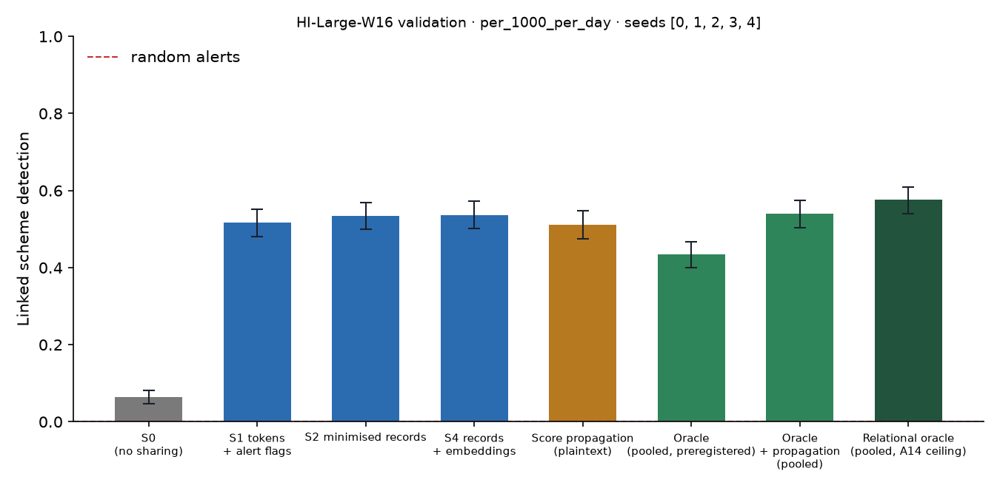

# X1 · sharing ladder on test · HI-Large-W16

> **Sealed test (week 18).** Every model trained on the training partition; every calibration, threshold, fusion and attribution parameter fitted on validation and frozen; test scored label-free, then opened once per seed through the logged seal (`finmesh sealed-log`). Wording below that says *validation* in a column or check name refers to the frozen rule; every number is on **test**.

Seeds [0, 1, 2, 3, 4]; primary budget per_1000_per_day; schemes detected within 12 windows; primary fusion **stacker** (A13); H1b ceiling **oracle-relational** (A14). Per-scheme outcomes are averaged over seeds before the scheme bootstrap. Total 22,602 s, peak memory 3,355 MB. S3 and PD sweeps: `x3_HI-Large-W16.md`; leakage audit: `audit_HI-Large-W16.md`.

## Linked detection per configuration (primary fusion)

| Configuration | Linked [95% CI] | Across members | Detected [95% CI] | Gain over S0 [95% CI] | p | AUPRC (mean) |
| --- | --- | --- | --- | --- | --- | --- |
| S0 (no sharing) | 0.0632 [0.0461, 0.0823] | 0.0000 | 0.7439 [0.7116, 0.7732] | — | — | 0.1718 |
| S1 tokens + alert flags | 0.5161 [0.4796, 0.5506] | 0.4925 | 0.7237 [0.6930, 0.7532] | 0.4516 [0.4139, 0.4909] | 0.0000 | 0.2090 |
| S2 minimised records | 0.5342 [0.5000, 0.5690] | 0.5126 | 0.7090 [0.6768, 0.7403] | 0.4710 [0.4332, 0.5084] | 0.0000 | 0.2062 |
| S4 records + embeddings | 0.5366 [0.5016, 0.5731] | 0.5151 | 0.7167 [0.6849, 0.7468] | 0.4720 [0.4349, 0.5118] | 0.0000 | 0.2133 |
| Score propagation (plaintext) | 0.5108 [0.4753, 0.5468] | 0.4849 | 0.7113 [0.6774, 0.7425] | 0.4462 [0.4097, 0.4860] | 0.0000 | 0.2079 |
| Oracle (pooled, preregistered) | 0.4339 [0.3990, 0.4671] | 0.3848 | 0.7939 [0.7629, 0.8226] | 0.3706 [0.3358, 0.4055] | 0.0000 | 0.2263 |
| Oracle + propagation (pooled) | 0.5392 [0.5043, 0.5747] | 0.4817 | 0.7215 [0.6892, 0.7543] | 0.4747 [0.4387, 0.5118] | 0.0000 | 0.2551 |
| Relational oracle (pooled, A14 ceiling) | 0.5765 [0.5403, 0.6087] | 0.5148 | 0.7039 [0.6703, 0.7352] | 0.5132 [0.4761, 0.5494] | 0.0000 | 0.2587 |

Random alerts at the same budget: detected 0.0036, linked 0.0000.

## H1b on test: share of the ceiling's gain recovered

(level − S0) / (ceiling − S0) in linked detection, scheme bootstrap. The relational oracle (pooled data with the same re-ranking, plaintext) is the ceiling from A14; the preregistered oracle is kept for comparison, and `strongest-pooled` uses whichever pooled relational configuration links more (oracle-relational) as a sensitivity check. Target: at least 0.60 for S2, judged on test.

| Level | Against oracle-relational [95% CI] | Against oracle [95% CI] | Against strongest-pooled [95% CI] |
| --- | --- | --- | --- |
| S1 | 0.8965 [0.8449, 0.9456] | 1.23 [1.14, 1.32] | 0.8965 [0.8449, 0.9456] |
| S2 | 0.9177 [0.8697, 0.9657] | 1.27 [1.18, 1.37] | 0.9177 [0.8697, 0.9657] |
| S4 | 0.9370 [0.8875, 0.9916] | 1.28 [1.18, 1.40] | 0.9370 [0.8875, 0.9916] |

## Secondary fusion rules

k-of-n uses only alert flags and noisy-OR only flags and the probability bucket, so their S2 and S4 rows coincide by construction.

| Level / rule | Linked | Detected | Gain over S0 | AUPRC (mean) |
| --- | --- | --- | --- | --- |
| S1/noisy_or | 0.3640 [0.3317, 0.4005] | 0.7478 [0.7145, 0.7785] | 0.2995 [0.2683, 0.3350] | 0.1737 |
| S1/kofn | 0.4059 [0.3704, 0.4419] | 0.6887 [0.6565, 0.7221] | 0.3414 [0.3021, 0.3806] | 0.1814 |
| S2/noisy_or | 0.5210 [0.4849, 0.5559] | 0.6715 [0.6382, 0.7038] | 0.4565 [0.4194, 0.4941] | 0.1971 |
| S2/kofn | 0.4059 [0.3704, 0.4419] | 0.6887 [0.6565, 0.7221] | 0.3414 [0.3021, 0.3806] | 0.1814 |
| S4/noisy_or | 0.5210 [0.4849, 0.5559] | 0.6715 [0.6382, 0.7038] | 0.4565 [0.4194, 0.4941] | 0.1971 |
| S4/kofn | 0.4059 [0.3704, 0.4419] | 0.6887 [0.6565, 0.7221] | 0.3414 [0.3021, 0.3806] | 0.1814 |

## Protocol per seed

Token evaluations are counted by the first level that needs them; later levels reuse the same tokens.

| Seed | Level | Requests | Answered: alert | Record, no alert | Refused | Accounts disclosed | LDP withheld | Max ε per account | Token evaluations | Seconds |
| --- | --- | --- | --- | --- | --- | --- | --- | --- | --- | --- |
| 0 | S1 | 730,529 | 9,555 | 0 | 1,335 | 0 | 0 | 0.0000 | 803,720 | 308.50 |
| 0 | S2 | 730,529 | 9,555 | 165,140 | 1,335 | 108,819 | 0 | 0.0000 | 0 | 141.90 |
| 0 | S4 | 730,529 | 9,555 | 165,140 | 1,335 | 108,819 | 0 | 0.0000 | 0 | 138.50 |
| 0 | S3[eps=0.5] | 730,529 | 9,555 | 719,639 | 1,335 | 108,819 | 0 | 3.50 | 0 | 181.40 |
| 0 | S3[eps=1] | 730,529 | 9,555 | 719,639 | 1,335 | 108,819 | 0 | 7.00 | 0 | 171.60 |
| 0 | S3[eps=2] | 730,529 | 9,555 | 719,638 | 1,335 | 108,819 | 100 | 8.00 | 0 | 169.50 |
| 0 | S3[eps=4] | 730,529 | 9,555 | 718,905 | 1,335 | 108,819 | 1,756 | 8.00 | 0 | 172.60 |
| 0 | S3[eps=8] | 730,529 | 9,555 | 704,827 | 1,335 | 105,105 | 17,857 | 8.00 | 0 | 177.20 |
| 0 | PD[tau=2] | 730,529 | 9,555 | 40,350 | 1,335 | 36,785 | 0 | 0.0000 | 0 | 132.10 |
| 0 | PD[tau=3] | 730,529 | 9,555 | 6,422 | 1,335 | 7,087 | 0 | 0.0000 | 0 | 130.50 |
| 0 | PD[tau=4] | 730,529 | 9,555 | 2,399 | 1,335 | 3,119 | 0 | 0.0000 | 0 | 131.10 |
| 0 | S1F[gate=2] | 730,529 | 6,511 | 0 | 1,335 | 0 | 0 | 0.0000 | 0 | 131.50 |
| 1 | S1 | 757,143 | 9,723 | 0 | 1,348 | 0 | 0 | 0.0000 | 819,006 | 300.10 |
| 1 | S2 | 757,143 | 9,723 | 162,123 | 1,348 | 107,404 | 0 | 0.0000 | 0 | 153.30 |
| 1 | S4 | 757,143 | 9,723 | 162,123 | 1,348 | 107,404 | 0 | 0.0000 | 0 | 147.20 |
| 1 | S3[eps=0.5] | 757,143 | 9,723 | 746,072 | 1,348 | 107,404 | 0 | 3.50 | 0 | 195.90 |
| 1 | S3[eps=1] | 757,143 | 9,723 | 746,072 | 1,348 | 107,404 | 0 | 7.00 | 0 | 215.30 |
| 1 | S3[eps=2] | 757,143 | 9,723 | 746,072 | 1,348 | 107,404 | 108 | 8.00 | 0 | 208.70 |
| 1 | S3[eps=4] | 757,143 | 9,723 | 745,398 | 1,348 | 107,404 | 1,823 | 8.00 | 0 | 206.00 |
| 1 | S3[eps=8] | 757,143 | 9,723 | 731,379 | 1,348 | 103,433 | 17,796 | 8.00 | 0 | 193.30 |
| 1 | PD[tau=2] | 757,143 | 9,723 | 41,364 | 1,348 | 37,852 | 0 | 0.0000 | 0 | 134.70 |
| 1 | PD[tau=3] | 757,143 | 9,723 | 6,001 | 1,348 | 6,667 | 0 | 0.0000 | 0 | 132.50 |
| 1 | PD[tau=4] | 757,143 | 9,723 | 2,605 | 1,348 | 3,234 | 0 | 0.0000 | 0 | 128.80 |
| 1 | S1F[gate=2] | 757,143 | 6,641 | 0 | 1,348 | 0 | 0 | 0.0000 | 0 | 136.40 |
| 2 | S1 | 771,520 | 9,637 | 0 | 1,343 | 0 | 0 | 0.0000 | 816,370 | 302.50 |
| 2 | S2 | 771,520 | 9,637 | 162,384 | 1,343 | 106,169 | 0 | 0.0000 | 0 | 151.20 |
| 2 | S4 | 771,520 | 9,637 | 162,384 | 1,343 | 106,169 | 0 | 0.0000 | 0 | 147.80 |
| 2 | S3[eps=0.5] | 771,520 | 9,637 | 760,540 | 1,343 | 106,169 | 0 | 3.50 | 0 | 205.00 |
| 2 | S3[eps=1] | 771,520 | 9,637 | 760,540 | 1,343 | 106,169 | 0 | 7.00 | 0 | 217.40 |
| 2 | S3[eps=2] | 771,520 | 9,637 | 760,540 | 1,343 | 106,169 | 107 | 8.00 | 0 | 191.60 |
| 2 | S3[eps=4] | 771,520 | 9,637 | 759,823 | 1,343 | 106,169 | 1,824 | 8.00 | 0 | 191.60 |
| 2 | S3[eps=8] | 771,520 | 9,637 | 745,540 | 1,343 | 102,256 | 18,132 | 8.00 | 0 | 197.40 |
| 2 | PD[tau=2] | 771,520 | 9,637 | 35,601 | 1,343 | 32,763 | 0 | 0.0000 | 0 | 134.90 |
| 2 | PD[tau=3] | 771,520 | 9,637 | 6,136 | 1,343 | 6,788 | 0 | 0.0000 | 0 | 130.80 |
| 2 | PD[tau=4] | 771,520 | 9,637 | 2,602 | 1,343 | 3,258 | 0 | 0.0000 | 0 | 128.60 |
| 2 | S1F[gate=2] | 771,520 | 6,345 | 0 | 1,343 | 0 | 0 | 0.0000 | 0 | 127.70 |
| 3 | S2 | 748,736 | 9,694 | 155,975 | 1,368 | 103,278 | 0 | 0.0000 | 806,631 | 376.80 |
| 3 | PD[tau=2] | 748,736 | 9,694 | 32,094 | 1,368 | 29,624 | 0 | 0.0000 | 0 | 132.80 |
| 3 | PD[tau=3] | 748,736 | 9,694 | 6,097 | 1,368 | 6,900 | 0 | 0.0000 | 0 | 140.00 |
| 3 | PD[tau=4] | 748,736 | 9,694 | 2,272 | 1,368 | 2,948 | 0 | 0.0000 | 0 | 135.00 |
| 4 | S2 | 779,503 | 9,586 | 169,544 | 1,363 | 110,634 | 0 | 0.0000 | 827,704 | 326.60 |
| 4 | PD[tau=2] | 779,503 | 9,586 | 35,249 | 1,363 | 32,213 | 0 | 0.0000 | 0 | 143.20 |
| 4 | PD[tau=3] | 779,503 | 9,586 | 6,533 | 1,363 | 7,234 | 0 | 0.0000 | 0 | 141.80 |
| 4 | PD[tau=4] | 779,503 | 9,586 | 2,421 | 1,363 | 3,156 | 0 | 0.0000 | 0 | 146.70 |

## Time per seed

| Seed | s0 | oracle | autoencoders | val:s0_score | val:oracle_score | val:relational | val:records | val:propagation | val:x6_tables | test:s0_score | test:oracle_score | test:relational | test:records | test:propagation | test:evaluate | test:x6 | total |
| --- | --- | --- | --- | --- | --- | --- | --- | --- | --- | --- | --- | --- | --- | --- | --- | --- | --- |
| 0 | 26.50 | 40.80 | 32.40 | 14.10 | 26.40 | 3.80 | 4.10 | 0.7000 | 20.70 | 14.00 | 23.30 | 4.60 | 5.60 | 1.10 | 2,356.80 | 29.10 | 5,996.90 |
| 1 | 30.00 | 34.20 | 22.20 | 16.60 | 22.00 | 5.40 | 10.40 | 1.20 | 38.60 | 19.50 | 21.20 | 4.10 | 7.70 | 1.60 | 2,390.90 | 30.40 | 6,062.00 |
| 2 | 32.50 | 40.60 | 22.00 | 15.90 | 28.80 | 4.20 | 9.30 | 1.30 | 33.90 | 17.60 | 31.30 | 4.80 | 8.00 | 1.60 | 2,396.80 | 28.60 | 6,083.00 |
| 3 | 30.10 | 47.90 | 46.00 | 22.30 | 32.20 | 4.80 | 7.80 | 1.40 | — | 16.10 | 28.30 | 4.10 | 8.50 | 1.10 | 690.40 | — | 2,278.50 |
| 4 | 30.40 | 39.20 | 23.70 | 19.70 | 32.20 | 5.40 | 10.10 | 1.70 | — | 20.60 | 28.50 | 5.40 | 7.30 | 1.80 | 725.10 | — | 2,178.50 |
