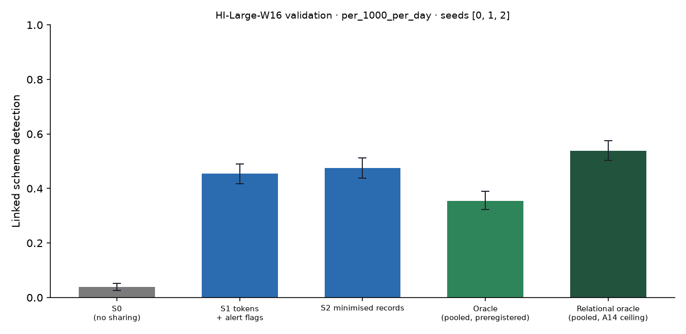

# X1 · sharing ladder on test · HI-Large-W16

> **Sealed test (week 18).** Every model trained on the training partition; every calibration, threshold, fusion and attribution parameter fitted on validation and frozen; test scored label-free, then opened once per seed through the logged seal (`finmesh sealed-log`). Wording below that says *validation* in a column or check name refers to the frozen rule; every number is on **test**.

Seeds [0, 1, 2]; primary budget per_1000_per_day; schemes detected within 12 windows; primary fusion **stacker** (A13); H1b ceiling **oracle-relational** (A14). Per-scheme outcomes are averaged over seeds before the scheme bootstrap. Total 5,283 s, peak memory 2,282 MB. S3 and PD sweeps: `x3_HI-Large-W16.md`; leakage audit: `audit_HI-Large-W16.md`.

## Linked detection per configuration (primary fusion)

| Configuration | Linked [95% CI] | Across members | Detected [95% CI] | Gain over S0 [95% CI] | p | AUPRC (mean) |
| --- | --- | --- | --- | --- | --- | --- |
| S0 (no sharing) | 0.0382 [0.0253, 0.0527] | 0.0000 | 0.7059 [0.6736, 0.7376] | — | — | 0.0977 |
| S1 tokens + alert flags | 0.4543 [0.4183, 0.4898] | 0.4409 | 0.6624 [0.6274, 0.6946] | 0.4161 [0.3780, 0.4554] | 0.0000 | 0.1182 |
| S2 minimised records | 0.4758 [0.4387, 0.5113] | 0.4602 | 0.6704 [0.6349, 0.7027] | 0.4376 [0.3994, 0.4742] | 0.0000 | 0.1337 |
| Oracle (pooled, preregistered) | 0.3543 [0.3220, 0.3903] | 0.3183 | 0.7651 [0.7339, 0.7962] | 0.3161 [0.2822, 0.3522] | 0.0000 | 0.1370 |
| Relational oracle (pooled, A14 ceiling) | 0.5382 [0.5032, 0.5753] | 0.4763 | 0.6737 [0.6408, 0.7086] | 0.5000 [0.4645, 0.5371] | 0.0000 | 0.1595 |

Random alerts at the same budget: detected —, linked —.

## H1b on test: share of the ceiling's gain recovered

(level − S0) / (ceiling − S0) in linked detection, scheme bootstrap. The relational oracle (pooled data with the same re-ranking, plaintext) is the ceiling from A14; the preregistered oracle is kept for comparison, and `strongest-pooled` uses whichever pooled relational configuration links more (—) as a sensitivity check. Target: at least 0.60 for S2, judged on test.

| Level | Against oracle-relational [95% CI] | Against oracle [95% CI] |
| --- | --- | --- |
| S1 | 0.8323 [0.7832, 0.8841] | 1.32 [1.21, 1.44] |
| S2 | 0.8753 [0.8250, 0.9247] | 1.38 [1.27, 1.51] |
| S4 | — | — |

## Secondary fusion rules

k-of-n uses only alert flags and noisy-OR only flags and the probability bucket, so their S2 and S4 rows coincide by construction.

| Level / rule | Linked | Detected | Gain over S0 | AUPRC (mean) |
| --- | --- | --- | --- | --- |

## Protocol per seed

Token evaluations are counted by the first level that needs them; later levels reuse the same tokens.

| Seed | Level | Requests | Answered: alert | Record, no alert | Refused | Accounts disclosed | LDP withheld | Max ε per account | Token evaluations | Seconds |
| --- | --- | --- | --- | --- | --- | --- | --- | --- | --- | --- |
| 0 | S1 | 1,382,360 | 8,849 | 0 | 1,096 | 0 | 0 | 0.0000 | 794,282 | 396.20 |
| 0 | S2 | 1,382,360 | 8,849 | 75,667 | 1,096 | 50,153 | 0 | 0.0000 | 0 | 236.30 |
| 1 | S1 | 1,351,663 | 8,743 | 0 | 1,191 | 0 | 0 | 0.0000 | 827,407 | 405.80 |
| 1 | S2 | 1,351,663 | 8,743 | 84,572 | 1,191 | 55,078 | 0 | 0.0000 | 0 | 225.40 |
| 2 | S1 | 1,455,194 | 9,003 | 0 | 1,131 | 0 | 0 | 0.0000 | 855,987 | 457.70 |
| 2 | S2 | 1,455,194 | 9,003 | 87,633 | 1,131 | 56,865 | 0 | 0.0000 | 0 | 301.00 |

## Time per seed

| Seed | s0 | oracle | autoencoders | val:s0_score | val:oracle_score | val:relational | val:records | val:propagation | test:s0_score | test:oracle_score | test:relational | test:records | test:propagation | test:evaluate | total |
| --- | --- | --- | --- | --- | --- | --- | --- | --- | --- | --- | --- | --- | --- | --- | --- |
| 0 | 19.90 | 31.00 | 20.00 | 11.10 | 21.90 | 3.10 | 4.30 | 1.10 | 12.30 | 20.30 | 5.20 | 7.30 | 1.30 | 520.60 | 1,682.30 |
| 1 | 22.50 | 31.10 | 20.80 | 15.80 | 17.00 | 3.70 | 6.10 | 1.50 | 15.80 | 17.60 | 5.20 | 7.00 | 1.30 | 493.30 | 1,689.00 |
| 2 | 18.70 | 19.60 | 20.90 | 13.70 | 13.80 | 4.90 | 8.60 | 2.00 | 13.50 | 14.00 | 5.20 | 8.20 | 2.10 | 596.90 | 1,910.60 |
