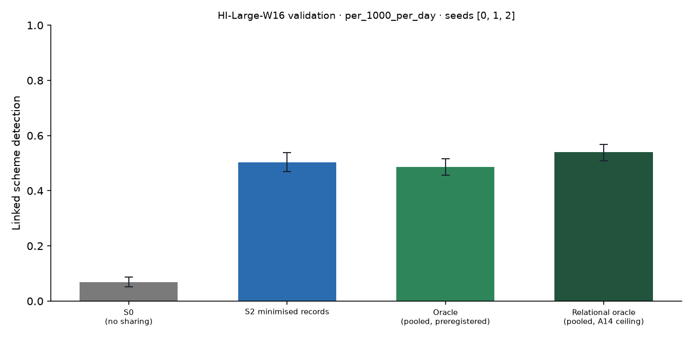

# X1 · sharing ladder on test · HI-Large-W16

> **Sealed test (week 18).** Every model trained on the training partition; every calibration, threshold, fusion and attribution parameter fitted on validation and frozen; test scored label-free, then opened once per seed through the logged seal (`finmesh sealed-log`). Wording below that says *validation* in a column or check name refers to the frozen rule; every number is on **test**.

Seeds [0, 1, 2]; primary budget per_1000_per_day; schemes detected within 12 windows; primary fusion **stacker** (A13); H1b ceiling **oracle-relational** (A14). Per-scheme outcomes are averaged over seeds before the scheme bootstrap. Total 6,605 s, peak memory 5,539 MB. S3 and PD sweeps: `x3_HI-Large-W16.md`; leakage audit: `audit_HI-Large-W16.md`.

## Linked detection per configuration (primary fusion)

| Configuration | Linked [95% CI] | Across members | Detected [95% CI] | Gain over S0 [95% CI] | p | AUPRC (mean) |
| --- | --- | --- | --- | --- | --- | --- |
| S0 (no sharing) | 0.0694 [0.0522, 0.0876] | 0.0000 | 0.6914 [0.6591, 0.7226] | — | — | 0.1317 |
| S2 minimised records | 0.5022 [0.4699, 0.5382] | 0.4812 | 0.6715 [0.6409, 0.7022] | 0.4328 [0.3962, 0.4710] | 0.0000 | 0.1757 |
| Oracle (pooled, preregistered) | 0.4866 [0.4565, 0.5161] | 0.4392 | 0.6581 [0.6269, 0.6882] | 0.4172 [0.3844, 0.4511] | 0.0000 | 0.1934 |
| Relational oracle (pooled, A14 ceiling) | 0.5392 [0.5091, 0.5683] | 0.4849 | 0.6452 [0.6145, 0.6742] | 0.4699 [0.4365, 0.5022] | 0.0000 | 0.2074 |

Random alerts at the same budget: detected —, linked —.

## H1b on test: share of the ceiling's gain recovered

(level − S0) / (ceiling − S0) in linked detection, scheme bootstrap. The relational oracle (pooled data with the same re-ranking, plaintext) is the ceiling from A14; the preregistered oracle is kept for comparison, and `strongest-pooled` uses whichever pooled relational configuration links more (—) as a sensitivity check. Target: at least 0.60 for S2, judged on test.

| Level | Against oracle-relational [95% CI] | Against oracle [95% CI] |
| --- | --- | --- |
| S1 | — | — |
| S2 | 0.9211 [0.8603, 0.9809] | 1.04 [0.9648, 1.11] |
| S4 | — | — |

## Secondary fusion rules

k-of-n uses only alert flags and noisy-OR only flags and the probability bucket, so their S2 and S4 rows coincide by construction.

| Level / rule | Linked | Detected | Gain over S0 | AUPRC (mean) |
| --- | --- | --- | --- | --- |

## Protocol per seed

Token evaluations are counted by the first level that needs them; later levels reuse the same tokens.

| Seed | Level | Requests | Answered: alert | Record, no alert | Refused | Accounts disclosed | LDP withheld | Max ε per account | Token evaluations | Seconds |
| --- | --- | --- | --- | --- | --- | --- | --- | --- | --- | --- |
| 0 | S2 | 716,781 | 8,759 | 169,581 | 1,242 | 111,240 | 0 | 0.0000 | 813,256 | 301.80 |
| 1 | S2 | 765,626 | 8,862 | 168,058 | 1,290 | 110,351 | 0 | 0.0000 | 852,817 | 322.30 |
| 2 | S2 | 665,349 | 8,804 | 140,317 | 1,245 | 93,198 | 0 | 0.0000 | 739,461 | 287.90 |

## Time per seed

| Seed | s0 | oracle | autoencoders | val:s0_score | val:oracle_score | val:relational | val:records | val:propagation | test:s0_score | test:oracle_score | test:relational | test:records | test:propagation | test:evaluate | total |
| --- | --- | --- | --- | --- | --- | --- | --- | --- | --- | --- | --- | --- | --- | --- | --- |
| 0 | 317.90 | 410.80 | 23.10 | 160.20 | 267.20 | 3.90 | 5.20 | 1.20 | 150.60 | 258.90 | 2.80 | 5.10 | 1.00 | 344.10 | 2,469.50 |
| 1 | 253.90 | 229.70 | 23.50 | 162.60 | 134.30 | 3.80 | 5.40 | 1.30 | 144.80 | 145.80 | 2.70 | 5.00 | 1.00 | 368.20 | 2,042.20 |
| 2 | 285.50 | 273.30 | 23.30 | 137.30 | 129.80 | 3.50 | 5.00 | 1.00 | 172.10 | 137.60 | 2.30 | 4.90 | 0.9000 | 400.50 | 2,091.80 |
