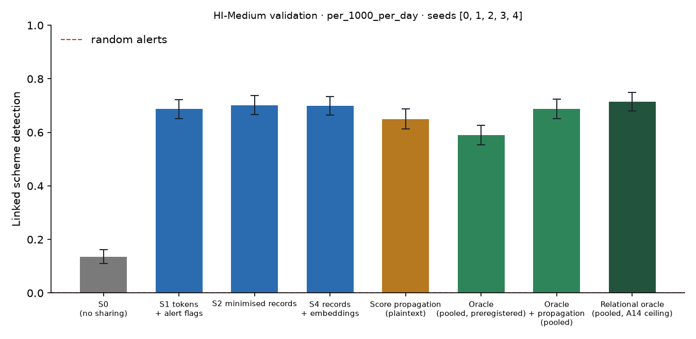

# X1 · sharing ladder on test · HI-Medium

> **Sealed test (week 18).** Every model trained on the training partition; every calibration, threshold, fusion and attribution parameter fitted on validation and frozen; test scored label-free, then opened once per seed through the logged seal (`finmesh sealed-log`). Wording below that says *validation* in a column or check name refers to the frozen rule; every number is on **test**.

Seeds [0, 1, 2, 3, 4]; primary budget per_1000_per_day; schemes detected within 12 windows; primary fusion **stacker** (A13); H1b ceiling **oracle-relational** (A14). Per-scheme outcomes are averaged over seeds before the scheme bootstrap. Total 24,856 s, peak memory 3,565 MB. S3 and PD sweeps: `x3_HI-Medium.md`; leakage audit: `audit_HI-Medium.md`.

## Linked detection per configuration (primary fusion)

| Configuration | Linked [95% CI] | Across members | Detected [95% CI] | Gain over S0 [95% CI] | p | AUPRC (mean) |
| --- | --- | --- | --- | --- | --- | --- |
| S0 (no sharing) | 0.1356 [0.1096, 0.1620] | 0.0000 | 0.8328 [0.8052, 0.8596] | — | — | 0.2035 |
| S1 tokens + alert flags | 0.6880 [0.6520, 0.7220] | 0.6620 | 0.8220 [0.7927, 0.8507] | 0.5513 [0.5120, 0.5933] | 0.0000 | 0.2786 |
| S2 minimised records | 0.7016 [0.6660, 0.7372] | 0.6740 | 0.8244 [0.7980, 0.8536] | 0.5660 [0.5292, 0.6060] | 0.0000 | 0.2849 |
| S4 records + embeddings | 0.6987 [0.6646, 0.7347] | 0.6740 | 0.8287 [0.8000, 0.8587] | 0.5620 [0.5253, 0.6033] | 0.0000 | 0.2845 |
| Score propagation (plaintext) | 0.6500 [0.6133, 0.6887] | 0.6133 | 0.8200 [0.7913, 0.8494] | 0.5133 [0.4766, 0.5534] | 0.0000 | 0.2638 |
| Oracle (pooled, preregistered) | 0.5904 [0.5528, 0.6264] | 0.5440 | 0.8536 [0.8280, 0.8792] | 0.4548 [0.4152, 0.4940] | 0.0000 | 0.2514 |
| Oracle + propagation (pooled) | 0.6880 [0.6513, 0.7240] | 0.6347 | 0.8180 [0.7893, 0.8467] | 0.5513 [0.5126, 0.5900] | 0.0000 | 0.3070 |
| Relational oracle (pooled, A14 ceiling) | 0.7140 [0.6796, 0.7496] | 0.6584 | 0.8020 [0.7720, 0.8312] | 0.5784 [0.5396, 0.6168] | 0.0000 | 0.3125 |

Random alerts at the same budget: detected 0.0063, linked 0.0000.

## H1b on test: share of the ceiling's gain recovered

(level − S0) / (ceiling − S0) in linked detection, scheme bootstrap. The relational oracle (pooled data with the same re-ranking, plaintext) is the ceiling from A14; the preregistered oracle is kept for comparison, and `strongest-pooled` uses whichever pooled relational configuration links more (oracle-relational) as a sensitivity check. Target: at least 0.60 for S2, judged on test.

| Level | Against oracle-relational [95% CI] | Against oracle [95% CI] | Against strongest-pooled [95% CI] |
| --- | --- | --- | --- |
| S1 | 0.9528 [0.9073, 1.00] | 1.21 [1.15, 1.29] | 0.9528 [0.9073, 1.00] |
| S2 | 0.9786 [0.9354, 1.03] | 1.24 [1.18, 1.33] | 0.9786 [0.9354, 1.03] |
| S4 | 0.9712 [0.9222, 1.02] | 1.23 [1.16, 1.33] | 0.9712 [0.9222, 1.02] |

## Secondary fusion rules

k-of-n uses only alert flags and noisy-OR only flags and the probability bucket, so their S2 and S4 rows coincide by construction.

| Level / rule | Linked | Detected | Gain over S0 | AUPRC (mean) |
| --- | --- | --- | --- | --- |
| S1/noisy_or | 0.5333 [0.4953, 0.5713] | 0.8373 [0.8087, 0.8653] | 0.3967 [0.3607, 0.4327] | 0.2025 |
| S1/kofn | 0.5760 [0.5373, 0.6167] | 0.8080 [0.7766, 0.8380] | 0.4393 [0.3980, 0.4833] | 0.2466 |
| S2/noisy_or | 0.6447 [0.6087, 0.6820] | 0.7907 [0.7593, 0.8220] | 0.5080 [0.4706, 0.5487] | 0.2538 |
| S2/kofn | 0.5760 [0.5373, 0.6167] | 0.8080 [0.7766, 0.8380] | 0.4393 [0.3980, 0.4833] | 0.2466 |
| S4/noisy_or | 0.6447 [0.6087, 0.6820] | 0.7907 [0.7593, 0.8220] | 0.5080 [0.4706, 0.5487] | 0.2538 |
| S4/kofn | 0.5760 [0.5373, 0.6167] | 0.8080 [0.7766, 0.8380] | 0.4393 [0.3980, 0.4833] | 0.2466 |

## Protocol per seed

Token evaluations are counted by the first level that needs them; later levels reuse the same tokens.

| Seed | Level | Requests | Answered: alert | Record, no alert | Refused | Accounts disclosed | LDP withheld | Max ε per account | Token evaluations | Seconds |
| --- | --- | --- | --- | --- | --- | --- | --- | --- | --- | --- |
| 0 | S1 | 1,573,485 | 13,819 | 0 | 1,234 | 0 | 0 | 0.0000 | 988,124 | 467.80 |
| 0 | S2 | 1,573,485 | 13,819 | 110,369 | 1,234 | 64,936 | 0 | 0.0000 | 0 | 263.60 |
| 0 | S4 | 1,573,485 | 13,819 | 110,369 | 1,234 | 64,936 | 0 | 0.0000 | 0 | 263.50 |
| 0 | S3[eps=0.5] | 1,573,485 | 13,819 | 1,558,432 | 1,234 | 64,936 | 0 | 3.50 | 0 | 364.80 |
| 0 | S3[eps=1] | 1,573,485 | 13,819 | 1,558,432 | 1,234 | 64,936 | 0 | 7.00 | 0 | 388.40 |
| 0 | S3[eps=2] | 1,573,485 | 13,819 | 1,558,419 | 1,234 | 64,936 | 181 | 8.00 | 0 | 381.60 |
| 0 | S3[eps=4] | 1,573,485 | 13,819 | 1,557,588 | 1,234 | 64,936 | 2,638 | 8.00 | 0 | 357.80 |
| 0 | S3[eps=8] | 1,573,485 | 13,819 | 1,537,802 | 1,234 | 56,568 | 25,598 | 8.00 | 0 | 327.80 |
| 0 | PD[tau=2] | 1,573,485 | 13,819 | 19,182 | 1,234 | 17,638 | 0 | 0.0000 | 0 | 256.20 |
| 0 | PD[tau=3] | 1,573,485 | 13,819 | 7,491 | 1,234 | 7,649 | 0 | 0.0000 | 0 | 254.60 |
| 0 | PD[tau=4] | 1,573,485 | 13,819 | 3,666 | 1,234 | 4,300 | 0 | 0.0000 | 0 | 254.80 |
| 1 | S1 | 1,548,669 | 13,872 | 0 | 1,204 | 0 | 0 | 0.0000 | 958,496 | 447.50 |
| 1 | S2 | 1,548,669 | 13,872 | 103,434 | 1,204 | 61,240 | 0 | 0.0000 | 0 | 252.40 |
| 1 | S4 | 1,548,669 | 13,872 | 103,434 | 1,204 | 61,240 | 0 | 0.0000 | 0 | 252.40 |
| 1 | S3[eps=0.5] | 1,548,669 | 13,872 | 1,533,593 | 1,204 | 61,240 | 0 | 4.00 | 0 | 339.60 |
| 1 | S3[eps=1] | 1,548,669 | 13,872 | 1,533,593 | 1,204 | 61,240 | 0 | 8.00 | 0 | 351.20 |
| 1 | S3[eps=2] | 1,548,669 | 13,872 | 1,533,580 | 1,204 | 61,240 | 181 | 8.00 | 0 | 335.50 |
| 1 | S3[eps=4] | 1,548,669 | 13,872 | 1,532,866 | 1,204 | 61,240 | 2,576 | 8.00 | 0 | 378.50 |
| 1 | S3[eps=8] | 1,548,669 | 13,872 | 1,513,910 | 1,204 | 53,180 | 24,742 | 8.00 | 0 | 356.30 |
| 1 | PD[tau=2] | 1,548,669 | 13,872 | 19,168 | 1,204 | 17,668 | 0 | 0.0000 | 0 | 255.10 |
| 1 | PD[tau=3] | 1,548,669 | 13,872 | 6,651 | 1,204 | 7,022 | 0 | 0.0000 | 0 | 250.90 |
| 1 | PD[tau=4] | 1,548,669 | 13,872 | 3,690 | 1,204 | 4,310 | 0 | 0.0000 | 0 | 255.00 |
| 2 | S1 | 1,567,181 | 13,762 | 0 | 1,212 | 0 | 0 | 0.0000 | 960,066 | 445.90 |
| 2 | S2 | 1,567,181 | 13,762 | 101,145 | 1,212 | 59,938 | 0 | 0.0000 | 0 | 252.50 |
| 2 | S4 | 1,567,181 | 13,762 | 101,145 | 1,212 | 59,938 | 0 | 0.0000 | 0 | 284.00 |
| 2 | S3[eps=0.5] | 1,567,181 | 13,762 | 1,552,207 | 1,212 | 59,938 | 0 | 4.00 | 0 | 525.90 |
| 2 | S3[eps=1] | 1,567,181 | 13,762 | 1,552,207 | 1,212 | 59,938 | 0 | 8.00 | 0 | 364.40 |
| 2 | S3[eps=2] | 1,567,181 | 13,762 | 1,552,195 | 1,212 | 59,938 | 167 | 8.00 | 0 | 357.70 |
| 2 | S3[eps=4] | 1,567,181 | 13,762 | 1,551,457 | 1,212 | 59,938 | 2,563 | 8.00 | 0 | 354.00 |
| 2 | S3[eps=8] | 1,567,181 | 13,762 | 1,532,743 | 1,212 | 51,917 | 24,423 | 8.00 | 0 | 372.20 |
| 2 | PD[tau=2] | 1,567,181 | 13,762 | 22,122 | 1,212 | 19,723 | 0 | 0.0000 | 0 | 255.90 |
| 2 | PD[tau=3] | 1,567,181 | 13,762 | 7,458 | 1,212 | 7,665 | 0 | 0.0000 | 0 | 254.40 |
| 2 | PD[tau=4] | 1,567,181 | 13,762 | 3,634 | 1,212 | 4,275 | 0 | 0.0000 | 0 | 256.30 |
| 3 | S2 | 1,601,533 | 14,156 | 111,858 | 1,234 | 65,316 | 0 | 0.0000 | 997,050 | 470.60 |
| 3 | PD[tau=2] | 1,601,533 | 14,156 | 24,151 | 1,234 | 22,011 | 0 | 0.0000 | 0 | 259.50 |
| 3 | PD[tau=3] | 1,601,533 | 14,156 | 6,577 | 1,234 | 6,947 | 0 | 0.0000 | 0 | 255.20 |
| 3 | PD[tau=4] | 1,601,533 | 14,156 | 3,629 | 1,234 | 4,248 | 0 | 0.0000 | 0 | 256.00 |
| 4 | S2 | 831,342 | 12,726 | 102,603 | 1,286 | 70,960 | 0 | 0.0000 | 847,961 | 317.80 |
| 4 | PD[tau=2] | 831,342 | 12,726 | 24,607 | 1,286 | 22,199 | 0 | 0.0000 | 0 | 136.90 |
| 4 | PD[tau=3] | 831,342 | 12,726 | 7,647 | 1,286 | 7,669 | 0 | 0.0000 | 0 | 135.40 |
| 4 | PD[tau=4] | 831,342 | 12,726 | 3,756 | 1,286 | 4,250 | 0 | 0.0000 | 0 | 133.90 |

## Time per seed

| Seed | s0 | oracle | autoencoders | val:s0_score | val:oracle_score | val:relational | val:records | val:propagation | val:x6_tables | test:s0_score | test:oracle_score | test:relational | test:records | test:propagation | test:evaluate | test:x6 | total |
| --- | --- | --- | --- | --- | --- | --- | --- | --- | --- | --- | --- | --- | --- | --- | --- | --- | --- |
| 0 | 24.00 | 65.80 | 23.50 | 11.10 | 44.00 | 2.50 | 3.00 | 0.4000 | 13.60 | 18.00 | 70.30 | 4.20 | 5.30 | 1.70 | 2,151.10 | 22.60 | 6,860.00 |
| 1 | 26.60 | 64.70 | 17.50 | 12.10 | 41.20 | 3.90 | 3.60 | 0.4000 | 13.10 | 19.70 | 65.50 | 5.10 | 6.60 | 2.40 | 2,269.20 | 25.60 | 6,580.10 |
| 2 | 30.90 | 55.60 | 17.50 | 13.70 | 33.20 | 3.70 | 3.60 | 0.5000 | 13.30 | 24.60 | 48.80 | 3.30 | 6.10 | 2.50 | 2,275.70 | 32.20 | 6,887.10 |
| 3 | 27.80 | 62.50 | 17.80 | 11.50 | 40.60 | 3.60 | 4.10 | 0.5000 | — | 21.10 | 61.60 | 5.70 | 5.90 | 2.50 | 765.60 | — | 2,490.90 |
| 4 | 45.90 | 70.90 | 17.40 | 14.30 | 44.00 | 3.60 | 3.70 | 0.6000 | — | 25.40 | 71.00 | 6.40 | 5.50 | 1.50 | 753.40 | — | 2,034.00 |
