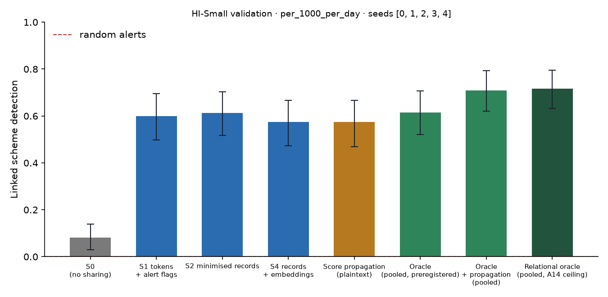

# X1 · sharing ladder on test · HI-Small

> **Sealed test (week 18).** Every model trained on the training partition; every calibration, threshold, fusion and attribution parameter fitted on validation and frozen; test scored label-free, then opened once per seed through the logged seal (`finmesh sealed-log`). Wording below that says *validation* in a column or check name refers to the frozen rule; every number is on **test**.

Seeds [0, 1, 2, 3, 4]; primary budget per_1000_per_day; schemes detected within 12 windows; primary fusion **stacker** (A13); H1b ceiling **oracle-relational** (A14). Per-scheme outcomes are averaged over seeds before the scheme bootstrap. Total 2,948 s, peak memory 839 MB. S3 and PD sweeps: `x3_HI-Small.md`; leakage audit: `audit_HI-Small.md`.

## Linked detection per configuration (primary fusion)

| Configuration | Linked [95% CI] | Across members | Detected [95% CI] | Gain over S0 [95% CI] | p | AUPRC (mean) |
| --- | --- | --- | --- | --- | --- | --- |
| S0 (no sharing) | 0.0810 [0.0304, 0.1392] | 0.0000 | 0.7468 [0.6683, 0.8278] | — | — | 0.1081 |
| S1 tokens + alert flags | 0.5992 [0.4979, 0.6962] | 0.5992 | 0.7300 [0.6456, 0.8143] | 0.5148 [0.4051, 0.6161] | 0.0000 | 0.2096 |
| S2 minimised records | 0.6127 [0.5165, 0.7038] | 0.6127 | 0.7975 [0.7139, 0.8684] | 0.5316 [0.4253, 0.6355] | 0.0000 | 0.2120 |
| S4 records + embeddings | 0.5738 [0.4726, 0.6667] | 0.5738 | 0.7764 [0.6920, 0.8481] | 0.4895 [0.3755, 0.5949] | 0.0000 | 0.2099 |
| Score propagation (plaintext) | 0.5738 [0.4684, 0.6668] | 0.5654 | 0.7089 [0.6203, 0.7932] | 0.4895 [0.3840, 0.5992] | 0.0000 | 0.1980 |
| Oracle (pooled, preregistered) | 0.6152 [0.5215, 0.7064] | 0.6076 | 0.8152 [0.7341, 0.8886] | 0.5342 [0.4328, 0.6330] | 0.0000 | 0.1821 |
| Oracle + propagation (pooled) | 0.7089 [0.6203, 0.7934] | 0.6709 | 0.8481 [0.7722, 0.9156] | 0.6245 [0.5190, 0.7215] | 0.0000 | 0.2606 |
| Relational oracle (pooled, A14 ceiling) | 0.7165 [0.6329, 0.7949] | 0.6658 | 0.8430 [0.7696, 0.9064] | 0.6354 [0.5468, 0.7165] | 0.0000 | 0.2510 |

Random alerts at the same budget: detected 0.0069, linked 0.0000.

## H1b on test: share of the ceiling's gain recovered

(level − S0) / (ceiling − S0) in linked detection, scheme bootstrap. The relational oracle (pooled data with the same re-ranking, plaintext) is the ceiling from A14; the preregistered oracle is kept for comparison, and `strongest-pooled` uses whichever pooled relational configuration links more (oracle+propagation) as a sensitivity check. Target: at least 0.60 for S2, judged on test.

| Level | Against oracle-relational [95% CI] | Against oracle [95% CI] | Against strongest-pooled [95% CI] |
| --- | --- | --- | --- |
| S1 | 0.8531 [0.7537, 0.9521] | 0.9606 [0.8592, 1.07] | 0.8243 [0.7290, 0.9167] |
| S2 | 0.8367 [0.7217, 0.9457] | 0.9953 [0.8974, 1.09] | 0.8716 [0.7536, 0.9936] |
| S4 | 0.8112 [0.6846, 0.9315] | 0.9134 [0.8017, 1.02] | 0.7838 [0.6623, 0.8977] |

## Secondary fusion rules

k-of-n uses only alert flags and noisy-OR only flags and the probability bucket, so their S2 and S4 rows coincide by construction.

| Level / rule | Linked | Detected | Gain over S0 | AUPRC (mean) |
| --- | --- | --- | --- | --- |
| S1/noisy_or | 0.4346 [0.3332, 0.5359] | 0.7215 [0.6329, 0.8017] | 0.3502 [0.2615, 0.4516] | 0.1148 |
| S1/kofn | 0.4684 [0.3755, 0.5612] | 0.7384 [0.6540, 0.8143] | 0.3840 [0.2785, 0.4937] | 0.1841 |
| S2/noisy_or | 0.5654 [0.4641, 0.6667] | 0.6793 [0.5865, 0.7722] | 0.4810 [0.3713, 0.5907] | 0.1694 |
| S2/kofn | 0.4684 [0.3755, 0.5612] | 0.7384 [0.6540, 0.8143] | 0.3840 [0.2785, 0.4937] | 0.1841 |
| S4/noisy_or | 0.5654 [0.4641, 0.6667] | 0.6793 [0.5865, 0.7722] | 0.4810 [0.3713, 0.5907] | 0.1694 |
| S4/kofn | 0.4684 [0.3755, 0.5612] | 0.7384 [0.6540, 0.8143] | 0.3840 [0.2785, 0.4937] | 0.1841 |

## Protocol per seed

Token evaluations are counted by the first level that needs them; later levels reuse the same tokens.

| Seed | Level | Requests | Answered: alert | Record, no alert | Refused | Accounts disclosed | LDP withheld | Max ε per account | Token evaluations | Seconds |
| --- | --- | --- | --- | --- | --- | --- | --- | --- | --- | --- |
| 0 | S1 | 107,008 | 1,346 | 0 | 229 | 0 | 0 | 0.0000 | 151,756 | 55.50 |
| 0 | S2 | 107,008 | 1,346 | 47,177 | 229 | 38,769 | 0 | 0.0000 | 0 | 23.90 |
| 0 | S4 | 107,008 | 1,346 | 47,177 | 229 | 38,769 | 0 | 0.0000 | 0 | 21.00 |
| 0 | S3[eps=0.5] | 107,008 | 1,346 | 105,433 | 229 | 38,769 | 0 | 3.50 | 0 | 25.60 |
| 0 | S3[eps=1] | 107,008 | 1,346 | 105,433 | 229 | 38,769 | 0 | 7.00 | 0 | 25.60 |
| 0 | S3[eps=2] | 107,008 | 1,346 | 105,433 | 229 | 38,769 | 31 | 8.00 | 0 | 25.80 |
| 0 | S3[eps=4] | 107,008 | 1,346 | 105,290 | 229 | 38,769 | 295 | 8.00 | 0 | 25.20 |
| 0 | S3[eps=8] | 107,008 | 1,346 | 101,931 | 229 | 37,582 | 3,894 | 8.00 | 0 | 22.50 |
| 0 | PD[tau=2] | 107,008 | 1,346 | 14,191 | 229 | 13,497 | 0 | 0.0000 | 0 | 18.10 |
| 0 | PD[tau=3] | 107,008 | 1,346 | 2,311 | 229 | 2,380 | 0 | 0.0000 | 0 | 17.80 |
| 0 | PD[tau=4] | 107,008 | 1,346 | 578 | 229 | 670 | 0 | 0.0000 | 0 | 17.60 |
| 1 | S1 | 106,442 | 1,395 | 0 | 221 | 0 | 0 | 0.0000 | 148,764 | 50.80 |
| 1 | S2 | 106,442 | 1,395 | 42,985 | 221 | 34,939 | 0 | 0.0000 | 0 | 19.60 |
| 1 | S4 | 106,442 | 1,395 | 42,985 | 221 | 34,939 | 0 | 0.0000 | 0 | 21.00 |
| 1 | S3[eps=0.5] | 106,442 | 1,395 | 104,826 | 221 | 34,939 | 0 | 3.50 | 0 | 26.90 |
| 1 | S3[eps=1] | 106,442 | 1,395 | 104,826 | 221 | 34,939 | 0 | 7.00 | 0 | 24.10 |
| 1 | S3[eps=2] | 106,442 | 1,395 | 104,824 | 221 | 34,939 | 29 | 8.00 | 0 | 22.80 |
| 1 | S3[eps=4] | 106,442 | 1,395 | 104,702 | 221 | 34,939 | 275 | 8.00 | 0 | 22.90 |
| 1 | S3[eps=8] | 106,442 | 1,395 | 101,457 | 221 | 33,725 | 3,803 | 8.00 | 0 | 23.00 |
| 1 | PD[tau=2] | 106,442 | 1,395 | 14,291 | 221 | 13,576 | 0 | 0.0000 | 0 | 18.10 |
| 1 | PD[tau=3] | 106,442 | 1,395 | 2,763 | 221 | 2,859 | 0 | 0.0000 | 0 | 18.70 |
| 1 | PD[tau=4] | 106,442 | 1,395 | 524 | 221 | 652 | 0 | 0.0000 | 0 | 21.00 |
| 2 | S1 | 108,586 | 1,383 | 0 | 228 | 0 | 0 | 0.0000 | 152,418 | 52.60 |
| 2 | S2 | 108,586 | 1,383 | 45,818 | 228 | 37,660 | 0 | 0.0000 | 0 | 19.60 |
| 2 | S4 | 108,586 | 1,383 | 45,818 | 228 | 37,660 | 0 | 0.0000 | 0 | 19.50 |
| 2 | S3[eps=0.5] | 108,586 | 1,383 | 106,975 | 228 | 37,660 | 0 | 3.00 | 0 | 23.30 |
| 2 | S3[eps=1] | 108,586 | 1,383 | 106,975 | 228 | 37,660 | 0 | 6.00 | 0 | 23.00 |
| 2 | S3[eps=2] | 108,586 | 1,383 | 106,974 | 228 | 37,660 | 22 | 8.00 | 0 | 23.00 |
| 2 | S3[eps=4] | 108,586 | 1,383 | 106,833 | 228 | 37,660 | 278 | 8.00 | 0 | 22.80 |
| 2 | S3[eps=8] | 108,586 | 1,383 | 103,464 | 228 | 36,442 | 3,917 | 8.00 | 0 | 22.80 |
| 2 | PD[tau=2] | 108,586 | 1,383 | 19,542 | 228 | 18,343 | 0 | 0.0000 | 0 | 18.50 |
| 2 | PD[tau=3] | 108,586 | 1,383 | 4,191 | 228 | 4,221 | 0 | 0.0000 | 0 | 18.00 |
| 2 | PD[tau=4] | 108,586 | 1,383 | 701 | 228 | 816 | 0 | 0.0000 | 0 | 17.80 |
| 3 | S2 | 109,664 | 1,431 | 48,792 | 235 | 39,834 | 0 | 0.0000 | 154,511 | 56.70 |
| 3 | PD[tau=2] | 109,664 | 1,431 | 20,774 | 235 | 19,521 | 0 | 0.0000 | 0 | 22.00 |
| 3 | PD[tau=3] | 109,664 | 1,431 | 1,980 | 235 | 2,047 | 0 | 0.0000 | 0 | 20.50 |
| 3 | PD[tau=4] | 109,664 | 1,431 | 919 | 235 | 1,002 | 0 | 0.0000 | 0 | 20.80 |
| 4 | S2 | 100,162 | 1,329 | 42,570 | 197 | 35,241 | 0 | 0.0000 | 141,192 | 52.70 |
| 4 | PD[tau=2] | 100,162 | 1,329 | 15,921 | 197 | 15,169 | 0 | 0.0000 | 0 | 19.60 |
| 4 | PD[tau=3] | 100,162 | 1,329 | 2,598 | 197 | 2,680 | 0 | 0.0000 | 0 | 19.30 |
| 4 | PD[tau=4] | 100,162 | 1,329 | 747 | 197 | 846 | 0 | 0.0000 | 0 | 18.80 |

## Time per seed

| Seed | s0 | oracle | autoencoders | val:s0_score | val:oracle_score | val:relational | val:records | val:propagation | test:s0_score | test:oracle_score | test:relational | test:records | test:propagation | test:evaluate | total |
| --- | --- | --- | --- | --- | --- | --- | --- | --- | --- | --- | --- | --- | --- | --- | --- |
| 0 | 3.60 | 1.80 | 11.60 | 1.50 | 1.20 | 0.6000 | 0.6000 | 0.1000 | 1.70 | 1.80 | 0.4000 | 0.7000 | 0.1000 | 296.70 | 795.00 |
| 1 | 3.00 | 1.60 | 8.30 | 1.40 | 1.10 | 0.4000 | 0.6000 | 0.1000 | 1.80 | 1.20 | 0.4000 | 0.7000 | 0.2000 | 297.60 | 780.40 |
| 2 | 2.60 | 1.80 | 7.90 | 1.20 | 1.20 | 0.4000 | 0.5000 | 0.1000 | 2.10 | 1.70 | 0.6000 | 0.8000 | 0.1000 | 278.40 | 737.10 |
| 3 | 2.50 | 1.80 | 7.80 | 1.10 | 1.30 | 0.5000 | 0.6000 | 0.1000 | 1.30 | 1.80 | 0.5000 | 0.9000 | 0.2000 | 109.80 | 326.20 |
| 4 | 2.90 | 2.50 | 9.70 | 1.40 | 1.50 | 0.5000 | 0.8000 | 0.1000 | 1.30 | 1.60 | 0.4000 | 1.00 | 0.2000 | 108.40 | 308.60 |
