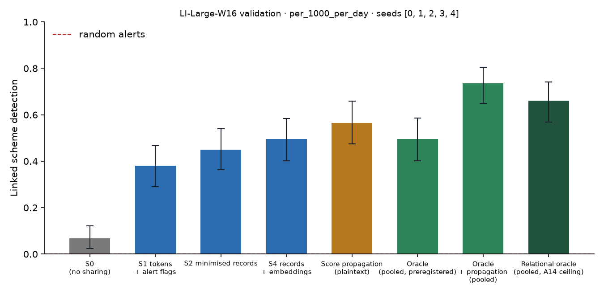

# X1 · sharing ladder on test · LI-Large-W16

> **Sealed test (week 18).** Every model trained on the training partition; every calibration, threshold, fusion and attribution parameter fitted on validation and frozen; test scored label-free, then opened once per seed through the logged seal (`finmesh sealed-log`). Wording below that says *validation* in a column or check name refers to the frozen rule; every number is on **test**.

Seeds [0, 1, 2, 3, 4]; primary budget per_1000_per_day; schemes detected within 12 windows; primary fusion **stacker** (A13); H1b ceiling **oracle-relational** (A14). Per-scheme outcomes are averaged over seeds before the scheme bootstrap. Total 17,574 s, peak memory 3,103 MB. S3 and PD sweeps: `x3_LI-Large-W16.md`; leakage audit: `audit_LI-Large-W16.md`.

## Linked detection per configuration (primary fusion)

| Configuration | Linked [95% CI] | Across members | Detected [95% CI] | Gain over S0 [95% CI] | p | AUPRC (mean) |
| --- | --- | --- | --- | --- | --- | --- |
| S0 (no sharing) | 0.0674 [0.0239, 0.1218] | 0.0000 | 0.7348 [0.6543, 0.8109] | — | — | 0.0647 |
| S1 tokens + alert flags | 0.3804 [0.2899, 0.4674] | 0.3370 | 0.7138 [0.6304, 0.7971] | 0.3152 [0.2246, 0.4058] | 0.0000 | 0.0673 |
| S2 minimised records | 0.4500 [0.3630, 0.5391] | 0.4065 | 0.6804 [0.5891, 0.7652] | 0.3826 [0.2891, 0.4783] | 0.0000 | 0.0718 |
| S4 records + embeddings | 0.4964 [0.4022, 0.5834] | 0.4493 | 0.6957 [0.6051, 0.7790] | 0.4312 [0.3369, 0.5254] | 0.0000 | 0.0721 |
| Score propagation (plaintext) | 0.5652 [0.4746, 0.6594] | 0.5181 | 0.7029 [0.6159, 0.7790] | 0.5000 [0.4022, 0.5942] | 0.0000 | 0.0734 |
| Oracle (pooled, preregistered) | 0.4957 [0.4021, 0.5870] | 0.4065 | 0.8391 [0.7695, 0.9065] | 0.4283 [0.3326, 0.5174] | 0.0000 | 0.0952 |
| Oracle + propagation (pooled) | 0.7355 [0.6486, 0.8043] | 0.6377 | 0.8043 [0.7283, 0.8696] | 0.6703 [0.5833, 0.7572] | 0.0000 | 0.1130 |
| Relational oracle (pooled, A14 ceiling) | 0.6609 [0.5695, 0.7414] | 0.5717 | 0.7739 [0.6912, 0.8457] | 0.5935 [0.4957, 0.6805] | 0.0000 | 0.1159 |

Random alerts at the same budget: detected 0.0035, linked 0.0000.

## H1b on test: share of the ceiling's gain recovered

(level − S0) / (ceiling − S0) in linked detection, scheme bootstrap. The relational oracle (pooled data with the same re-ranking, plaintext) is the ceiling from A14; the preregistered oracle is kept for comparison, and `strongest-pooled` uses whichever pooled relational configuration links more (oracle+propagation) as a sensitivity check. Target: at least 0.60 for S2, judged on test.

| Level | Against oracle-relational [95% CI] | Against oracle [95% CI] | Against strongest-pooled [95% CI] |
| --- | --- | --- | --- |
| S1 | 0.5337 [0.3972, 0.6624] | 0.7500 [0.5750, 0.9167] | 0.4703 [0.3478, 0.5823] |
| S2 | 0.6447 [0.5171, 0.7684] | 0.8934 [0.7363, 1.08] | 0.6000 [0.4837, 0.7173] |
| S4 | 0.7301 [0.6067, 0.8544] | 1.03 [0.8554, 1.23] | 0.6432 [0.5337, 0.7546] |

## Secondary fusion rules

k-of-n uses only alert flags and noisy-OR only flags and the probability bucket, so their S2 and S4 rows coincide by construction.

| Level / rule | Linked | Detected | Gain over S0 | AUPRC (mean) |
| --- | --- | --- | --- | --- |
| S1/noisy_or | 0.3370 [0.2464, 0.4239] | 0.7428 [0.6630, 0.8225] | 0.2717 [0.1920, 0.3551] | 0.0638 |
| S1/kofn | 0.2862 [0.1993, 0.3696] | 0.5543 [0.4565, 0.6486] | 0.2210 [0.1123, 0.3261] | 0.0542 |
| S2/noisy_or | 0.5109 [0.4167, 0.5978] | 0.7029 [0.6159, 0.7826] | 0.4457 [0.3442, 0.5362] | 0.0669 |
| S2/kofn | 0.2862 [0.1993, 0.3696] | 0.5543 [0.4565, 0.6486] | 0.2210 [0.1123, 0.3261] | 0.0542 |
| S4/noisy_or | 0.5109 [0.4167, 0.5978] | 0.7029 [0.6159, 0.7826] | 0.4457 [0.3442, 0.5362] | 0.0669 |
| S4/kofn | 0.2862 [0.1993, 0.3696] | 0.5543 [0.4565, 0.6486] | 0.2210 [0.1123, 0.3261] | 0.0542 |

## Protocol per seed

Token evaluations are counted by the first level that needs them; later levels reuse the same tokens.

| Seed | Level | Requests | Answered: alert | Record, no alert | Refused | Accounts disclosed | LDP withheld | Max ε per account | Token evaluations | Seconds |
| --- | --- | --- | --- | --- | --- | --- | --- | --- | --- | --- |
| 0 | S1 | 529,250 | 10,048 | 0 | 1,097 | 0 | 0 | 0.0000 | 601,177 | 234.00 |
| 0 | S2 | 529,250 | 10,048 | 112,176 | 1,097 | 79,904 | 0 | 0.0000 | 0 | 104.90 |
| 0 | S4 | 529,250 | 10,048 | 112,176 | 1,097 | 79,904 | 0 | 0.0000 | 0 | 106.30 |
| 0 | S3[eps=0.5] | 529,250 | 10,048 | 518,105 | 1,097 | 79,904 | 0 | 2.00 | 0 | 135.80 |
| 0 | S3[eps=1] | 529,250 | 10,048 | 518,105 | 1,097 | 79,904 | 0 | 4.00 | 0 | 152.80 |
| 0 | S3[eps=2] | 529,250 | 10,048 | 518,105 | 1,097 | 79,904 | 0 | 8.00 | 0 | 137.60 |
| 0 | S3[eps=4] | 529,250 | 10,048 | 517,769 | 1,097 | 79,904 | 390 | 8.00 | 0 | 136.40 |
| 0 | S3[eps=8] | 529,250 | 10,048 | 509,778 | 1,097 | 77,833 | 9,345 | 8.00 | 0 | 138.30 |
| 0 | PD[tau=2] | 529,250 | 10,048 | 17,993 | 1,097 | 17,784 | 0 | 0.0000 | 0 | 99.10 |
| 0 | PD[tau=3] | 529,250 | 10,048 | 643 | 1,097 | 860 | 0 | 0.0000 | 0 | 98.60 |
| 0 | PD[tau=4] | 529,250 | 10,048 | 279 | 1,097 | 427 | 0 | 0.0000 | 0 | 97.60 |
| 0 | S1F[gate=2] | 529,250 | 1,553 | 0 | 1,097 | 0 | 0 | 0.0000 | 0 | 97.80 |
| 1 | S1 | 489,514 | 9,372 | 0 | 1,017 | 0 | 0 | 0.0000 | 558,419 | 198.40 |
| 1 | S2 | 489,514 | 9,372 | 101,105 | 1,017 | 73,835 | 0 | 0.0000 | 0 | 83.50 |
| 1 | S4 | 489,514 | 9,372 | 101,105 | 1,017 | 73,835 | 0 | 0.0000 | 0 | 84.30 |
| 1 | S3[eps=0.5] | 489,514 | 9,372 | 479,125 | 1,017 | 73,835 | 0 | 2.00 | 0 | 105.70 |
| 1 | S3[eps=1] | 489,514 | 9,372 | 479,125 | 1,017 | 73,835 | 0 | 4.00 | 0 | 104.50 |
| 1 | S3[eps=2] | 489,514 | 9,372 | 479,125 | 1,017 | 73,835 | 0 | 8.00 | 0 | 105.20 |
| 1 | S3[eps=4] | 489,514 | 9,372 | 478,900 | 1,017 | 73,835 | 265 | 8.00 | 0 | 106.80 |
| 1 | S3[eps=8] | 489,514 | 9,372 | 472,332 | 1,017 | 72,115 | 7,701 | 8.00 | 0 | 107.10 |
| 1 | PD[tau=2] | 489,514 | 9,372 | 17,941 | 1,017 | 17,573 | 0 | 0.0000 | 0 | 81.00 |
| 1 | PD[tau=3] | 489,514 | 9,372 | 696 | 1,017 | 925 | 0 | 0.0000 | 0 | 80.00 |
| 1 | PD[tau=4] | 489,514 | 9,372 | 226 | 1,017 | 343 | 0 | 0.0000 | 0 | 79.70 |
| 1 | S1F[gate=2] | 489,514 | 1,560 | 0 | 1,017 | 0 | 0 | 0.0000 | 0 | 78.70 |
| 2 | S1 | 462,438 | 8,677 | 0 | 984 | 0 | 0 | 0.0000 | 526,070 | 198.30 |
| 2 | S2 | 462,438 | 8,677 | 90,800 | 984 | 66,912 | 0 | 0.0000 | 0 | 82.60 |
| 2 | S4 | 462,438 | 8,677 | 90,800 | 984 | 66,912 | 0 | 0.0000 | 0 | 80.10 |
| 2 | S3[eps=0.5] | 462,438 | 8,677 | 452,777 | 984 | 66,912 | 0 | 2.00 | 0 | 100.80 |
| 2 | S3[eps=1] | 462,438 | 8,677 | 452,777 | 984 | 66,912 | 0 | 4.00 | 0 | 107.80 |
| 2 | S3[eps=2] | 462,438 | 8,677 | 452,777 | 984 | 66,912 | 0 | 8.00 | 0 | 100.70 |
| 2 | S3[eps=4] | 462,438 | 8,677 | 452,556 | 984 | 66,912 | 254 | 8.00 | 0 | 100.70 |
| 2 | S3[eps=8] | 462,438 | 8,677 | 446,528 | 984 | 65,228 | 7,042 | 8.00 | 0 | 109.60 |
| 2 | PD[tau=2] | 462,438 | 8,677 | 11,877 | 984 | 11,984 | 0 | 0.0000 | 0 | 77.90 |
| 2 | PD[tau=3] | 462,438 | 8,677 | 529 | 984 | 740 | 0 | 0.0000 | 0 | 85.90 |
| 2 | PD[tau=4] | 462,438 | 8,677 | 89 | 984 | 185 | 0 | 0.0000 | 0 | 86.70 |
| 2 | S1F[gate=2] | 462,438 | 1,350 | 0 | 984 | 0 | 0 | 0.0000 | 0 | 84.60 |
| 3 | S2 | 470,626 | 8,890 | 93,059 | 1,068 | 68,582 | 0 | 0.0000 | 536,386 | 198.70 |
| 3 | PD[tau=2] | 470,626 | 8,890 | 12,994 | 1,068 | 13,317 | 0 | 0.0000 | 0 | 79.30 |
| 3 | PD[tau=3] | 470,626 | 8,890 | 514 | 1,068 | 754 | 0 | 0.0000 | 0 | 78.60 |
| 3 | PD[tau=4] | 470,626 | 8,890 | 211 | 1,068 | 362 | 0 | 0.0000 | 0 | 78.70 |
| 4 | S2 | 506,441 | 9,683 | 105,491 | 1,083 | 75,972 | 0 | 0.0000 | 576,442 | 215.70 |
| 4 | PD[tau=2] | 506,441 | 9,683 | 14,505 | 1,083 | 14,418 | 0 | 0.0000 | 0 | 84.40 |
| 4 | PD[tau=3] | 506,441 | 9,683 | 545 | 1,083 | 752 | 0 | 0.0000 | 0 | 83.10 |
| 4 | PD[tau=4] | 506,441 | 9,683 | 296 | 1,083 | 451 | 0 | 0.0000 | 0 | 82.80 |

## Time per seed

| Seed | s0 | oracle | autoencoders | val:s0_score | val:oracle_score | val:relational | val:records | val:propagation | val:x6_tables | test:s0_score | test:oracle_score | test:relational | test:records | test:propagation | test:evaluate | test:x6 | total |
| --- | --- | --- | --- | --- | --- | --- | --- | --- | --- | --- | --- | --- | --- | --- | --- | --- | --- |
| 0 | 18.80 | 29.40 | 28.40 | 6.80 | 15.00 | 2.60 | 4.90 | 0.6000 | 22.50 | 7.60 | 16.10 | 3.70 | 5.70 | 0.9000 | 2,410.20 | 31.90 | 5,283.10 |
| 1 | 21.90 | 27.50 | 21.90 | 9.50 | 13.20 | 7.90 | 5.10 | 0.6000 | 19.50 | 9.00 | 10.10 | 3.50 | 5.70 | 0.5000 | 2,298.20 | 23.50 | 4,503.40 |
| 2 | 24.50 | 27.50 | 22.90 | 10.80 | 15.00 | 4.10 | 6.40 | 0.6000 | 31.90 | 8.20 | 12.70 | 2.30 | 6.50 | 1.10 | 2,310.70 | 20.20 | 4,589.00 |
| 3 | 22.30 | 32.50 | 23.10 | 13.70 | 19.30 | 5.60 | 9.30 | 0.9000 | — | 12.20 | 20.90 | 4.30 | 8.30 | 0.8000 | 683.70 | — | 1,621.60 |
| 4 | 20.50 | 25.80 | 22.10 | 8.80 | 16.70 | 6.30 | 8.80 | 0.6000 | — | 10.80 | 14.70 | 2.60 | 8.50 | 0.5000 | 643.70 | — | 1,574.20 |
