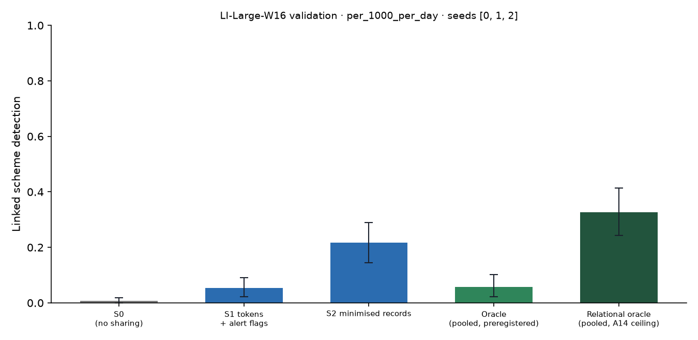

# X1 · sharing ladder on test · LI-Large-W16

> **Sealed test (week 18).** Every model trained on the training partition; every calibration, threshold, fusion and attribution parameter fitted on validation and frozen; test scored label-free, then opened once per seed through the logged seal (`finmesh sealed-log`). Wording below that says *validation* in a column or check name refers to the frozen rule; every number is on **test**.

Seeds [0, 1, 2]; primary budget per_1000_per_day; schemes detected within 12 windows; primary fusion **stacker** (A13); H1b ceiling **oracle-relational** (A14). Per-scheme outcomes are averaged over seeds before the scheme bootstrap. Total 3,423 s, peak memory 2,090 MB. S3 and PD sweeps: `x3_LI-Large-W16.md`; leakage audit: `audit_LI-Large-W16.md`.

## Linked detection per configuration (primary fusion)

| Configuration | Linked [95% CI] | Across members | Detected [95% CI] | Gain over S0 [95% CI] | p | AUPRC (mean) |
| --- | --- | --- | --- | --- | --- | --- |
| S0 (no sharing) | 0.0072 [0.0000, 0.0181] | 0.0000 | 0.4855 [0.3949, 0.5725] | — | — | 0.0345 |
| S1 tokens + alert flags | 0.0543 [0.0217, 0.0906] | 0.0507 | 0.4891 [0.3986, 0.5725] | 0.0471 [0.0145, 0.0870] | 0.0000 | 0.0340 |
| S2 minimised records | 0.2174 [0.1449, 0.2899] | 0.2138 | 0.4601 [0.3767, 0.5435] | 0.2101 [0.1377, 0.2827] | 0.0000 | 0.0358 |
| Oracle (pooled, preregistered) | 0.0580 [0.0217, 0.1014] | 0.0543 | 0.5435 [0.4529, 0.6341] | 0.0507 [0.0145, 0.0942] | 0.0060 | 0.0590 |
| Relational oracle (pooled, A14 ceiling) | 0.3261 [0.2428, 0.4131] | 0.2790 | 0.5362 [0.4457, 0.6304] | 0.3188 [0.2355, 0.4058] | 0.0000 | 0.0649 |

Random alerts at the same budget: detected —, linked —.

## H1b on test: share of the ceiling's gain recovered

(level − S0) / (ceiling − S0) in linked detection, scheme bootstrap. The relational oracle (pooled data with the same re-ranking, plaintext) is the ceiling from A14; the preregistered oracle is kept for comparison, and `strongest-pooled` uses whichever pooled relational configuration links more (—) as a sensitivity check. Target: at least 0.60 for S2, judged on test.

| Level | Against oracle-relational [95% CI] | Against oracle [95% CI] |
| --- | --- | --- |
| S1 | 0.1477 [0.0532, 0.2544] | 0.9286 [0.3636, 2.60] |
| S2 | 0.6591 [0.4830, 0.8205] | 4.14 [2.35, 12.00] |
| S4 | — | — |

## Secondary fusion rules

k-of-n uses only alert flags and noisy-OR only flags and the probability bucket, so their S2 and S4 rows coincide by construction.

| Level / rule | Linked | Detected | Gain over S0 | AUPRC (mean) |
| --- | --- | --- | --- | --- |

## Protocol per seed

Token evaluations are counted by the first level that needs them; later levels reuse the same tokens.

| Seed | Level | Requests | Answered: alert | Record, no alert | Refused | Accounts disclosed | LDP withheld | Max ε per account | Token evaluations | Seconds |
| --- | --- | --- | --- | --- | --- | --- | --- | --- | --- | --- |
| 0 | S1 | 316,048 | 5,737 | 0 | 761 | 0 | 0 | 0.0000 | 362,619 | 128.50 |
| 0 | S2 | 316,048 | 5,737 | 31,538 | 761 | 29,202 | 0 | 0.0000 | 0 | 52.50 |
| 1 | S1 | 877,650 | 5,004 | 0 | 674 | 0 | 0 | 0.0000 | 493,432 | 249.50 |
| 1 | S2 | 877,650 | 5,004 | 28,107 | 674 | 23,028 | 0 | 0.0000 | 0 | 145.10 |
| 2 | S1 | 1,156,790 | 7,966 | 0 | 918 | 0 | 0 | 0.0000 | 664,941 | 337.90 |
| 2 | S2 | 1,156,790 | 7,966 | 62,697 | 918 | 46,009 | 0 | 0.0000 | 0 | 193.70 |

## Time per seed

| Seed | s0 | oracle | autoencoders | val:s0_score | val:oracle_score | val:relational | val:records | val:propagation | test:s0_score | test:oracle_score | test:relational | test:records | test:propagation | test:evaluate | total |
| --- | --- | --- | --- | --- | --- | --- | --- | --- | --- | --- | --- | --- | --- | --- | --- |
| 0 | 23.90 | 19.30 | 21.90 | 9.40 | 10.60 | 9.00 | 6.40 | 0.5000 | 9.70 | 16.10 | 3.50 | 2.90 | 0.5000 | 470.90 | 914.60 |
| 1 | 15.60 | 21.10 | 20.40 | 8.70 | 15.20 | 4.40 | 6.30 | 0.5000 | 10.60 | 12.20 | 3.30 | 6.30 | 1.20 | 494.70 | 1,128.50 |
| 2 | 18.70 | 21.50 | 21.00 | 11.10 | 13.20 | 4.60 | 6.20 | 0.6000 | 11.80 | 13.50 | 5.70 | 7.00 | 1.10 | 497.10 | 1,378.80 |
