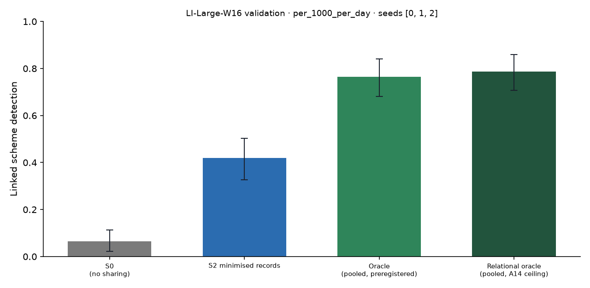

# X1 · sharing ladder on test · LI-Large-W16

> **Sealed test (week 18).** Every model trained on the training partition; every calibration, threshold, fusion and attribution parameter fitted on validation and frozen; test scored label-free, then opened once per seed through the logged seal (`finmesh sealed-log`). Wording below that says *validation* in a column or check name refers to the frozen rule; every number is on **test**.

Seeds [0, 1, 2]; primary budget per_1000_per_day; schemes detected within 12 windows; primary fusion **stacker** (A13); H1b ceiling **oracle-relational** (A14). Per-scheme outcomes are averaged over seeds before the scheme bootstrap. Total 5,990 s, peak memory 5,543 MB. S3 and PD sweeps: `x3_LI-Large-W16.md`; leakage audit: `audit_LI-Large-W16.md`.

## Linked detection per configuration (primary fusion)

| Configuration | Linked [95% CI] | Across members | Detected [95% CI] | Gain over S0 [95% CI] | p | AUPRC (mean) |
| --- | --- | --- | --- | --- | --- | --- |
| S0 (no sharing) | 0.0652 [0.0217, 0.1123] | 0.0000 | 0.7138 [0.6376, 0.7862] | — | — | 0.0440 |
| S2 minimised records | 0.4203 [0.3261, 0.5036] | 0.4094 | 0.6123 [0.5181, 0.6957] | 0.3551 [0.2464, 0.4530] | 0.0000 | 0.0515 |
| Oracle (pooled, preregistered) | 0.7645 [0.6811, 0.8406] | 0.6486 | 0.8659 [0.8043, 0.9203] | 0.6993 [0.6087, 0.7826] | 0.0000 | 0.0841 |
| Relational oracle (pooled, A14 ceiling) | 0.7862 [0.7065, 0.8587] | 0.6775 | 0.8623 [0.8043, 0.9130] | 0.7210 [0.6341, 0.8043] | 0.0000 | 0.0765 |

Random alerts at the same budget: detected —, linked —.

## H1b on test: share of the ceiling's gain recovered

(level − S0) / (ceiling − S0) in linked detection, scheme bootstrap. The relational oracle (pooled data with the same re-ranking, plaintext) is the ceiling from A14; the preregistered oracle is kept for comparison, and `strongest-pooled` uses whichever pooled relational configuration links more (—) as a sensitivity check. Target: at least 0.60 for S2, judged on test.

| Level | Against oracle-relational [95% CI] | Against oracle [95% CI] |
| --- | --- | --- |
| S1 | — | — |
| S2 | 0.4925 [0.3617, 0.6083] | 0.5078 [0.3743, 0.6279] |
| S4 | — | — |

## Secondary fusion rules

k-of-n uses only alert flags and noisy-OR only flags and the probability bucket, so their S2 and S4 rows coincide by construction.

| Level / rule | Linked | Detected | Gain over S0 | AUPRC (mean) |
| --- | --- | --- | --- | --- |

## Protocol per seed

Token evaluations are counted by the first level that needs them; later levels reuse the same tokens.

| Seed | Level | Requests | Answered: alert | Record, no alert | Refused | Accounts disclosed | LDP withheld | Max ε per account | Token evaluations | Seconds |
| --- | --- | --- | --- | --- | --- | --- | --- | --- | --- | --- |
| 0 | S2 | 472,752 | 5,504 | 110,281 | 1,061 | 77,276 | 0 | 0.0000 | 559,076 | 221.70 |
| 1 | S2 | 453,335 | 5,453 | 100,563 | 1,085 | 70,543 | 0 | 0.0000 | 530,836 | 204.60 |
| 2 | S2 | 521,004 | 5,384 | 130,169 | 1,098 | 88,008 | 0 | 0.0000 | 609,279 | 233.90 |

## Time per seed

| Seed | s0 | oracle | autoencoders | val:s0_score | val:oracle_score | val:relational | val:records | val:propagation | test:s0_score | test:oracle_score | test:relational | test:records | test:propagation | test:evaluate | total |
| --- | --- | --- | --- | --- | --- | --- | --- | --- | --- | --- | --- | --- | --- | --- | --- |
| 0 | 300.80 | 288.20 | 23.40 | 140.90 | 137.50 | 2.80 | 4.10 | 1.00 | 180.40 | 157.30 | 2.30 | 4.90 | 1.10 | 394.80 | 2,022.10 |
| 1 | 288.70 | 290.10 | 23.20 | 140.20 | 135.90 | 3.00 | 4.50 | 0.8000 | 182.10 | 150.00 | 2.00 | 4.50 | 0.7000 | 366.20 | 1,969.30 |
| 2 | 320.70 | 258.40 | 22.70 | 155.50 | 118.00 | 3.00 | 4.40 | 0.9000 | 161.60 | 166.30 | 2.00 | 4.70 | 0.8000 | 365.50 | 1,996.90 |
