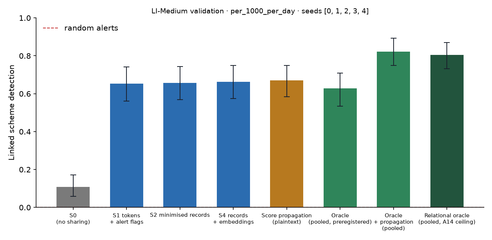

# X1 · sharing ladder on test · LI-Medium

> **Sealed test (week 18).** Every model trained on the training partition; every calibration, threshold, fusion and attribution parameter fitted on validation and frozen; test scored label-free, then opened once per seed through the logged seal (`finmesh sealed-log`). Wording below that says *validation* in a column or check name refers to the frozen rule; every number is on **test**.

Seeds [0, 1, 2, 3, 4]; primary budget per_1000_per_day; schemes detected within 12 windows; primary fusion **stacker** (A13); H1b ceiling **oracle-relational** (A14). Per-scheme outcomes are averaged over seeds before the scheme bootstrap. Total 15,624 s, peak memory 3,228 MB. S3 and PD sweeps: `x3_LI-Medium.md`; leakage audit: `audit_LI-Medium.md`.

## Linked detection per configuration (primary fusion)

| Configuration | Linked [95% CI] | Across members | Detected [95% CI] | Gain over S0 [95% CI] | p | AUPRC (mean) |
| --- | --- | --- | --- | --- | --- | --- |
| S0 (no sharing) | 0.1085 [0.0574, 0.1724] | 0.0000 | 0.8021 [0.7255, 0.8681] | — | — | 0.0566 |
| S1 tokens + alert flags | 0.6525 [0.5603, 0.7411] | 0.6348 | 0.7943 [0.7199, 0.8617] | 0.5496 [0.4504, 0.6348] | 0.0000 | 0.0736 |
| S2 minimised records | 0.6574 [0.5680, 0.7426] | 0.6489 | 0.7830 [0.7043, 0.8511] | 0.5489 [0.4489, 0.6340] | 0.0000 | 0.0835 |
| S4 records + embeddings | 0.6631 [0.5745, 0.7482] | 0.6596 | 0.8085 [0.7304, 0.8794] | 0.5603 [0.4574, 0.6525] | 0.0000 | 0.0827 |
| Score propagation (plaintext) | 0.6702 [0.5850, 0.7482] | 0.6454 | 0.8156 [0.7411, 0.8794] | 0.5674 [0.4716, 0.6560] | 0.0000 | 0.0797 |
| Oracle (pooled, preregistered) | 0.6277 [0.5340, 0.7086] | 0.6000 | 0.8957 [0.8255, 0.9489] | 0.5191 [0.4212, 0.6064] | 0.0000 | 0.0786 |
| Oracle + propagation (pooled) | 0.8227 [0.7482, 0.8936] | 0.7908 | 0.8865 [0.8191, 0.9397] | 0.7199 [0.6348, 0.7943] | 0.0000 | 0.1054 |
| Relational oracle (pooled, A14 ceiling) | 0.8043 [0.7319, 0.8702] | 0.7723 | 0.8872 [0.8213, 0.9383] | 0.6957 [0.6149, 0.7702] | 0.0000 | 0.1084 |

Random alerts at the same budget: detected 0.0074, linked 0.0000.

## H1b on test: share of the ceiling's gain recovered

(level − S0) / (ceiling − S0) in linked detection, scheme bootstrap. The relational oracle (pooled data with the same re-ranking, plaintext) is the ceiling from A14; the preregistered oracle is kept for comparison, and `strongest-pooled` uses whichever pooled relational configuration links more (oracle+propagation) as a sensitivity check. Target: at least 0.60 for S2, judged on test.

| Level | Against oracle-relational [95% CI] | Against oracle [95% CI] | Against strongest-pooled [95% CI] |
| --- | --- | --- | --- |
| S1 | 0.7711 [0.6745, 0.8543] | 1.05 [0.9183, 1.21] | 0.7635 [0.6651, 0.8454] |
| S2 | 0.7890 [0.6921, 0.8761] | 1.06 [0.9219, 1.23] | 0.7734 [0.6701, 0.8600] |
| S4 | 0.7861 [0.6862, 0.8786] | 1.07 [0.9231, 1.25] | 0.7783 [0.6750, 0.8670] |

## Secondary fusion rules

k-of-n uses only alert flags and noisy-OR only flags and the probability bucket, so their S2 and S4 rows coincide by construction.

| Level / rule | Linked | Detected | Gain over S0 | AUPRC (mean) |
| --- | --- | --- | --- | --- |
| S1/noisy_or | 0.5213 [0.4255, 0.6064] | 0.7908 [0.7092, 0.8617] | 0.4184 [0.3298, 0.4965] | 0.0566 |
| S1/kofn | 0.5106 [0.4149, 0.5993] | 0.7411 [0.6596, 0.8191] | 0.4078 [0.3014, 0.4965] | 0.0642 |
| S2/noisy_or | 0.6312 [0.5390, 0.7163] | 0.7908 [0.7162, 0.8582] | 0.5284 [0.4291, 0.6170] | 0.0763 |
| S2/kofn | 0.5106 [0.4149, 0.5993] | 0.7411 [0.6596, 0.8191] | 0.4078 [0.3014, 0.4965] | 0.0642 |
| S4/noisy_or | 0.6312 [0.5390, 0.7163] | 0.7908 [0.7162, 0.8582] | 0.5284 [0.4291, 0.6170] | 0.0763 |
| S4/kofn | 0.5106 [0.4149, 0.5993] | 0.7411 [0.6596, 0.8191] | 0.4078 [0.3014, 0.4965] | 0.0642 |

## Protocol per seed

Token evaluations are counted by the first level that needs them; later levels reuse the same tokens.

| Seed | Level | Requests | Answered: alert | Record, no alert | Refused | Accounts disclosed | LDP withheld | Max ε per account | Token evaluations | Seconds |
| --- | --- | --- | --- | --- | --- | --- | --- | --- | --- | --- |
| 0 | S1 | 500,715 | 7,745 | 0 | 911 | 0 | 0 | 0.0000 | 556,575 | 218.20 |
| 0 | S2 | 500,715 | 7,745 | 64,472 | 911 | 50,650 | 0 | 0.0000 | 0 | 95.00 |
| 0 | S4 | 500,715 | 7,745 | 64,472 | 911 | 50,650 | 0 | 0.0000 | 0 | 95.00 |
| 0 | S3[eps=0.5] | 500,715 | 7,745 | 492,059 | 911 | 50,650 | 0 | 2.50 | 0 | 122.00 |
| 0 | S3[eps=1] | 500,715 | 7,745 | 492,059 | 911 | 50,650 | 0 | 5.00 | 0 | 121.60 |
| 0 | S3[eps=2] | 500,715 | 7,745 | 492,059 | 911 | 50,650 | 2 | 8.00 | 0 | 123.20 |
| 0 | S3[eps=4] | 500,715 | 7,745 | 492,010 | 911 | 50,650 | 132 | 8.00 | 0 | 123.90 |
| 0 | S3[eps=8] | 500,715 | 7,745 | 488,164 | 911 | 49,156 | 4,764 | 8.00 | 0 | 130.50 |
| 0 | PD[tau=2] | 500,715 | 7,745 | 8,857 | 911 | 9,166 | 0 | 0.0000 | 0 | 93.50 |
| 0 | PD[tau=3] | 500,715 | 7,745 | 612 | 911 | 842 | 0 | 0.0000 | 0 | 93.70 |
| 0 | PD[tau=4] | 500,715 | 7,745 | 269 | 911 | 448 | 0 | 0.0000 | 0 | 92.70 |
| 1 | S1 | 497,468 | 7,174 | 0 | 936 | 0 | 0 | 0.0000 | 541,098 | 194.60 |
| 1 | S2 | 497,468 | 7,174 | 56,954 | 936 | 45,215 | 0 | 0.0000 | 0 | 82.70 |
| 1 | S4 | 497,468 | 7,174 | 56,954 | 936 | 45,215 | 0 | 0.0000 | 0 | 82.80 |
| 1 | S3[eps=0.5] | 497,468 | 7,174 | 489,358 | 936 | 45,215 | 0 | 2.50 | 0 | 106.10 |
| 1 | S3[eps=1] | 497,468 | 7,174 | 489,358 | 936 | 45,215 | 0 | 5.00 | 0 | 105.60 |
| 1 | S3[eps=2] | 497,468 | 7,174 | 489,358 | 936 | 45,215 | 4 | 8.00 | 0 | 105.40 |
| 1 | S3[eps=4] | 497,468 | 7,174 | 489,270 | 936 | 45,215 | 187 | 8.00 | 0 | 105.50 |
| 1 | S3[eps=8] | 497,468 | 7,174 | 485,681 | 936 | 43,717 | 4,531 | 8.00 | 0 | 105.50 |
| 1 | PD[tau=2] | 497,468 | 7,174 | 7,651 | 936 | 7,965 | 0 | 0.0000 | 0 | 80.60 |
| 1 | PD[tau=3] | 497,468 | 7,174 | 946 | 936 | 1,210 | 0 | 0.0000 | 0 | 79.60 |
| 1 | PD[tau=4] | 497,468 | 7,174 | 211 | 936 | 380 | 0 | 0.0000 | 0 | 79.50 |
| 2 | S1 | 478,177 | 6,968 | 0 | 900 | 0 | 0 | 0.0000 | 518,900 | 185.10 |
| 2 | S2 | 478,177 | 6,968 | 54,269 | 900 | 43,523 | 0 | 0.0000 | 0 | 78.70 |
| 2 | S4 | 478,177 | 6,968 | 54,269 | 900 | 43,523 | 0 | 0.0000 | 0 | 78.30 |
| 2 | S3[eps=0.5] | 478,177 | 6,968 | 470,309 | 900 | 43,523 | 0 | 2.50 | 0 | 101.20 |
| 2 | S3[eps=1] | 478,177 | 6,968 | 470,309 | 900 | 43,523 | 0 | 5.00 | 0 | 99.60 |
| 2 | S3[eps=2] | 478,177 | 6,968 | 470,309 | 900 | 43,523 | 3 | 8.00 | 0 | 100.30 |
| 2 | S3[eps=4] | 478,177 | 6,968 | 470,259 | 900 | 43,523 | 130 | 8.00 | 0 | 98.80 |
| 2 | S3[eps=8] | 478,177 | 6,968 | 466,916 | 900 | 42,120 | 4,225 | 8.00 | 0 | 99.80 |
| 2 | PD[tau=2] | 478,177 | 6,968 | 8,727 | 900 | 8,842 | 0 | 0.0000 | 0 | 76.20 |
| 2 | PD[tau=3] | 478,177 | 6,968 | 906 | 900 | 1,169 | 0 | 0.0000 | 0 | 76.30 |
| 2 | PD[tau=4] | 478,177 | 6,968 | 196 | 900 | 342 | 0 | 0.0000 | 0 | 75.80 |
| 3 | S2 | 536,912 | 7,356 | 68,674 | 938 | 52,376 | 0 | 0.0000 | 580,334 | 213.70 |
| 3 | PD[tau=2] | 536,912 | 7,356 | 7,540 | 938 | 7,863 | 0 | 0.0000 | 0 | 86.70 |
| 3 | PD[tau=3] | 536,912 | 7,356 | 702 | 938 | 939 | 0 | 0.0000 | 0 | 85.70 |
| 3 | PD[tau=4] | 536,912 | 7,356 | 262 | 938 | 412 | 0 | 0.0000 | 0 | 86.20 |
| 4 | S2 | 455,276 | 6,860 | 53,178 | 836 | 42,112 | 0 | 0.0000 | 505,922 | 183.30 |
| 4 | PD[tau=2] | 455,276 | 6,860 | 6,882 | 836 | 7,231 | 0 | 0.0000 | 0 | 73.80 |
| 4 | PD[tau=3] | 455,276 | 6,860 | 679 | 836 | 909 | 0 | 0.0000 | 0 | 72.80 |
| 4 | PD[tau=4] | 455,276 | 6,860 | 244 | 836 | 402 | 0 | 0.0000 | 0 | 72.80 |

## Time per seed

| Seed | s0 | oracle | autoencoders | val:s0_score | val:oracle_score | val:relational | val:records | val:propagation | val:x6_tables | test:s0_score | test:oracle_score | test:relational | test:records | test:propagation | test:evaluate | test:x6 | total |
| --- | --- | --- | --- | --- | --- | --- | --- | --- | --- | --- | --- | --- | --- | --- | --- | --- | --- |
| 0 | 11.00 | 37.80 | 23.90 | 3.70 | 20.30 | 2.60 | 3.00 | 0.3000 | 13.00 | 8.50 | 38.30 | 4.30 | 8.40 | 0.9000 | 2,285.20 | 20.00 | 4,576.20 |
| 1 | 15.50 | 37.20 | 17.80 | 5.00 | 19.70 | 3.30 | 3.50 | 0.4000 | 12.40 | 9.70 | 32.90 | 3.40 | 5.00 | 0.6000 | 2,279.00 | 28.50 | 4,074.60 |
| 2 | 18.00 | 26.80 | 17.60 | 5.10 | 11.60 | 3.10 | 4.20 | 0.4000 | 12.70 | 9.90 | 20.30 | 3.60 | 4.40 | 0.6000 | 2,272.00 | 31.30 | 3,965.80 |
| 3 | 15.30 | 31.80 | 18.20 | 4.20 | 14.50 | 3.40 | 4.80 | 0.4000 | — | 9.70 | 23.80 | 3.40 | 7.40 | 0.7000 | 743.40 | — | 1,562.50 |
| 4 | 14.50 | 29.20 | 18.20 | 5.30 | 14.30 | 4.40 | 5.50 | 0.4000 | — | 10.50 | 24.30 | 3.10 | 3.90 | 0.7000 | 726.90 | — | 1,443.00 |
