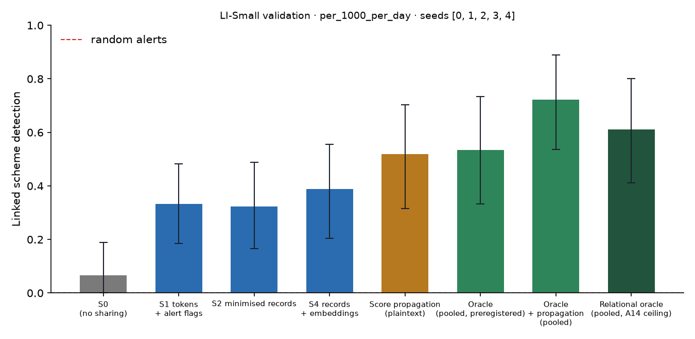

# X1 · sharing ladder on test · LI-Small

> **Sealed test (week 18).** Every model trained on the training partition; every calibration, threshold, fusion and attribution parameter fitted on validation and frozen; test scored label-free, then opened once per seed through the logged seal (`finmesh sealed-log`). Wording below that says *validation* in a column or check name refers to the frozen rule; every number is on **test**.

Seeds [0, 1, 2, 3, 4]; primary budget per_1000_per_day; schemes detected within 12 windows; primary fusion **stacker** (A13); H1b ceiling **oracle-relational** (A14). Per-scheme outcomes are averaged over seeds before the scheme bootstrap. Total 3,774 s, peak memory 947 MB. S3 and PD sweeps: `x3_LI-Small.md`; leakage audit: `audit_LI-Small.md`.

## Linked detection per configuration (primary fusion)

| Configuration | Linked [95% CI] | Across members | Detected [95% CI] | Gain over S0 [95% CI] | p | AUPRC (mean) |
| --- | --- | --- | --- | --- | --- | --- |
| S0 (no sharing) | 0.0667 [0.0000, 0.1889] | 0.0000 | 0.6333 [0.4333, 0.8111] | — | — | 0.0169 |
| S1 tokens + alert flags | 0.3333 [0.1852, 0.4815] | 0.3333 | 0.5185 [0.3148, 0.7222] | 0.2778 [0.1111, 0.4444] | 0.0000 | 0.0216 |
| S2 minimised records | 0.3222 [0.1667, 0.4889] | 0.3222 | 0.6000 [0.3997, 0.7889] | 0.2556 [0.1111, 0.4000] | 0.0000 | 0.0219 |
| S4 records + embeddings | 0.3889 [0.2037, 0.5556] | 0.3889 | 0.6667 [0.4630, 0.8519] | 0.3333 [0.1667, 0.5185] | 0.0000 | 0.0254 |
| Score propagation (plaintext) | 0.5185 [0.3148, 0.7037] | 0.5185 | 0.6111 [0.4074, 0.7968] | 0.4630 [0.2593, 0.6667] | 0.0000 | 0.0244 |
| Oracle (pooled, preregistered) | 0.5333 [0.3333, 0.7333] | 0.5333 | 0.8111 [0.6111, 0.9778] | 0.4667 [0.2553, 0.6778] | 0.0000 | 0.0536 |
| Oracle + propagation (pooled) | 0.7222 [0.5366, 0.8889] | 0.7037 | 0.7963 [0.6111, 0.9444] | 0.6667 [0.4630, 0.8519] | 0.0000 | 0.0559 |
| Relational oracle (pooled, A14 ceiling) | 0.6111 [0.4108, 0.8000] | 0.6000 | 0.7667 [0.5778, 0.9333] | 0.5444 [0.3442, 0.7556] | 0.0000 | 0.0505 |

Random alerts at the same budget: detected 0.0092, linked 0.0000.

## H1b on test: share of the ceiling's gain recovered

(level − S0) / (ceiling − S0) in linked detection, scheme bootstrap. The relational oracle (pooled data with the same re-ranking, plaintext) is the ceiling from A14; the preregistered oracle is kept for comparison, and `strongest-pooled` uses whichever pooled relational configuration links more (oracle+propagation) as a sensitivity check. Target: at least 0.60 for S2, judged on test.

| Level | Against oracle-relational [95% CI] | Against oracle [95% CI] | Against strongest-pooled [95% CI] |
| --- | --- | --- | --- |
| S1 | 0.5357 [0.2647, 0.8802] | 0.6000 [0.3043, 0.9500] | 0.4167 [0.1891, 0.6669] |
| S2 | 0.4694 [0.2439, 0.7037] | 0.5476 [0.2917, 0.8149] | 0.4167 [0.2092, 0.6334] |
| S4 | 0.6429 [0.3611, 0.9501] | 0.7200 [0.4074, 1.07] | 0.5000 [0.2647, 0.7429] |

## Secondary fusion rules

k-of-n uses only alert flags and noisy-OR only flags and the probability bucket, so their S2 and S4 rows coincide by construction.

| Level / rule | Linked | Detected | Gain over S0 | AUPRC (mean) |
| --- | --- | --- | --- | --- |
| S1/noisy_or | 0.2593 [0.0926, 0.4444] | 0.6852 [0.4815, 0.8523] | 0.2037 [0.0556, 0.3704] | 0.0176 |
| S1/kofn | 0.2778 [0.1111, 0.4449] | 0.5556 [0.3333, 0.7593] | 0.2222 [0.0551, 0.3894] | 0.0230 |
| S2/noisy_or | 0.5000 [0.2963, 0.6856] | 0.5370 [0.3333, 0.7407] | 0.4444 [0.2407, 0.6481] | 0.0218 |
| S2/kofn | 0.2778 [0.1111, 0.4449] | 0.5556 [0.3333, 0.7593] | 0.2222 [0.0551, 0.3894] | 0.0230 |
| S4/noisy_or | 0.5000 [0.2963, 0.6856] | 0.5370 [0.3333, 0.7407] | 0.4444 [0.2407, 0.6481] | 0.0218 |
| S4/kofn | 0.2778 [0.1111, 0.4449] | 0.5556 [0.3333, 0.7593] | 0.2222 [0.0551, 0.3894] | 0.0230 |

## Protocol per seed

Token evaluations are counted by the first level that needs them; later levels reuse the same tokens.

| Seed | Level | Requests | Answered: alert | Record, no alert | Refused | Accounts disclosed | LDP withheld | Max ε per account | Token evaluations | Seconds |
| --- | --- | --- | --- | --- | --- | --- | --- | --- | --- | --- |
| 0 | S1 | 109,734 | 1,714 | 0 | 202 | 0 | 0 | 0.0000 | 159,647 | 54.70 |
| 0 | S2 | 109,734 | 1,714 | 40,115 | 202 | 34,910 | 0 | 0.0000 | 0 | 21.70 |
| 0 | S4 | 109,734 | 1,714 | 40,115 | 202 | 34,910 | 0 | 0.0000 | 0 | 22.20 |
| 0 | S3[eps=0.5] | 109,734 | 1,714 | 107,818 | 202 | 34,910 | 0 | 3.00 | 0 | 27.20 |
| 0 | S3[eps=1] | 109,734 | 1,714 | 107,818 | 202 | 34,910 | 0 | 6.00 | 0 | 27.00 |
| 0 | S3[eps=2] | 109,734 | 1,714 | 107,817 | 202 | 34,910 | 5 | 8.00 | 0 | 27.40 |
| 0 | S3[eps=4] | 109,734 | 1,714 | 107,750 | 202 | 34,910 | 98 | 8.00 | 0 | 28.20 |
| 0 | S3[eps=8] | 109,734 | 1,714 | 105,609 | 202 | 34,001 | 2,482 | 8.00 | 0 | 27.70 |
| 0 | PD[tau=2] | 109,734 | 1,714 | 5,312 | 202 | 5,341 | 0 | 0.0000 | 0 | 20.60 |
| 0 | PD[tau=3] | 109,734 | 1,714 | 375 | 202 | 390 | 0 | 0.0000 | 0 | 20.50 |
| 0 | PD[tau=4] | 109,734 | 1,714 | 59 | 202 | 63 | 0 | 0.0000 | 0 | 19.80 |
| 1 | S1 | 110,484 | 1,519 | 0 | 208 | 0 | 0 | 0.0000 | 156,612 | 66.30 |
| 1 | S2 | 110,484 | 1,519 | 40,538 | 208 | 34,945 | 0 | 0.0000 | 0 | 24.50 |
| 1 | S4 | 110,484 | 1,519 | 40,538 | 208 | 34,945 | 0 | 0.0000 | 0 | 23.50 |
| 1 | S3[eps=0.5] | 110,484 | 1,519 | 108,757 | 208 | 34,945 | 0 | 3.00 | 0 | 29.50 |
| 1 | S3[eps=1] | 110,484 | 1,519 | 108,757 | 208 | 34,945 | 0 | 6.00 | 0 | 28.30 |
| 1 | S3[eps=2] | 110,484 | 1,519 | 108,757 | 208 | 34,945 | 4 | 8.00 | 0 | 28.80 |
| 1 | S3[eps=4] | 110,484 | 1,519 | 108,659 | 208 | 34,945 | 119 | 8.00 | 0 | 27.10 |
| 1 | S3[eps=8] | 110,484 | 1,519 | 106,350 | 208 | 34,058 | 2,626 | 8.00 | 0 | 28.30 |
| 1 | PD[tau=2] | 110,484 | 1,519 | 11,007 | 208 | 10,902 | 0 | 0.0000 | 0 | 21.30 |
| 1 | PD[tau=3] | 110,484 | 1,519 | 212 | 208 | 228 | 0 | 0.0000 | 0 | 20.70 |
| 1 | PD[tau=4] | 110,484 | 1,519 | 49 | 208 | 53 | 0 | 0.0000 | 0 | 21.00 |
| 2 | S1 | 101,323 | 1,383 | 0 | 180 | 0 | 0 | 0.0000 | 147,069 | 50.60 |
| 2 | S2 | 101,323 | 1,383 | 36,880 | 180 | 31,513 | 0 | 0.0000 | 0 | 20.70 |
| 2 | S4 | 101,323 | 1,383 | 36,880 | 180 | 31,513 | 0 | 0.0000 | 0 | 21.00 |
| 2 | S3[eps=0.5] | 101,323 | 1,383 | 99,760 | 180 | 31,513 | 0 | 2.50 | 0 | 24.70 |
| 2 | S3[eps=1] | 101,323 | 1,383 | 99,760 | 180 | 31,513 | 0 | 5.00 | 0 | 24.70 |
| 2 | S3[eps=2] | 101,323 | 1,383 | 99,759 | 180 | 31,513 | 1 | 8.00 | 0 | 25.00 |
| 2 | S3[eps=4] | 101,323 | 1,383 | 99,690 | 180 | 31,513 | 90 | 8.00 | 0 | 25.20 |
| 2 | S3[eps=8] | 101,323 | 1,383 | 97,566 | 180 | 30,740 | 2,390 | 8.00 | 0 | 24.60 |
| 2 | PD[tau=2] | 101,323 | 1,383 | 6,320 | 180 | 6,264 | 0 | 0.0000 | 0 | 18.70 |
| 2 | PD[tau=3] | 101,323 | 1,383 | 432 | 180 | 457 | 0 | 0.0000 | 0 | 18.70 |
| 2 | PD[tau=4] | 101,323 | 1,383 | 111 | 180 | 117 | 0 | 0.0000 | 0 | 18.60 |
| 3 | S2 | 156,031 | 1,743 | 43,791 | 233 | 35,860 | 0 | 0.0000 | 173,709 | 67.80 |
| 3 | PD[tau=2] | 156,031 | 1,743 | 5,030 | 233 | 4,983 | 0 | 0.0000 | 0 | 28.80 |
| 3 | PD[tau=3] | 156,031 | 1,743 | 504 | 233 | 519 | 0 | 0.0000 | 0 | 28.30 |
| 3 | PD[tau=4] | 156,031 | 1,743 | 215 | 233 | 233 | 0 | 0.0000 | 0 | 28.40 |
| 4 | S2 | 134,506 | 1,638 | 52,408 | 216 | 43,840 | 0 | 0.0000 | 183,909 | 68.00 |
| 4 | PD[tau=2] | 134,506 | 1,638 | 8,417 | 216 | 8,374 | 0 | 0.0000 | 0 | 25.60 |
| 4 | PD[tau=3] | 134,506 | 1,638 | 454 | 216 | 469 | 0 | 0.0000 | 0 | 24.90 |
| 4 | PD[tau=4] | 134,506 | 1,638 | 30 | 216 | 29 | 0 | 0.0000 | 0 | 25.00 |

## Time per seed

| Seed | s0 | oracle | autoencoders | val:s0_score | val:oracle_score | val:relational | val:records | val:propagation | test:s0_score | test:oracle_score | test:relational | test:records | test:propagation | test:evaluate | total |
| --- | --- | --- | --- | --- | --- | --- | --- | --- | --- | --- | --- | --- | --- | --- | --- |
| 0 | 3.80 | 2.50 | 10.20 | 1.70 | 1.90 | 0.8000 | 0.9000 | 0.1000 | 2.20 | 1.70 | 0.8000 | 1.30 | 0.2000 | 481.30 | 1,011.90 |
| 1 | 3.30 | 2.50 | 10.90 | 1.50 | 1.40 | 0.6000 | 1.00 | 0.1000 | 2.00 | 1.60 | 0.8000 | 1.50 | 0.2000 | 496.80 | 1,035.50 |
| 2 | 3.60 | 2.90 | 9.50 | 1.70 | 2.30 | 0.6000 | 0.8000 | 0.1000 | 1.80 | 2.10 | 0.8000 | 1.30 | 0.2000 | 454.90 | 933.30 |
| 3 | 3.70 | 2.50 | 9.50 | 1.60 | 1.90 | 0.7000 | 0.9000 | 0.1000 | 1.70 | 1.80 | 0.7000 | 1.20 | 0.2000 | 147.70 | 401.90 |
| 4 | 2.90 | 3.20 | 9.60 | 1.40 | 2.60 | 0.6000 | 0.9000 | 0.1000 | 1.40 | 3.10 | 0.7000 | 1.10 | 0.2000 | 142.50 | 390.50 |
