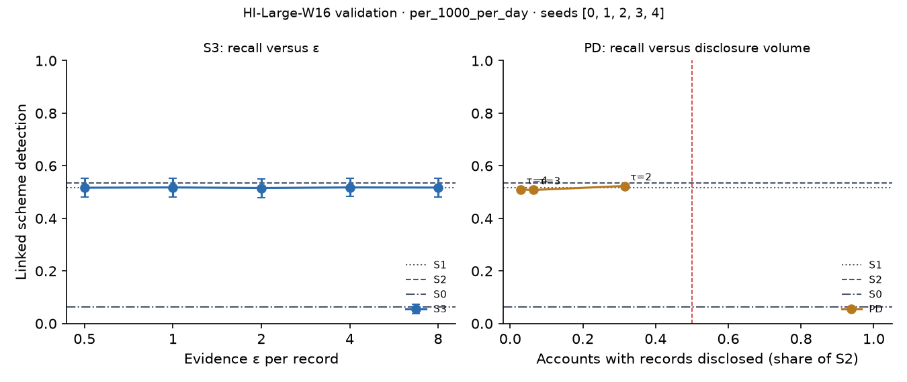

# X3 · evidence-channel privacy on test · HI-Large-W16

> **Sealed test (week 18).** Every model trained on the training partition; every calibration, threshold, fusion and attribution parameter fitted on validation and frozen; test scored label-free, then opened once per seed through the logged seal (`finmesh sealed-log`). Wording below that says *validation* in a column or check name refers to the frozen rule; every number is on **test**.

Seeds [0, 1, 2, 3, 4]; primary budget per_1000_per_day; primary fusion stacker, fitted on evidence released through the same mechanism. S3: every record field but the time bucket and alert flag through k-ary randomised response at ε / 20 per field, memoised per record, at most ε = 8 per account and epoch (over budget: the S1 answer). PD: the S1 answer, plus the S2 record when the requester's score bucket is at least τ.

## S3: recall versus ε

| ε per record | Linked [95% CI] | Gain over S0 | Share of relational-oracle gain | Records withheld (budget), mean per seed | Max ε spent on one account |
| --- | --- | --- | --- | --- | --- |
| 0.5000 | 0.5167 [0.4812, 0.5516] | 0.4522 [0.4140, 0.4914] | 0.8975 [0.8475, 0.9453] | 0.0000 | 3.50 |
| 1.00 | 0.5177 [0.4812, 0.5532] | 0.4532 [0.4145, 0.4925] | 0.8997 [0.8484, 0.9466] | 0.0000 | 7.00 |
| 2.00 | 0.5156 [0.4790, 0.5506] | 0.4511 [0.4124, 0.4898] | 0.8954 [0.8451, 0.9424] | 63.00 | 8.00 |
| 4.00 | 0.5177 [0.4828, 0.5527] | 0.4532 [0.4151, 0.4914] | 0.8997 [0.8482, 0.9492] | 1,080.60 | 8.00 |
| 8.00 | 0.5172 [0.4812, 0.5516] | 0.4527 [0.4150, 0.4919] | 0.8986 [0.8502, 0.9483] | 10,757.00 | 8.00 |

## PD: recall versus disclosure volume (H1d)

H1d: at least 0.80 of S2's gain over S0 with records disclosed on fewer than half as many accounts as S2. Decided here, on test.

| τ (requester bucket) | Linked [95% CI] | Share of S2 gain [95% CI] | Accounts disclosed, share of S2 | Accounts disclosed (mean) | H1d met on test |
| --- | --- | --- | --- | --- | --- |
| 2.00 | 0.5232 [0.4868, 0.5587] | 0.9767 [0.9493, 1.01] | 0.3154 | 33,847.40 | yes |
| 3.00 | 0.5081 [0.4719, 0.5426] | 0.9445 [0.9138, 0.9778] | 0.0647 | 6,935.20 | yes |
| 4.00 | 0.5097 [0.4752, 0.5442] | 0.9479 [0.9205, 0.9769] | 0.0293 | 3,143.00 | yes |

Reference: S1, which discloses no record, reaches 0.9524 [0.9223, 0.9824] of S2's gain. When this is itself at least 0.80, H1d holds for any τ and says little about disclosure; the informative comparison is then PD against S1.
