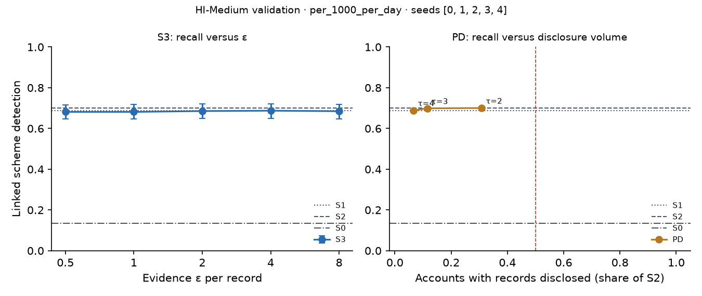

# X3 · evidence-channel privacy on test · HI-Medium

> **Sealed test (week 18).** Every model trained on the training partition; every calibration, threshold, fusion and attribution parameter fitted on validation and frozen; test scored label-free, then opened once per seed through the logged seal (`finmesh sealed-log`). Wording below that says *validation* in a column or check name refers to the frozen rule; every number is on **test**.

Seeds [0, 1, 2, 3, 4]; primary budget per_1000_per_day; primary fusion stacker, fitted on evidence released through the same mechanism. S3: every record field but the time bucket and alert flag through k-ary randomised response at ε / 20 per field, memoised per record, at most ε = 8 per account and epoch (over budget: the S1 answer). PD: the S1 answer, plus the S2 record when the requester's score bucket is at least τ.

## S3: recall versus ε

| ε per record | Linked [95% CI] | Gain over S0 | Share of relational-oracle gain | Records withheld (budget), mean per seed | Max ε spent on one account |
| --- | --- | --- | --- | --- | --- |
| 0.5000 | 0.6813 [0.6466, 0.7160] | 0.5447 [0.5040, 0.5867] | 0.9412 [0.8943, 0.9907] | 0.0000 | 4.00 |
| 1.00 | 0.6813 [0.6466, 0.7173] | 0.5447 [0.5046, 0.5867] | 0.9412 [0.8952, 0.9895] | 0.0000 | 8.00 |
| 2.00 | 0.6853 [0.6506, 0.7207] | 0.5487 [0.5093, 0.5900] | 0.9482 [0.9037, 0.9956] | 105.80 | 8.00 |
| 4.00 | 0.6873 [0.6507, 0.7213] | 0.5507 [0.5106, 0.5933] | 0.9516 [0.9042, 1.00] | 1,555.40 | 8.00 |
| 8.00 | 0.6847 [0.6480, 0.7187] | 0.5480 [0.5066, 0.5893] | 0.9470 [0.9014, 0.9932] | 14,952.60 | 8.00 |

## PD: recall versus disclosure volume (H1d)

H1d: at least 0.80 of S2's gain over S0 with records disclosed on fewer than half as many accounts as S2. Decided here, on test.

| τ (requester bucket) | Linked [95% CI] | Share of S2 gain [95% CI] | Accounts disclosed, share of S2 | Accounts disclosed (mean) | H1d met on test |
| --- | --- | --- | --- | --- | --- |
| 2.00 | 0.7004 [0.6656, 0.7336] | 0.9979 [0.9824, 1.01] | 0.3078 | 19,847.80 | yes |
| 3.00 | 0.6988 [0.6656, 0.7324] | 0.9951 [0.9752, 1.02] | 0.1150 | 7,390.40 | yes |
| 4.00 | 0.6888 [0.6548, 0.7240] | 0.9774 [0.9596, 0.9949] | 0.0666 | 4,276.60 | yes |

Reference: S1, which discloses no record, reaches 0.9799 [0.9578, 1.00] of S2's gain. When this is itself at least 0.80, H1d holds for any τ and says little about disclosure; the informative comparison is then PD against S1.
