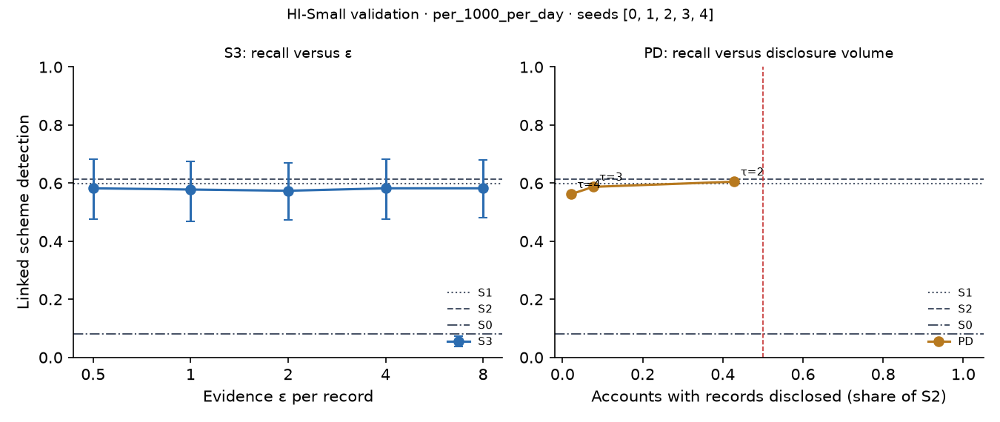

# X3 · evidence-channel privacy on test · HI-Small

> **Sealed test (week 18).** Every model trained on the training partition; every calibration, threshold, fusion and attribution parameter fitted on validation and frozen; test scored label-free, then opened once per seed through the logged seal (`finmesh sealed-log`). Wording below that says *validation* in a column or check name refers to the frozen rule; every number is on **test**.

Seeds [0, 1, 2, 3, 4]; primary budget per_1000_per_day; primary fusion stacker, fitted on evidence released through the same mechanism. S3: every record field but the time bucket and alert flag through k-ary randomised response at ε / 20 per field, memoised per record, at most ε = 8 per account and epoch (over budget: the S1 answer). PD: the S1 answer, plus the S2 record when the requester's score bucket is at least τ.

## S3: recall versus ε

| ε per record | Linked [95% CI] | Gain over S0 | Share of relational-oracle gain | Records withheld (budget), mean per seed | Max ε spent on one account |
| --- | --- | --- | --- | --- | --- |
| 0.5000 | 0.5823 [0.4768, 0.6835] | 0.4979 [0.3840, 0.6035] | 0.8252 [0.7132, 0.9281] | 0.0000 | 3.50 |
| 1.00 | 0.5781 [0.4684, 0.6751] | 0.4937 [0.3797, 0.5993] | 0.8182 [0.7092, 0.9207] | 0.0000 | 7.00 |
| 2.00 | 0.5738 [0.4725, 0.6709] | 0.4895 [0.3755, 0.5949] | 0.8112 [0.7007, 0.9156] | 16.40 | 8.00 |
| 4.00 | 0.5823 [0.4768, 0.6836] | 0.4979 [0.3840, 0.6034] | 0.8252 [0.7185, 0.9313] | 169.60 | 8.00 |
| 8.00 | 0.5823 [0.4810, 0.6794] | 0.4979 [0.3797, 0.6035] | 0.8252 [0.7143, 0.9254] | 2,322.80 | 8.00 |

## PD: recall versus disclosure volume (H1d)

H1d: at least 0.80 of S2's gain over S0 with records disclosed on fewer than half as many accounts as S2. Decided here, on test.

| τ (requester bucket) | Linked [95% CI] | Share of S2 gain [95% CI] | Accounts disclosed, share of S2 | Accounts disclosed (mean) | H1d met on test |
| --- | --- | --- | --- | --- | --- |
| 2.00 | 0.6051 [0.5114, 0.7038] | 0.9857 [0.9350, 1.04] | 0.4289 | 16,021.20 | yes |
| 3.00 | 0.5873 [0.4911, 0.6886] | 0.9524 [0.8705, 1.05] | 0.0765 | 2,837.40 | yes |
| 4.00 | 0.5620 [0.4684, 0.6557] | 0.9048 [0.8235, 0.9950] | 0.0214 | 797.20 | yes |

Reference: S1, which discloses no record, reaches 0.9457 [0.8499, 1.05] of S2's gain. When this is itself at least 0.80, H1d holds for any τ and says little about disclosure; the informative comparison is then PD against S1.
