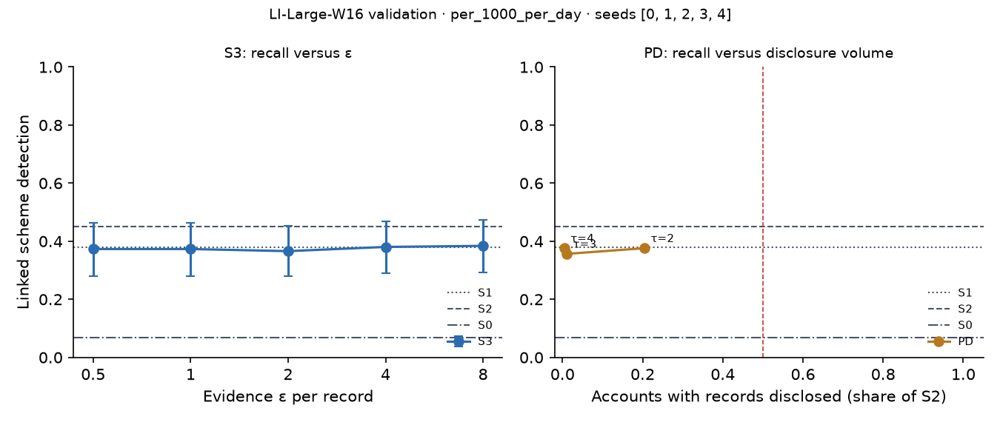

# X3 · evidence-channel privacy on test · LI-Large-W16

> **Sealed test (week 18).** Every model trained on the training partition; every calibration, threshold, fusion and attribution parameter fitted on validation and frozen; test scored label-free, then opened once per seed through the logged seal (`finmesh sealed-log`). Wording below that says *validation* in a column or check name refers to the frozen rule; every number is on **test**.

Seeds [0, 1, 2, 3, 4]; primary budget per_1000_per_day; primary fusion stacker, fitted on evidence released through the same mechanism. S3: every record field but the time bucket and alert flag through k-ary randomised response at ε / 20 per field, memoised per record, at most ε = 8 per account and epoch (over budget: the S1 answer). PD: the S1 answer, plus the S2 record when the requester's score bucket is at least τ.

## S3: recall versus ε

| ε per record | Linked [95% CI] | Gain over S0 | Share of relational-oracle gain | Records withheld (budget), mean per seed | Max ε spent on one account |
| --- | --- | --- | --- | --- | --- |
| 0.5000 | 0.3732 [0.2790, 0.4638] | 0.3080 [0.2174, 0.3949] | 0.5215 [0.3957, 0.6439] | 0.0000 | 2.00 |
| 1.00 | 0.3732 [0.2790, 0.4638] | 0.3080 [0.2174, 0.3949] | 0.5215 [0.3957, 0.6439] | 0.0000 | 4.00 |
| 2.00 | 0.3659 [0.2789, 0.4529] | 0.3007 [0.2101, 0.3877] | 0.5092 [0.3832, 0.6330] | 0.0000 | 8.00 |
| 4.00 | 0.3804 [0.2899, 0.4674] | 0.3152 [0.2283, 0.4022] | 0.5337 [0.4048, 0.6667] | 181.80 | 8.00 |
| 8.00 | 0.3841 [0.2935, 0.4746] | 0.3188 [0.2283, 0.4094] | 0.5399 [0.4047, 0.6734] | 4,817.60 | 8.00 |

## PD: recall versus disclosure volume (H1d)

H1d: at least 0.80 of S2's gain over S0 with records disclosed on fewer than half as many accounts as S2. Decided here, on test.

| τ (requester bucket) | Linked [95% CI] | Share of S2 gain [95% CI] | Accounts disclosed, share of S2 | Accounts disclosed (mean) | H1d met on test |
| --- | --- | --- | --- | --- | --- |
| 2.00 | 0.3761 [0.2891, 0.4587] | 0.8068 [0.6667, 0.9421] | 0.2047 | 15,015.20 | yes |
| 3.00 | 0.3565 [0.2696, 0.4326] | 0.7557 [0.6176, 0.8831] | 0.0110 | 806.20 | no |
| 4.00 | 0.3761 [0.2891, 0.4565] | 0.8068 [0.6685, 0.9480] | 0.0048 | 353.60 | yes |

Reference: S1, which discloses no record, reaches 0.7838 [0.6428, 0.9221] of S2's gain. When this is itself at least 0.80, H1d holds for any τ and says little about disclosure; the informative comparison is then PD against S1.
