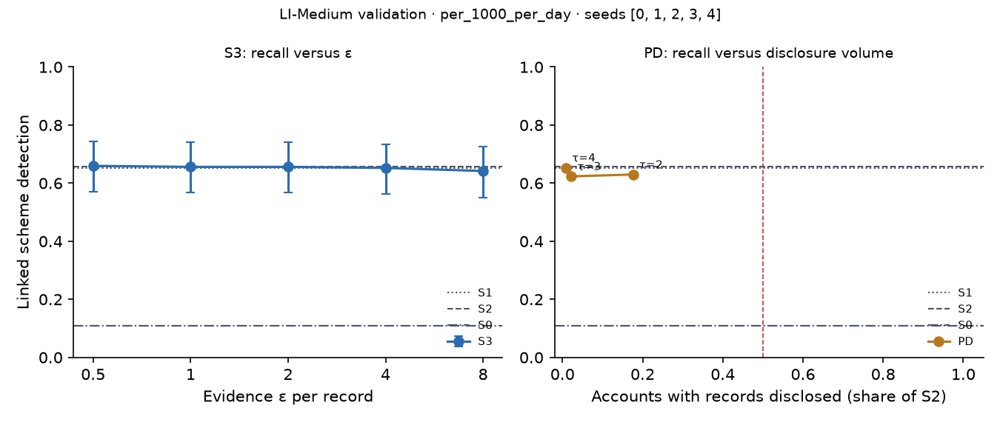

# X3 · evidence-channel privacy on test · LI-Medium

> **Sealed test (week 18).** Every model trained on the training partition; every calibration, threshold, fusion and attribution parameter fitted on validation and frozen; test scored label-free, then opened once per seed through the logged seal (`finmesh sealed-log`). Wording below that says *validation* in a column or check name refers to the frozen rule; every number is on **test**.

Seeds [0, 1, 2, 3, 4]; primary budget per_1000_per_day; primary fusion stacker, fitted on evidence released through the same mechanism. S3: every record field but the time bucket and alert flag through k-ary randomised response at ε / 20 per field, memoised per record, at most ε = 8 per account and epoch (over budget: the S1 answer). PD: the S1 answer, plus the S2 record when the requester's score bucket is at least τ.

## S3: recall versus ε

| ε per record | Linked [95% CI] | Gain over S0 | Share of relational-oracle gain | Records withheld (budget), mean per seed | Max ε spent on one account |
| --- | --- | --- | --- | --- | --- |
| 0.5000 | 0.6596 [0.5708, 0.7447] | 0.5567 [0.4610, 0.6383] | 0.7811 [0.6878, 0.8674] | 0.0000 | 2.50 |
| 1.00 | 0.6560 [0.5674, 0.7411] | 0.5532 [0.4574, 0.6348] | 0.7761 [0.6832, 0.8628] | 0.0000 | 5.00 |
| 2.00 | 0.6560 [0.5674, 0.7411] | 0.5532 [0.4574, 0.6348] | 0.7761 [0.6818, 0.8586] | 1.80 | 8.00 |
| 4.00 | 0.6525 [0.5637, 0.7341] | 0.5496 [0.4504, 0.6348] | 0.7711 [0.6732, 0.8558] | 89.80 | 8.00 |
| 8.00 | 0.6418 [0.5496, 0.7270] | 0.5390 [0.4362, 0.6241] | 0.7562 [0.6590, 0.8451] | 2,704.00 | 8.00 |

## PD: recall versus disclosure volume (H1d)

H1d: at least 0.80 of S2's gain over S0 with records disclosed on fewer than half as many accounts as S2. Decided here, on test.

| τ (requester bucket) | Linked [95% CI] | Share of S2 gain [95% CI] | Accounts disclosed, share of S2 | Accounts disclosed (mean) | H1d met on test |
| --- | --- | --- | --- | --- | --- |
| 2.00 | 0.6298 [0.5404, 0.7149] | 0.9496 [0.9091, 0.9821] | 0.1764 | 8,213.40 | yes |
| 3.00 | 0.6234 [0.5404, 0.7021] | 0.9380 [0.8788, 0.9921] | 0.0220 | 1,013.80 | yes |
| 4.00 | 0.6532 [0.5660, 0.7362] | 0.9922 [0.9540, 1.03] | 0.0085 | 396.80 | yes |

Reference: S1, which discloses no record, reaches 0.9873 [0.9317, 1.05] of S2's gain. When this is itself at least 0.80, H1d holds for any τ and says little about disclosure; the informative comparison is then PD against S1.
