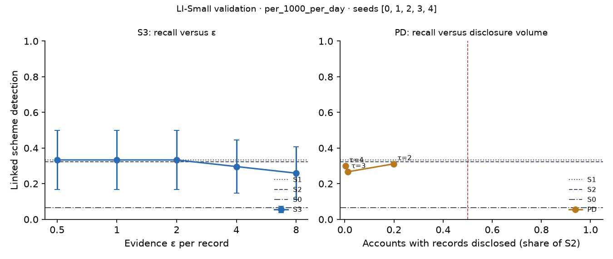

# X3 · evidence-channel privacy on test · LI-Small

> **Sealed test (week 18).** Every model trained on the training partition; every calibration, threshold, fusion and attribution parameter fitted on validation and frozen; test scored label-free, then opened once per seed through the logged seal (`finmesh sealed-log`). Wording below that says *validation* in a column or check name refers to the frozen rule; every number is on **test**.

Seeds [0, 1, 2, 3, 4]; primary budget per_1000_per_day; primary fusion stacker, fitted on evidence released through the same mechanism. S3: every record field but the time bucket and alert flag through k-ary randomised response at ε / 20 per field, memoised per record, at most ε = 8 per account and epoch (over budget: the S1 answer). PD: the S1 answer, plus the S2 record when the requester's score bucket is at least τ.

## S3: recall versus ε

| ε per record | Linked [95% CI] | Gain over S0 | Share of relational-oracle gain | Records withheld (budget), mean per seed | Max ε spent on one account |
| --- | --- | --- | --- | --- | --- |
| 0.5000 | 0.3333 [0.1667, 0.5000] | 0.2778 [0.1111, 0.4630] | 0.5357 [0.2353, 0.9584] | 0.0000 | 3.00 |
| 1.00 | 0.3333 [0.1667, 0.5000] | 0.2778 [0.1111, 0.4630] | 0.5357 [0.2353, 0.9584] | 0.0000 | 6.00 |
| 2.00 | 0.3333 [0.1667, 0.5000] | 0.2778 [0.1111, 0.4630] | 0.5357 [0.2353, 0.9584] | 2.00 | 8.00 |
| 4.00 | 0.2963 [0.1481, 0.4444] | 0.2407 [0.0741, 0.4074] | 0.4643 [0.1875, 0.7827] | 61.40 | 8.00 |
| 8.00 | 0.2593 [0.1111, 0.4074] | 0.2037 [0.0556, 0.3519] | 0.3929 [0.1429, 0.6072] | 1,499.60 | 8.00 |

## PD: recall versus disclosure volume (H1d)

H1d: at least 0.80 of S2's gain over S0 with records disclosed on fewer than half as many accounts as S2. Decided here, on test.

| τ (requester bucket) | Linked [95% CI] | Share of S2 gain [95% CI] | Accounts disclosed, share of S2 | Accounts disclosed (mean) | H1d met on test |
| --- | --- | --- | --- | --- | --- |
| 2.00 | 0.3111 [0.1667, 0.4667] | 0.9565 [0.7500, 1.11] | 0.1987 | 7,172.80 | yes |
| 3.00 | 0.2667 [0.1333, 0.4111] | 0.7826 [0.4781, 1.00] | 0.0115 | 412.60 | no |
| 4.00 | 0.3000 [0.1556, 0.4447] | 0.9130 [0.6667, 1.14] | 0.0028 | 99.00 | yes |

Reference: S1, which discloses no record, reaches 1.00 [0.7000, 1.31] of S2's gain. When this is itself at least 0.80, H1d holds for any τ and says little about disclosure; the informative comparison is then PD against S1.
