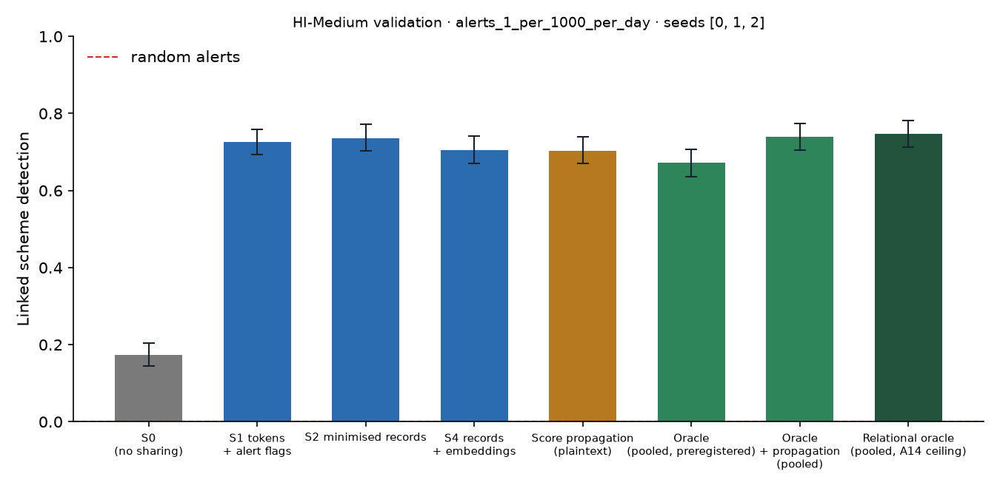

# X1 · sharing ladder on validation · HI-Medium

Seeds [0, 1, 2]; primary budget alerts_1_per_1000_per_day; schemes detected within 12 windows; primary fusion **stacker** (A13); H1b ceiling **oracle-relational** (A14). Per-scheme outcomes are averaged over seeds before the scheme bootstrap. Total 3,762 s, peak memory 1,751 MB. S3 and PD sweeps: `x3_HI-Medium.md`; leakage audit: `audit_HI-Medium.md`.

## Linked detection per configuration (primary fusion)

| Configuration | Linked [95% CI] | Across members | Detected [95% CI] | Gain over S0 [95% CI] | p | AUPRC (mean) |
| --- | --- | --- | --- | --- | --- | --- |
| S0 (no sharing) | 0.1736 [0.1446, 0.2033] | 0.0000 | 0.8730 [0.8469, 0.8966] | — | — | 0.3337 |
| S1 tokens + alert flags | 0.7266 [0.6933, 0.7592] | 0.6933 | 0.8554 [0.8282, 0.8814] | 0.5529 [0.5136, 0.5935] | 0.0000 | 0.3735 |
| S2 minimised records | 0.7356 [0.7030, 0.7713] | 0.7036 | 0.8584 [0.8330, 0.8839] | 0.5620 [0.5227, 0.6025] | 0.0000 | 0.3763 |
| S4 records + embeddings | 0.7042 [0.6703, 0.7405] | 0.6745 | 0.8391 [0.8100, 0.8669] | 0.5306 [0.4894, 0.5711] | 0.0000 | 0.3897 |
| Score propagation (plaintext) | 0.7036 [0.6697, 0.7399] | 0.6655 | 0.8566 [0.8300, 0.8832] | 0.5299 [0.4912, 0.5705] | 0.0000 | 0.4027 |
| Oracle (pooled, preregistered) | 0.6721 [0.6364, 0.7066] | 0.6219 | 0.8905 [0.8651, 0.9153] | 0.4985 [0.4567, 0.5372] | 0.0000 | 0.3961 |
| Oracle + propagation (pooled) | 0.7405 [0.7042, 0.7750] | 0.6872 | 0.8524 [0.8233, 0.8802] | 0.5668 [0.5275, 0.6056] | 0.0000 | 0.4462 |
| Relational oracle (pooled, A14 ceiling) | 0.7465 [0.7126, 0.7816] | 0.6939 | 0.8445 [0.8161, 0.8742] | 0.5729 [0.5342, 0.6116] | 0.0000 | 0.4420 |

Random alerts at the same budget: detected 0.0102, linked 0.0000.

## H1b on validation: share of the ceiling's gain recovered

(level − S0) / (ceiling − S0) in linked detection, scheme bootstrap. The relational oracle (pooled data with the same re-ranking, plaintext) is the ceiling from A14; the preregistered oracle is kept for comparison. Target: at least 0.60 for S2, judged on test.

| Level | Against oracle-relational [95% CI] | Against oracle [95% CI] |
| --- | --- | --- |
| S1 | 0.9652 [0.9229, 1.01] | 1.11 [1.06, 1.16] |
| S2 | 0.9810 [0.9363, 1.02] | 1.13 [1.07, 1.19] |
| S4 | 0.9261 [0.8804, 0.9648] | 1.06 [1.01, 1.12] |

## Secondary fusion rules

k-of-n uses only alert flags and noisy-OR only flags and the probability bucket, so their S2 and S4 rows coincide by construction.

| Level / rule | Linked | Detected | Gain over S0 | AUPRC (mean) |
| --- | --- | --- | --- | --- |
| S1/noisy_or | 0.6800 [0.6449, 0.7145] | 0.8669 [0.8403, 0.8923] | 0.5064 [0.4670, 0.5487] | 0.3623 |
| S1/kofn | 0.6467 [0.6104, 0.6830] | 0.8603 [0.8342, 0.8863] | 0.4731 [0.4277, 0.5160] | 0.3650 |
| S2/noisy_or | 0.6842 [0.6503, 0.7205] | 0.8215 [0.7925, 0.8494] | 0.5106 [0.4713, 0.5517] | 0.3786 |
| S2/kofn | 0.6467 [0.6104, 0.6830] | 0.8603 [0.8342, 0.8863] | 0.4731 [0.4277, 0.5160] | 0.3650 |
| S4/noisy_or | 0.6842 [0.6503, 0.7205] | 0.8215 [0.7925, 0.8494] | 0.5106 [0.4713, 0.5517] | 0.3786 |
| S4/kofn | 0.6467 [0.6104, 0.6830] | 0.8603 [0.8342, 0.8863] | 0.4731 [0.4277, 0.5160] | 0.3650 |

## Protocol per seed

Token evaluations are counted by the first level that needs them; later levels reuse the same tokens.

| Seed | Level | Requests | Answered: alert | Record, no alert | Refused | Accounts disclosed | LDP withheld | Max ε per account | Token evaluations | Seconds |
| --- | --- | --- | --- | --- | --- | --- | --- | --- | --- | --- |
| 0 | S1 | 231,520 | 10,076 | 0 | 811 | 0 | 0 | 0.0000 | 272,380 | 118.60 |
| 0 | S2 | 231,520 | 10,076 | 56,219 | 811 | 45,809 | 0 | 0.0000 | 0 | 54.60 |
| 0 | S4 | 231,520 | 10,076 | 56,219 | 811 | 45,809 | 0 | 0.0000 | 0 | 55.40 |
| 0 | S3[eps=0.5] | 231,520 | 10,076 | 56,219 | 811 | 45,809 | 0 | 5.00 | 0 | 71.60 |
| 0 | S3[eps=1] | 231,520 | 10,076 | 56,219 | 811 | 45,809 | 11 | 8.00 | 0 | 72.40 |
| 0 | S3[eps=2] | 231,520 | 10,076 | 56,216 | 811 | 45,809 | 504 | 8.00 | 0 | 71.80 |
| 0 | S3[eps=4] | 231,520 | 10,076 | 55,965 | 811 | 45,809 | 1,943 | 8.00 | 0 | 67.90 |
| 0 | S3[eps=8] | 231,520 | 10,076 | 52,863 | 811 | 45,809 | 6,706 | 8.00 | 0 | 66.40 |
| 0 | PD[tau=2] | 231,520 | 10,076 | 11,096 | 811 | 12,333 | 0 | 0.0000 | 0 | 47.00 |
| 0 | PD[tau=3] | 231,520 | 10,076 | 4,416 | 811 | 5,904 | 0 | 0.0000 | 0 | 46.90 |
| 0 | PD[tau=4] | 231,520 | 10,076 | 2,506 | 811 | 3,930 | 0 | 0.0000 | 0 | 46.60 |
| 1 | S1 | 223,237 | 9,963 | 0 | 789 | 0 | 0 | 0.0000 | 261,691 | 101.90 |
| 1 | S2 | 223,237 | 9,963 | 49,804 | 789 | 41,531 | 0 | 0.0000 | 0 | 41.60 |
| 1 | S4 | 223,237 | 9,963 | 49,804 | 789 | 41,531 | 0 | 0.0000 | 0 | 41.40 |
| 1 | S3[eps=0.5] | 223,237 | 9,963 | 49,804 | 789 | 41,531 | 0 | 5.00 | 0 | 58.00 |
| 1 | S3[eps=1] | 223,237 | 9,963 | 49,804 | 789 | 41,531 | 16 | 8.00 | 0 | 58.10 |
| 1 | S3[eps=2] | 223,237 | 9,963 | 49,803 | 789 | 41,531 | 503 | 8.00 | 0 | 58.80 |
| 1 | S3[eps=4] | 223,237 | 9,963 | 49,610 | 789 | 41,531 | 1,865 | 8.00 | 0 | 58.90 |
| 1 | S3[eps=8] | 223,237 | 9,963 | 46,888 | 789 | 41,531 | 6,269 | 8.00 | 0 | 57.50 |
| 1 | PD[tau=2] | 223,237 | 9,963 | 11,015 | 789 | 12,217 | 0 | 0.0000 | 0 | 39.70 |
| 1 | PD[tau=3] | 223,237 | 9,963 | 4,089 | 789 | 5,577 | 0 | 0.0000 | 0 | 39.60 |
| 1 | PD[tau=4] | 223,237 | 9,963 | 2,507 | 789 | 3,866 | 0 | 0.0000 | 0 | 40.00 |
| 2 | S1 | 259,834 | 9,962 | 0 | 782 | 0 | 0 | 0.0000 | 265,152 | 108.00 |
| 2 | S2 | 259,834 | 9,962 | 48,875 | 782 | 40,611 | 0 | 0.0000 | 0 | 58.00 |
| 2 | S4 | 259,834 | 9,962 | 48,875 | 782 | 40,611 | 0 | 0.0000 | 0 | 48.30 |
| 2 | S3[eps=0.5] | 259,834 | 9,962 | 48,875 | 782 | 40,611 | 0 | 5.00 | 0 | 66.50 |
| 2 | S3[eps=1] | 259,834 | 9,962 | 48,875 | 782 | 40,611 | 12 | 8.00 | 0 | 66.10 |
| 2 | S3[eps=2] | 259,834 | 9,962 | 48,873 | 782 | 40,611 | 525 | 8.00 | 0 | 66.70 |
| 2 | S3[eps=4] | 259,834 | 9,962 | 48,654 | 782 | 40,611 | 1,889 | 8.00 | 0 | 66.40 |
| 2 | S3[eps=8] | 259,834 | 9,962 | 46,057 | 782 | 40,611 | 6,079 | 8.00 | 0 | 63.50 |
| 2 | PD[tau=2] | 259,834 | 9,962 | 11,988 | 782 | 13,123 | 0 | 0.0000 | 0 | 46.10 |
| 2 | PD[tau=3] | 259,834 | 9,962 | 4,318 | 782 | 5,868 | 0 | 0.0000 | 0 | 46.40 |
| 2 | PD[tau=4] | 259,834 | 9,962 | 2,362 | 782 | 3,758 | 0 | 0.0000 | 0 | 48.60 |

## Time per seed

| Seed | s0 | oracle | relational | records | propagation | evaluate | total |
| --- | --- | --- | --- | --- | --- | --- | --- |
| 0 | 40.40 | 116.80 | 4.60 | 21.10 | 0.6000 | 319.60 | 1,369.50 |
| 1 | 41.90 | 116.50 | 3.30 | 27.70 | 0.6000 | 332.50 | 1,118.10 |
| 2 | 49.00 | 96.30 | 2.90 | 27.00 | 0.7000 | 377.40 | 1,238.20 |
