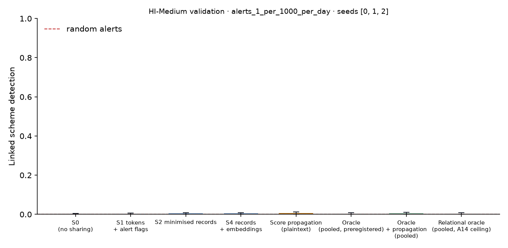

# X1 · sharing ladder on validation · HI-Medium · federation A64

**Secondary analysis (A20): federation A64**, real banks only; accounts at other banks are outside and cannot be asked. No sweeps or audit; decides no hypothesis. Seeds [0, 1, 2]; primary budget alerts_1_per_1000_per_day; schemes detected within 12 windows; primary fusion **stacker** (A13); H1b ceiling **oracle-relational** (A14). Per-scheme outcomes are averaged over seeds before the scheme bootstrap. Total 165 s, peak memory 1,014 MB.

## Linked detection per configuration (primary fusion)

| Configuration | Linked [95% CI] | Across members | Detected [95% CI] | Gain over S0 [95% CI] | p | AUPRC (mean) |
| --- | --- | --- | --- | --- | --- | --- |
| S0 (no sharing) | 0.0018 [0.0000, 0.0054] | 0.0000 | 0.0569 [0.0417, 0.0732] | — | — | 0.1987 |
| S1 tokens + alert flags | 0.0030 [0.0000, 0.0067] | 0.0018 | 0.0557 [0.0399, 0.0720] | 0.0012 [-0.0012, 0.0048] | 0.5580 | 0.1447 |
| S2 minimised records | 0.0042 [0.0006, 0.0085] | 0.0036 | 0.0496 [0.0357, 0.0659] | 0.0024 [-0.0024, 0.0073] | 0.3360 | 0.1288 |
| S4 records + embeddings | 0.0042 [0.0006, 0.0091] | 0.0030 | 0.0508 [0.0357, 0.0672] | 0.0024 [-0.0006, 0.0067] | 0.2480 | 0.1374 |
| Score propagation (plaintext) | 0.0060 [0.0012, 0.0127] | 0.0042 | 0.0436 [0.0290, 0.0593] | 0.0042 [0.0000, 0.0103] | 0.1180 | 0.2424 |
| Oracle (pooled, preregistered) | 0.0036 [0.0000, 0.0085] | 0.0024 | 0.0665 [0.0490, 0.0859] | 0.0018 [-0.0012, 0.0067] | 0.4820 | 0.5766 |
| Oracle + propagation (pooled) | 0.0042 [0.0006, 0.0097] | 0.0030 | 0.0605 [0.0430, 0.0811] | 0.0024 [-0.0006, 0.0073] | 0.2880 | 0.5446 |
| Relational oracle (pooled, A14 ceiling) | 0.0036 [0.0000, 0.0085] | 0.0024 | 0.0581 [0.0423, 0.0762] | 0.0018 [-0.0012, 0.0055] | 0.3880 | 0.4538 |

Random alerts at the same budget: detected 0.0005, linked 0.0000.

## H1b on validation: share of the ceiling's gain recovered

(level − S0) / (ceiling − S0) in linked detection, scheme bootstrap. The relational oracle (pooled data with the same re-ranking, plaintext) is the ceiling from A14; the preregistered oracle is kept for comparison, and `strongest-pooled` uses whichever pooled relational configuration links more (oracle+propagation) as a sensitivity check. Target: at least 0.60 for S2, judged on test.

| Level | Against oracle-relational [95% CI] | Against oracle [95% CI] | Against strongest-pooled [95% CI] |
| --- | --- | --- | --- |
| S1 | 0.6667 [-1.00, 4.00] | 0.6667 [0.0000, 1.00] | 0.5000 [-1.00, 1.00] |
| S2 | 1.33 [-0.5000, 5.00] | 1.33 [-0.0000, 5.00] | 1.00 [-1.00, 4.00] |
| S4 | 1.33 [0.0000, 4.94] | 1.33 [0.5000, 4.05] | 1.00 [0.0000, 3.00] |

## Secondary fusion rules

k-of-n uses only alert flags and noisy-OR only flags and the probability bucket, so their S2 and S4 rows coincide by construction.

| Level / rule | Linked | Detected | Gain over S0 | AUPRC (mean) |
| --- | --- | --- | --- | --- |
| S1/noisy_or | 0.0054 [0.0006, 0.0115] | 0.0557 [0.0411, 0.0714] | 0.0036 [0.0006, 0.0085] | 0.2008 |
| S1/kofn | 0.0091 [0.0030, 0.0170] | 0.0454 [0.0309, 0.0605] | 0.0073 [0.0018, 0.0145] | 0.2133 |
| S2/noisy_or | 0.0060 [0.0006, 0.0127] | 0.0454 [0.0315, 0.0599] | 0.0042 [0.0006, 0.0097] | 0.2148 |
| S2/kofn | 0.0091 [0.0030, 0.0170] | 0.0454 [0.0309, 0.0605] | 0.0073 [0.0018, 0.0145] | 0.2133 |
| S4/noisy_or | 0.0060 [0.0006, 0.0127] | 0.0454 [0.0315, 0.0599] | 0.0042 [0.0006, 0.0097] | 0.2148 |
| S4/kofn | 0.0091 [0.0030, 0.0170] | 0.0454 [0.0309, 0.0605] | 0.0073 [0.0018, 0.0145] | 0.2133 |

## Protocol per seed

Token evaluations are counted by the first level that needs them; later levels reuse the same tokens.

| Seed | Level | Requests | Answered: alert | Record, no alert | Refused | Accounts disclosed | LDP withheld | Max ε per account | Token evaluations | Seconds |
| --- | --- | --- | --- | --- | --- | --- | --- | --- | --- | --- |
| 0 | S1 | 12,411 | 135 | 0 | 9 | 0 | 0 | 0.0000 | 19,109 | 6.40 |
| 0 | S2 | 12,411 | 135 | 3,891 | 9 | 2,508 | 0 | 0.0000 | 0 | 2.50 |
| 0 | S4 | 12,411 | 135 | 3,891 | 9 | 2,508 | 0 | 0.0000 | 0 | 2.60 |
| 1 | S1 | 13,104 | 120 | 0 | 11 | 0 | 0 | 0.0000 | 20,537 | 6.80 |
| 1 | S2 | 13,104 | 120 | 4,340 | 11 | 2,776 | 0 | 0.0000 | 0 | 2.60 |
| 1 | S4 | 13,104 | 120 | 4,340 | 11 | 2,776 | 0 | 0.0000 | 0 | 2.70 |
| 2 | S1 | 12,818 | 126 | 0 | 15 | 0 | 0 | 0.0000 | 20,134 | 6.50 |
| 2 | S2 | 12,818 | 126 | 4,219 | 15 | 2,733 | 0 | 0.0000 | 0 | 2.60 |
| 2 | S4 | 12,818 | 126 | 4,219 | 15 | 2,733 | 0 | 0.0000 | 0 | 2.60 |

## Time per seed

| Seed | s0 | oracle | relational | records | propagation | evaluate | total |
| --- | --- | --- | --- | --- | --- | --- | --- |
| 0 | 5.20 | 5.80 | 2.20 | 18.90 | 0.0000 | 12.30 | 56.00 |
| 1 | 4.70 | 4.10 | 1.30 | 18.40 | 0.0000 | 11.80 | 52.40 |
| 2 | 4.40 | 4.30 | 1.30 | 18.90 | 0.1000 | 11.60 | 52.30 |
