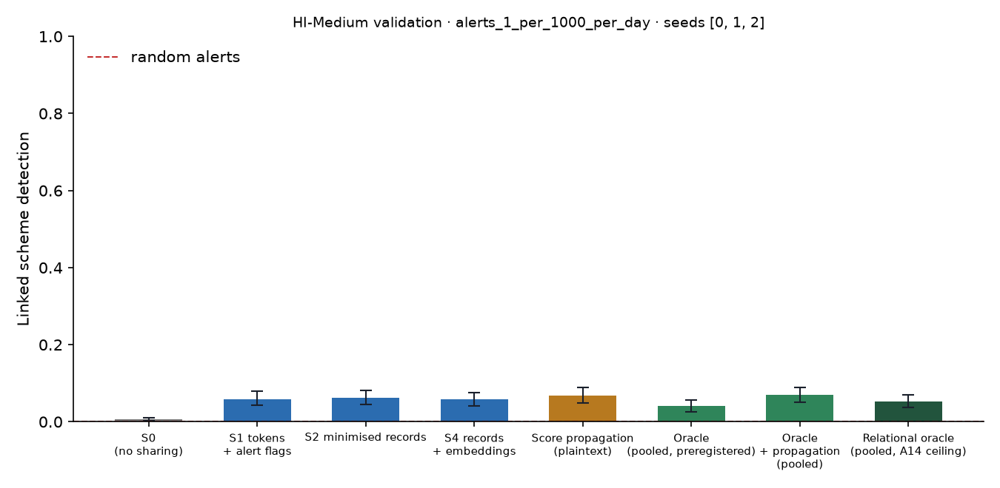

# X1 · sharing ladder on validation · HI-Medium · federation B8c10

**Secondary analysis (A21 coverage curve): federation B8c10**, the largest banks holding 10% of accounts, grouped into 8 members; accounts at other banks are outside and cannot be asked. No sweeps or audit; decides no hypothesis. Seeds [0, 1, 2]; primary budget alerts_1_per_1000_per_day; schemes detected within 12 windows; primary fusion **stacker** (A13); H1b ceiling **oracle-relational** (A14). Per-scheme outcomes are averaged over seeds before the scheme bootstrap. Total 264 s, peak memory 1,060 MB.

## Linked detection per configuration (primary fusion)

| Configuration | Linked [95% CI] | Across members | Detected [95% CI] | Gain over S0 [95% CI] | p | AUPRC (mean) |
| --- | --- | --- | --- | --- | --- | --- |
| S0 (no sharing) | 0.0060 [0.0018, 0.0109] | 0.0000 | 0.2105 [0.1803, 0.2432] | — | — | 0.4107 |
| S1 tokens + alert flags | 0.0593 [0.0429, 0.0786] | 0.0563 | 0.1785 [0.1518, 0.2093] | 0.0532 [0.0375, 0.0714] | 0.0000 | 0.3994 |
| S2 minimised records | 0.0617 [0.0448, 0.0817] | 0.0599 | 0.1827 [0.1555, 0.2136] | 0.0557 [0.0399, 0.0744] | 0.0000 | 0.3818 |
| S4 records + embeddings | 0.0575 [0.0417, 0.0756] | 0.0544 | 0.1809 [0.1542, 0.2129] | 0.0514 [0.0363, 0.0684] | 0.0000 | 0.3786 |
| Score propagation (plaintext) | 0.0678 [0.0496, 0.0889] | 0.0653 | 0.1579 [0.1313, 0.1876] | 0.0617 [0.0448, 0.0829] | 0.0000 | 0.4555 |
| Oracle (pooled, preregistered) | 0.0417 [0.0266, 0.0569] | 0.0417 | 0.2202 [0.1887, 0.2529] | 0.0357 [0.0218, 0.0502] | 0.0000 | 0.5397 |
| Oracle + propagation (pooled) | 0.0690 [0.0502, 0.0895] | 0.0647 | 0.1706 [0.1427, 0.2027] | 0.0629 [0.0460, 0.0829] | 0.0000 | 0.5516 |
| Relational oracle (pooled, A14 ceiling) | 0.0520 [0.0363, 0.0702] | 0.0472 | 0.2051 [0.1766, 0.2372] | 0.0460 [0.0314, 0.0629] | 0.0000 | 0.5237 |

Random alerts at the same budget: detected 0.0017, linked 0.0000.

## H1b on validation: share of the ceiling's gain recovered

(level − S0) / (ceiling − S0) in linked detection, scheme bootstrap. The relational oracle (pooled data with the same re-ranking, plaintext) is the ceiling from A14; the preregistered oracle is kept for comparison, and `strongest-pooled` uses whichever pooled relational configuration links more (oracle+propagation) as a sensitivity check. Target: at least 0.60 for S2, judged on test.

| Level | Against oracle-relational [95% CI] | Against oracle [95% CI] | Against strongest-pooled [95% CI] |
| --- | --- | --- | --- |
| S1 | 1.16 [0.9124, 1.47] | 1.49 [1.12, 2.18] | 0.8462 [0.6666, 1.06] |
| S2 | 1.21 [0.9583, 1.55] | 1.56 [1.16, 2.28] | 0.8846 [0.6916, 1.09] |
| S4 | 1.12 [0.8862, 1.44] | 1.44 [1.08, 2.12] | 0.8173 [0.6396, 1.03] |

## Secondary fusion rules

k-of-n uses only alert flags and noisy-OR only flags and the probability bucket, so their S2 and S4 rows coincide by construction.

| Level / rule | Linked | Detected | Gain over S0 | AUPRC (mean) |
| --- | --- | --- | --- | --- |
| S1/noisy_or | 0.0569 [0.0405, 0.0750] | 0.1815 [0.1531, 0.2136] | 0.0508 [0.0357, 0.0690] | 0.4088 |
| S1/kofn | 0.0599 [0.0411, 0.0799] | 0.1410 [0.1155, 0.1724] | 0.0538 [0.0363, 0.0720] | 0.4024 |
| S2/noisy_or | 0.0605 [0.0441, 0.0793] | 0.1785 [0.1494, 0.2099] | 0.0544 [0.0393, 0.0726] | 0.4106 |
| S2/kofn | 0.0599 [0.0411, 0.0799] | 0.1410 [0.1155, 0.1724] | 0.0538 [0.0363, 0.0720] | 0.4024 |
| S4/noisy_or | 0.0605 [0.0441, 0.0793] | 0.1785 [0.1494, 0.2099] | 0.0544 [0.0393, 0.0726] | 0.4106 |
| S4/kofn | 0.0599 [0.0411, 0.0799] | 0.1410 [0.1155, 0.1724] | 0.0538 [0.0363, 0.0720] | 0.4024 |

## Protocol per seed

Token evaluations are counted by the first level that needs them; later levels reuse the same tokens.

| Seed | Level | Requests | Answered: alert | Record, no alert | Refused | Accounts disclosed | LDP withheld | Max ε per account | Token evaluations | Seconds |
| --- | --- | --- | --- | --- | --- | --- | --- | --- | --- | --- |
| 0 | S1 | 24,129 | 857 | 0 | 13 | 0 | 0 | 0.0000 | 33,462 | 11.70 |
| 0 | S2 | 24,129 | 857 | 6,622 | 13 | 4,867 | 0 | 0.0000 | 0 | 4.30 |
| 0 | S4 | 24,129 | 857 | 6,622 | 13 | 4,867 | 0 | 0.0000 | 0 | 4.20 |
| 1 | S1 | 23,456 | 823 | 0 | 13 | 0 | 0 | 0.0000 | 32,562 | 10.90 |
| 1 | S2 | 23,456 | 823 | 6,094 | 13 | 4,484 | 0 | 0.0000 | 0 | 4.10 |
| 1 | S4 | 23,456 | 823 | 6,094 | 13 | 4,484 | 0 | 0.0000 | 0 | 4.20 |
| 2 | S1 | 22,940 | 878 | 0 | 12 | 0 | 0 | 0.0000 | 32,135 | 10.70 |
| 2 | S2 | 22,940 | 878 | 6,260 | 12 | 4,605 | 0 | 0.0000 | 0 | 4.10 |
| 2 | S4 | 22,940 | 878 | 6,260 | 12 | 4,605 | 0 | 0.0000 | 0 | 4.00 |

## Time per seed

| Seed | s0 | oracle | relational | records | propagation | evaluate | total |
| --- | --- | --- | --- | --- | --- | --- | --- |
| 0 | 7.60 | 9.70 | 2.20 | 19.60 | 0.1000 | 23.80 | 83.30 |
| 1 | 5.20 | 16.20 | 1.20 | 18.60 | 0.1000 | 23.20 | 83.60 |
| 2 | 7.60 | 20.90 | 1.10 | 19.60 | 0.1000 | 23.20 | 91.40 |
