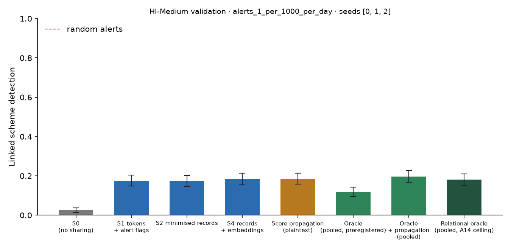

# X1 · sharing ladder on validation · HI-Medium · federation B8c25

**Secondary analysis (A21 coverage curve): federation B8c25**, the largest banks holding 25% of accounts, grouped into 8 members; accounts at other banks are outside and cannot be asked. No sweeps or audit; decides no hypothesis. Seeds [0, 1, 2]; primary budget alerts_1_per_1000_per_day; schemes detected within 12 windows; primary fusion **stacker** (A13); H1b ceiling **oracle-relational** (A14). Per-scheme outcomes are averaged over seeds before the scheme bootstrap. Total 613 s, peak memory 1,160 MB.

## Linked detection per configuration (primary fusion)

| Configuration | Linked [95% CI] | Across members | Detected [95% CI] | Gain over S0 [95% CI] | p | AUPRC (mean) |
| --- | --- | --- | --- | --- | --- | --- |
| S0 (no sharing) | 0.0254 [0.0145, 0.0381] | 0.0000 | 0.4658 [0.4253, 0.5033] | — | — | 0.4126 |
| S1 tokens + alert flags | 0.1748 [0.1482, 0.2033] | 0.1676 | 0.3969 [0.3618, 0.4362] | 0.1494 [0.1234, 0.1760] | 0.0000 | 0.4277 |
| S2 minimised records | 0.1730 [0.1464, 0.2027] | 0.1645 | 0.3950 [0.3600, 0.4338] | 0.1476 [0.1216, 0.1755] | 0.0000 | 0.4184 |
| S4 records + embeddings | 0.1839 [0.1543, 0.2129] | 0.1742 | 0.4029 [0.3672, 0.4392] | 0.1585 [0.1301, 0.1851] | 0.0000 | 0.4236 |
| Score propagation (plaintext) | 0.1851 [0.1579, 0.2136] | 0.1773 | 0.3805 [0.3448, 0.4193] | 0.1597 [0.1343, 0.1876] | 0.0000 | 0.4662 |
| Oracle (pooled, preregistered) | 0.1186 [0.0944, 0.1428] | 0.1101 | 0.4682 [0.4301, 0.5070] | 0.0932 [0.0702, 0.1168] | 0.0000 | 0.5056 |
| Oracle + propagation (pooled) | 0.1972 [0.1682, 0.2281] | 0.1760 | 0.3654 [0.3291, 0.4059] | 0.1718 [0.1440, 0.2021] | 0.0000 | 0.5351 |
| Relational oracle (pooled, A14 ceiling) | 0.1809 [0.1525, 0.2099] | 0.1591 | 0.4108 [0.3757, 0.4501] | 0.1555 [0.1276, 0.1839] | 0.0000 | 0.5208 |

Random alerts at the same budget: detected 0.0037, linked 0.0000.

## H1b on validation: share of the ceiling's gain recovered

(level − S0) / (ceiling − S0) in linked detection, scheme bootstrap. The relational oracle (pooled data with the same re-ranking, plaintext) is the ceiling from A14; the preregistered oracle is kept for comparison, and `strongest-pooled` uses whichever pooled relational configuration links more (oracle+propagation) as a sensitivity check. Target: at least 0.60 for S2, judged on test.

| Level | Against oracle-relational [95% CI] | Against oracle [95% CI] | Against strongest-pooled [95% CI] |
| --- | --- | --- | --- |
| S1 | 0.9611 [0.8537, 1.09] | 1.60 [1.37, 1.92] | 0.8697 [0.7713, 0.9821] |
| S2 | 0.9494 [0.8435, 1.09] | 1.58 [1.36, 1.93] | 0.8592 [0.7643, 0.9720] |
| S4 | 1.02 [0.8985, 1.16] | 1.70 [1.44, 2.04] | 0.9225 [0.8093, 1.05] |

## Secondary fusion rules

k-of-n uses only alert flags and noisy-OR only flags and the probability bucket, so their S2 and S4 rows coincide by construction.

| Level / rule | Linked | Detected | Gain over S0 | AUPRC (mean) |
| --- | --- | --- | --- | --- |
| S1/noisy_or | 0.1518 [0.1264, 0.1779] | 0.4077 [0.3708, 0.4447] | 0.1264 [0.1034, 0.1512] | 0.4355 |
| S1/kofn | 0.1452 [0.1198, 0.1718] | 0.3345 [0.2988, 0.3739] | 0.1198 [0.0938, 0.1458] | 0.4219 |
| S2/noisy_or | 0.1639 [0.1373, 0.1912] | 0.3872 [0.3521, 0.4241] | 0.1385 [0.1119, 0.1652] | 0.4370 |
| S2/kofn | 0.1452 [0.1198, 0.1718] | 0.3345 [0.2988, 0.3739] | 0.1198 [0.0938, 0.1458] | 0.4219 |
| S4/noisy_or | 0.1639 [0.1373, 0.1912] | 0.3872 [0.3521, 0.4241] | 0.1385 [0.1119, 0.1652] | 0.4370 |
| S4/kofn | 0.1452 [0.1198, 0.1718] | 0.3345 [0.2988, 0.3739] | 0.1198 [0.0938, 0.1458] | 0.4219 |

## Protocol per seed

Token evaluations are counted by the first level that needs them; later levels reuse the same tokens.

| Seed | Level | Requests | Answered: alert | Record, no alert | Refused | Accounts disclosed | LDP withheld | Max ε per account | Token evaluations | Seconds |
| --- | --- | --- | --- | --- | --- | --- | --- | --- | --- | --- |
| 0 | S1 | 65,247 | 2,415 | 0 | 53 | 0 | 0 | 0.0000 | 83,240 | 29.30 |
| 0 | S2 | 65,247 | 2,415 | 16,715 | 53 | 12,742 | 0 | 0.0000 | 0 | 11.30 |
| 0 | S4 | 65,247 | 2,415 | 16,715 | 53 | 12,742 | 0 | 0.0000 | 0 | 11.50 |
| 1 | S1 | 64,353 | 2,577 | 0 | 64 | 0 | 0 | 0.0000 | 83,370 | 28.50 |
| 1 | S2 | 64,353 | 2,577 | 16,656 | 64 | 12,792 | 0 | 0.0000 | 0 | 11.30 |
| 1 | S4 | 64,353 | 2,577 | 16,656 | 64 | 12,792 | 0 | 0.0000 | 0 | 11.30 |
| 2 | S1 | 66,819 | 2,393 | 0 | 67 | 0 | 0 | 0.0000 | 86,470 | 30.50 |
| 2 | S2 | 66,819 | 2,393 | 18,264 | 67 | 13,718 | 0 | 0.0000 | 0 | 12.60 |
| 2 | S4 | 66,819 | 2,393 | 18,264 | 67 | 13,718 | 0 | 0.0000 | 0 | 11.80 |

## Time per seed

| Seed | s0 | oracle | relational | records | propagation | evaluate | total |
| --- | --- | --- | --- | --- | --- | --- | --- |
| 0 | 16.70 | 48.20 | 3.70 | 22.90 | 0.3000 | 59.40 | 203.30 |
| 1 | 13.20 | 52.80 | 3.40 | 22.00 | 0.2000 | 58.40 | 201.00 |
| 2 | 14.90 | 42.20 | 2.40 | 20.80 | 0.3000 | 60.30 | 195.90 |
