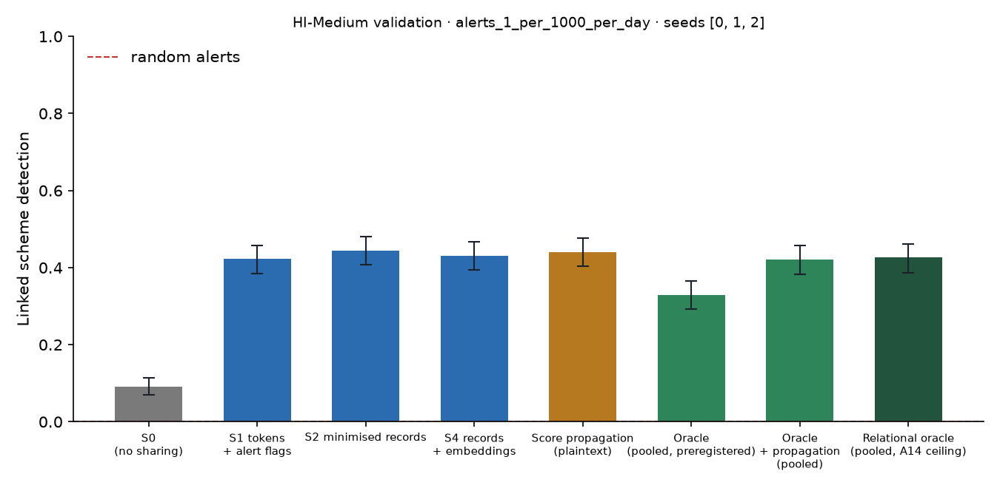

# X1 · sharing ladder on validation · HI-Medium · federation B8c50

**Secondary analysis (A21 coverage curve): federation B8c50**, the largest banks holding 50% of accounts, grouped into 8 members; accounts at other banks are outside and cannot be asked. No sweeps or audit; decides no hypothesis. Seeds [0, 1, 2]; primary budget alerts_1_per_1000_per_day; schemes detected within 12 windows; primary fusion **stacker** (A13); H1b ceiling **oracle-relational** (A14). Per-scheme outcomes are averaged over seeds before the scheme bootstrap. Total 1,206 s, peak memory 1,349 MB.

## Linked detection per configuration (primary fusion)

| Configuration | Linked [95% CI] | Across members | Detected [95% CI] | Gain over S0 [95% CI] | p | AUPRC (mean) |
| --- | --- | --- | --- | --- | --- | --- |
| S0 (no sharing) | 0.0901 [0.0696, 0.1131] | 0.0000 | 0.6963 [0.6606, 0.7308] | — | — | 0.3877 |
| S1 tokens + alert flags | 0.4223 [0.3854, 0.4580] | 0.3993 | 0.6207 [0.5850, 0.6576] | 0.3321 [0.2928, 0.3702] | 0.0000 | 0.4306 |
| S2 minimised records | 0.4440 [0.4077, 0.4810] | 0.4174 | 0.6273 [0.5923, 0.6649] | 0.3539 [0.3128, 0.3926] | 0.0000 | 0.4301 |
| S4 records + embeddings | 0.4301 [0.3944, 0.4676] | 0.4041 | 0.6183 [0.5826, 0.6558] | 0.3400 [0.3013, 0.3793] | 0.0000 | 0.4415 |
| Score propagation (plaintext) | 0.4398 [0.4035, 0.4773] | 0.4090 | 0.6388 [0.6037, 0.6739] | 0.3497 [0.3128, 0.3860] | 0.0000 | 0.4592 |
| Oracle (pooled, preregistered) | 0.3297 [0.2928, 0.3648] | 0.2964 | 0.7060 [0.6721, 0.7405] | 0.2396 [0.2039, 0.2753] | 0.0000 | 0.4600 |
| Oracle + propagation (pooled) | 0.4211 [0.3823, 0.4567] | 0.3751 | 0.6346 [0.5977, 0.6715] | 0.3309 [0.2922, 0.3667] | 0.0000 | 0.5117 |
| Relational oracle (pooled, A14 ceiling) | 0.4265 [0.3872, 0.4616] | 0.3793 | 0.6419 [0.6068, 0.6800] | 0.3364 [0.2989, 0.3721] | 0.0000 | 0.5050 |

Random alerts at the same budget: detected 0.0063, linked 0.0000.

## H1b on validation: share of the ceiling's gain recovered

(level − S0) / (ceiling − S0) in linked detection, scheme bootstrap. The relational oracle (pooled data with the same re-ranking, plaintext) is the ceiling from A14; the preregistered oracle is kept for comparison, and `strongest-pooled` uses whichever pooled relational configuration links more (oracle-relational) as a sensitivity check. Target: at least 0.60 for S2, judged on test.

| Level | Against oracle-relational [95% CI] | Against oracle [95% CI] | Against strongest-pooled [95% CI] |
| --- | --- | --- | --- |
| S1 | 0.9874 [0.9185, 1.06] | 1.39 [1.25, 1.56] | 0.9874 [0.9185, 1.06] |
| S2 | 1.05 [0.9755, 1.14] | 1.48 [1.33, 1.66] | 1.05 [0.9755, 1.14] |
| S4 | 1.01 [0.9256, 1.10] | 1.42 [1.27, 1.59] | 1.01 [0.9256, 1.10] |

## Secondary fusion rules

k-of-n uses only alert flags and noisy-OR only flags and the probability bucket, so their S2 and S4 rows coincide by construction.

| Level / rule | Linked | Detected | Gain over S0 | AUPRC (mean) |
| --- | --- | --- | --- | --- |
| S1/noisy_or | 0.3890 [0.3515, 0.4241] | 0.6491 [0.6140, 0.6854] | 0.2989 [0.2601, 0.3370] | 0.4255 |
| S1/kofn | 0.3454 [0.3091, 0.3787] | 0.6050 [0.5674, 0.6419] | 0.2553 [0.2172, 0.2922] | 0.4166 |
| S2/noisy_or | 0.3956 [0.3600, 0.4307] | 0.6086 [0.5729, 0.6455] | 0.3055 [0.2674, 0.3430] | 0.4341 |
| S2/kofn | 0.3454 [0.3091, 0.3787] | 0.6050 [0.5674, 0.6419] | 0.2553 [0.2172, 0.2922] | 0.4166 |
| S4/noisy_or | 0.3956 [0.3600, 0.4307] | 0.6086 [0.5729, 0.6455] | 0.3055 [0.2674, 0.3430] | 0.4341 |
| S4/kofn | 0.3454 [0.3091, 0.3787] | 0.6050 [0.5674, 0.6419] | 0.2553 [0.2172, 0.2922] | 0.4166 |

## Protocol per seed

Token evaluations are counted by the first level that needs them; later levels reuse the same tokens.

| Seed | Level | Requests | Answered: alert | Record, no alert | Refused | Accounts disclosed | LDP withheld | Max ε per account | Token evaluations | Seconds |
| --- | --- | --- | --- | --- | --- | --- | --- | --- | --- | --- |
| 0 | S1 | 150,042 | 5,643 | 0 | 101 | 0 | 0 | 0.0000 | 184,687 | 64.50 |
| 0 | S2 | 150,042 | 5,643 | 44,109 | 101 | 33,488 | 0 | 0.0000 | 0 | 27.40 |
| 0 | S4 | 150,042 | 5,643 | 44,109 | 101 | 33,488 | 0 | 0.0000 | 0 | 27.40 |
| 1 | S1 | 147,280 | 5,724 | 0 | 99 | 0 | 0 | 0.0000 | 182,509 | 64.20 |
| 1 | S2 | 147,280 | 5,724 | 42,432 | 99 | 32,547 | 0 | 0.0000 | 0 | 26.70 |
| 1 | S4 | 147,280 | 5,724 | 42,432 | 99 | 32,547 | 0 | 0.0000 | 0 | 26.80 |
| 2 | S1 | 152,177 | 5,671 | 0 | 99 | 0 | 0 | 0.0000 | 190,028 | 67.50 |
| 2 | S2 | 152,177 | 5,671 | 45,748 | 99 | 34,303 | 0 | 0.0000 | 0 | 27.50 |
| 2 | S4 | 152,177 | 5,671 | 45,748 | 99 | 34,303 | 0 | 0.0000 | 0 | 27.60 |

## Time per seed

| Seed | s0 | oracle | relational | records | propagation | evaluate | total |
| --- | --- | --- | --- | --- | --- | --- | --- |
| 0 | 34.10 | 87.60 | 2.50 | 24.90 | 0.4000 | 134.50 | 403.30 |
| 1 | 36.60 | 69.90 | 3.50 | 26.50 | 0.5000 | 124.20 | 379.10 |
| 2 | 39.20 | 91.20 | 3.00 | 22.40 | 0.5000 | 123.80 | 402.60 |
