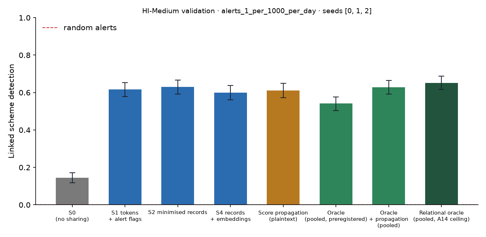

# X1 · sharing ladder on validation · HI-Medium · federation B8c75

**Secondary analysis (A21 coverage curve): federation B8c75**, the largest banks holding 75% of accounts, grouped into 8 members; accounts at other banks are outside and cannot be asked. No sweeps or audit; decides no hypothesis. Seeds [0, 1, 2]; primary budget alerts_1_per_1000_per_day; schemes detected within 12 windows; primary fusion **stacker** (A13); H1b ceiling **oracle-relational** (A14). Per-scheme outcomes are averaged over seeds before the scheme bootstrap. Total 2,013 s, peak memory 1,687 MB.

## Linked detection per configuration (primary fusion)

| Configuration | Linked [95% CI] | Across members | Detected [95% CI] | Gain over S0 [95% CI] | p | AUPRC (mean) |
| --- | --- | --- | --- | --- | --- | --- |
| S0 (no sharing) | 0.1446 [0.1186, 0.1718] | 0.0000 | 0.8106 [0.7792, 0.8391] | — | — | 0.3384 |
| S1 tokens + alert flags | 0.6158 [0.5777, 0.6534] | 0.5862 | 0.7641 [0.7302, 0.7973] | 0.4713 [0.4307, 0.5130] | 0.0000 | 0.3861 |
| S2 minimised records | 0.6298 [0.5910, 0.6673] | 0.5977 | 0.7707 [0.7399, 0.8040] | 0.4852 [0.4422, 0.5275] | 0.0000 | 0.3869 |
| S4 records + embeddings | 0.5995 [0.5614, 0.6370] | 0.5717 | 0.7580 [0.7272, 0.7907] | 0.4549 [0.4114, 0.4973] | 0.0000 | 0.3989 |
| Score propagation (plaintext) | 0.6104 [0.5735, 0.6485] | 0.5735 | 0.7822 [0.7520, 0.8131] | 0.4658 [0.4271, 0.5070] | 0.0000 | 0.4096 |
| Oracle (pooled, preregistered) | 0.5414 [0.5033, 0.5771] | 0.4894 | 0.8306 [0.8004, 0.8597] | 0.3969 [0.3587, 0.4350] | 0.0000 | 0.3943 |
| Oracle + propagation (pooled) | 0.6286 [0.5923, 0.6642] | 0.5723 | 0.7810 [0.7483, 0.8131] | 0.4840 [0.4452, 0.5227] | 0.0000 | 0.4483 |
| Relational oracle (pooled, A14 ceiling) | 0.6521 [0.6176, 0.6879] | 0.5947 | 0.7786 [0.7459, 0.8100] | 0.5076 [0.4701, 0.5463] | 0.0000 | 0.4452 |

Random alerts at the same budget: detected 0.0077, linked 0.0000.

## H1b on validation: share of the ceiling's gain recovered

(level − S0) / (ceiling − S0) in linked detection, scheme bootstrap. The relational oracle (pooled data with the same re-ranking, plaintext) is the ceiling from A14; the preregistered oracle is kept for comparison, and `strongest-pooled` uses whichever pooled relational configuration links more (oracle-relational) as a sensitivity check. Target: at least 0.60 for S2, judged on test.

| Level | Against oracle-relational [95% CI] | Against oracle [95% CI] | Against strongest-pooled [95% CI] |
| --- | --- | --- | --- |
| S1 | 0.9285 [0.8830, 0.9744] | 1.19 [1.11, 1.27] | 0.9285 [0.8830, 0.9744] |
| S2 | 0.9559 [0.9050, 1.00] | 1.22 [1.14, 1.31] | 0.9559 [0.9050, 1.00] |
| S4 | 0.8963 [0.8427, 0.9453] | 1.15 [1.06, 1.24] | 0.8963 [0.8427, 0.9453] |

## Secondary fusion rules

k-of-n uses only alert flags and noisy-OR only flags and the probability bucket, so their S2 and S4 rows coincide by construction.

| Level / rule | Linked | Detected | Gain over S0 | AUPRC (mean) |
| --- | --- | --- | --- | --- |
| S1/noisy_or | 0.5826 [0.5439, 0.6201] | 0.7931 [0.7623, 0.8252] | 0.4380 [0.3999, 0.4785] | 0.3736 |
| S1/kofn | 0.5172 [0.4797, 0.5536] | 0.7822 [0.7513, 0.8131] | 0.3727 [0.3333, 0.4138] | 0.3699 |
| S2/noisy_or | 0.5886 [0.5505, 0.6268] | 0.7610 [0.7296, 0.7931] | 0.4440 [0.4029, 0.4864] | 0.3851 |
| S2/kofn | 0.5172 [0.4797, 0.5536] | 0.7822 [0.7513, 0.8131] | 0.3727 [0.3333, 0.4138] | 0.3699 |
| S4/noisy_or | 0.5886 [0.5505, 0.6268] | 0.7610 [0.7296, 0.7931] | 0.4440 [0.4029, 0.4864] | 0.3851 |
| S4/kofn | 0.5172 [0.4797, 0.5536] | 0.7822 [0.7513, 0.8131] | 0.3727 [0.3333, 0.4138] | 0.3699 |

## Protocol per seed

Token evaluations are counted by the first level that needs them; later levels reuse the same tokens.

| Seed | Level | Requests | Answered: alert | Record, no alert | Refused | Accounts disclosed | LDP withheld | Max ε per account | Token evaluations | Seconds |
| --- | --- | --- | --- | --- | --- | --- | --- | --- | --- | --- |
| 0 | S1 | 264,472 | 8,511 | 0 | 145 | 0 | 0 | 0.0000 | 320,979 | 113.90 |
| 0 | S2 | 264,472 | 8,511 | 90,381 | 145 | 65,621 | 0 | 0.0000 | 0 | 51.20 |
| 0 | S4 | 264,472 | 8,511 | 90,381 | 145 | 65,621 | 0 | 0.0000 | 0 | 50.50 |
| 1 | S1 | 260,175 | 8,510 | 0 | 163 | 0 | 0 | 0.0000 | 316,164 | 112.10 |
| 1 | S2 | 260,175 | 8,510 | 89,346 | 163 | 65,299 | 0 | 0.0000 | 0 | 48.10 |
| 1 | S4 | 260,175 | 8,510 | 89,346 | 163 | 65,299 | 0 | 0.0000 | 0 | 48.00 |
| 2 | S1 | 249,732 | 8,481 | 0 | 145 | 0 | 0 | 0.0000 | 305,447 | 112.80 |
| 2 | S2 | 249,732 | 8,481 | 84,688 | 145 | 62,608 | 0 | 0.0000 | 0 | 48.00 |
| 2 | S4 | 249,732 | 8,481 | 84,688 | 145 | 62,608 | 0 | 0.0000 | 0 | 46.50 |

## Time per seed

| Seed | s0 | oracle | relational | records | propagation | evaluate | total |
| --- | --- | --- | --- | --- | --- | --- | --- |
| 0 | 66.00 | 126.20 | 5.80 | 33.30 | 0.6000 | 232.90 | 680.60 |
| 1 | 43.30 | 119.40 | 4.70 | 27.20 | 0.6000 | 246.70 | 650.40 |
| 2 | 55.30 | 153.00 | 4.80 | 34.00 | 0.5000 | 196.30 | 651.40 |
