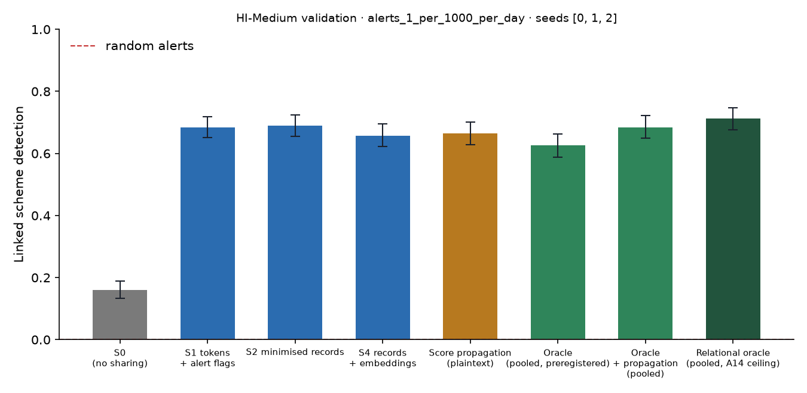

# X1 · sharing ladder on validation · HI-Medium · federation B8c90

**Secondary analysis (A21 coverage curve): federation B8c90**, the largest banks holding 90% of accounts, grouped into 8 members; accounts at other banks are outside and cannot be asked. No sweeps or audit; decides no hypothesis. Seeds [0, 1, 2]; primary budget alerts_1_per_1000_per_day; schemes detected within 12 windows; primary fusion **stacker** (A13); H1b ceiling **oracle-relational** (A14). Per-scheme outcomes are averaged over seeds before the scheme bootstrap. Total 1,757 s, peak memory 1,687 MB.

## Linked detection per configuration (primary fusion)

| Configuration | Linked [95% CI] | Across members | Detected [95% CI] | Gain over S0 [95% CI] | p | AUPRC (mean) |
| --- | --- | --- | --- | --- | --- | --- |
| S0 (no sharing) | 0.1597 [0.1337, 0.1887] | 0.0000 | 0.8506 [0.8221, 0.8760] | — | — | 0.3334 |
| S1 tokens + alert flags | 0.6842 [0.6515, 0.7193] | 0.6534 | 0.8149 [0.7822, 0.8439] | 0.5245 [0.4840, 0.5662] | 0.0000 | 0.3788 |
| S2 minimised records | 0.6903 [0.6558, 0.7248] | 0.6576 | 0.8252 [0.7949, 0.8548] | 0.5306 [0.4882, 0.5705] | 0.0000 | 0.3803 |
| S4 records + embeddings | 0.6576 [0.6219, 0.6945] | 0.6286 | 0.8143 [0.7840, 0.8439] | 0.4979 [0.4555, 0.5396] | 0.0000 | 0.3922 |
| Score propagation (plaintext) | 0.6649 [0.6286, 0.7006] | 0.6255 | 0.8355 [0.8058, 0.8633] | 0.5051 [0.4664, 0.5469] | 0.0000 | 0.4040 |
| Oracle (pooled, preregistered) | 0.6255 [0.5886, 0.6624] | 0.5705 | 0.8639 [0.8354, 0.8905] | 0.4658 [0.4265, 0.5057] | 0.0000 | 0.3965 |
| Oracle + propagation (pooled) | 0.6848 [0.6491, 0.7229] | 0.6298 | 0.8173 [0.7876, 0.8494] | 0.5251 [0.4864, 0.5656] | 0.0000 | 0.4460 |
| Relational oracle (pooled, A14 ceiling) | 0.7120 [0.6763, 0.7477] | 0.6552 | 0.8203 [0.7907, 0.8506] | 0.5523 [0.5142, 0.5917] | 0.0000 | 0.4426 |

Random alerts at the same budget: detected 0.0091, linked 0.0000.

## H1b on validation: share of the ceiling's gain recovered

(level − S0) / (ceiling − S0) in linked detection, scheme bootstrap. The relational oracle (pooled data with the same re-ranking, plaintext) is the ceiling from A14; the preregistered oracle is kept for comparison, and `strongest-pooled` uses whichever pooled relational configuration links more (oracle-relational) as a sensitivity check. Target: at least 0.60 for S2, judged on test.

| Level | Against oracle-relational [95% CI] | Against oracle [95% CI] | Against strongest-pooled [95% CI] |
| --- | --- | --- | --- |
| S1 | 0.9496 [0.9025, 0.9945] | 1.13 [1.07, 1.19] | 0.9496 [0.9025, 0.9945] |
| S2 | 0.9606 [0.9150, 1.01] | 1.14 [1.08, 1.21] | 0.9606 [0.9150, 1.01] |
| S4 | 0.9014 [0.8552, 0.9469] | 1.07 [1.01, 1.13] | 0.9014 [0.8552, 0.9469] |

## Secondary fusion rules

k-of-n uses only alert flags and noisy-OR only flags and the probability bucket, so their S2 and S4 rows coincide by construction.

| Level / rule | Linked | Detected | Gain over S0 | AUPRC (mean) |
| --- | --- | --- | --- | --- |
| S1/noisy_or | 0.6352 [0.5995, 0.6697] | 0.8373 [0.8082, 0.8645] | 0.4755 [0.4368, 0.5167] | 0.3668 |
| S1/kofn | 0.6086 [0.5711, 0.6473] | 0.8300 [0.8016, 0.8578] | 0.4489 [0.4047, 0.4931] | 0.3688 |
| S2/noisy_or | 0.6473 [0.6110, 0.6824] | 0.7949 [0.7641, 0.8252] | 0.4876 [0.4440, 0.5306] | 0.3809 |
| S2/kofn | 0.6086 [0.5711, 0.6473] | 0.8300 [0.8016, 0.8578] | 0.4489 [0.4047, 0.4931] | 0.3688 |
| S4/noisy_or | 0.6473 [0.6110, 0.6824] | 0.7949 [0.7641, 0.8252] | 0.4876 [0.4440, 0.5306] | 0.3809 |
| S4/kofn | 0.6086 [0.5711, 0.6473] | 0.8300 [0.8016, 0.8578] | 0.4489 [0.4047, 0.4931] | 0.3688 |

## Protocol per seed

Token evaluations are counted by the first level that needs them; later levels reuse the same tokens.

| Seed | Level | Requests | Answered: alert | Record, no alert | Refused | Accounts disclosed | LDP withheld | Max ε per account | Token evaluations | Seconds |
| --- | --- | --- | --- | --- | --- | --- | --- | --- | --- | --- |
| 0 | S1 | 216,710 | 9,159 | 0 | 793 | 0 | 0 | 0.0000 | 255,636 | 91.10 |
| 0 | S2 | 216,710 | 9,159 | 50,454 | 793 | 41,407 | 0 | 0.0000 | 0 | 38.10 |
| 0 | S4 | 216,710 | 9,159 | 50,454 | 793 | 41,407 | 0 | 0.0000 | 0 | 38.30 |
| 1 | S1 | 230,214 | 9,290 | 0 | 849 | 0 | 0 | 0.0000 | 272,245 | 100.70 |
| 1 | S2 | 230,214 | 9,290 | 58,317 | 849 | 46,925 | 0 | 0.0000 | 0 | 41.30 |
| 1 | S4 | 230,214 | 9,290 | 58,317 | 849 | 46,925 | 0 | 0.0000 | 0 | 41.20 |
| 2 | S1 | 237,687 | 9,310 | 0 | 844 | 0 | 0 | 0.0000 | 281,378 | 104.90 |
| 2 | S2 | 237,687 | 9,310 | 61,672 | 844 | 49,056 | 0 | 0.0000 | 0 | 44.80 |
| 2 | S4 | 237,687 | 9,310 | 61,672 | 844 | 49,056 | 0 | 0.0000 | 0 | 47.50 |

## Time per seed

| Seed | s0 | oracle | relational | records | propagation | evaluate | total |
| --- | --- | --- | --- | --- | --- | --- | --- |
| 0 | 45.90 | 117.40 | 5.60 | 26.30 | 0.5000 | 215.40 | 578.90 |
| 1 | 50.40 | 127.90 | 7.00 | 33.80 | 0.5000 | 190.60 | 593.50 |
| 2 | 45.20 | 59.10 | 5.10 | 42.30 | 0.5000 | 205.20 | 554.90 |
