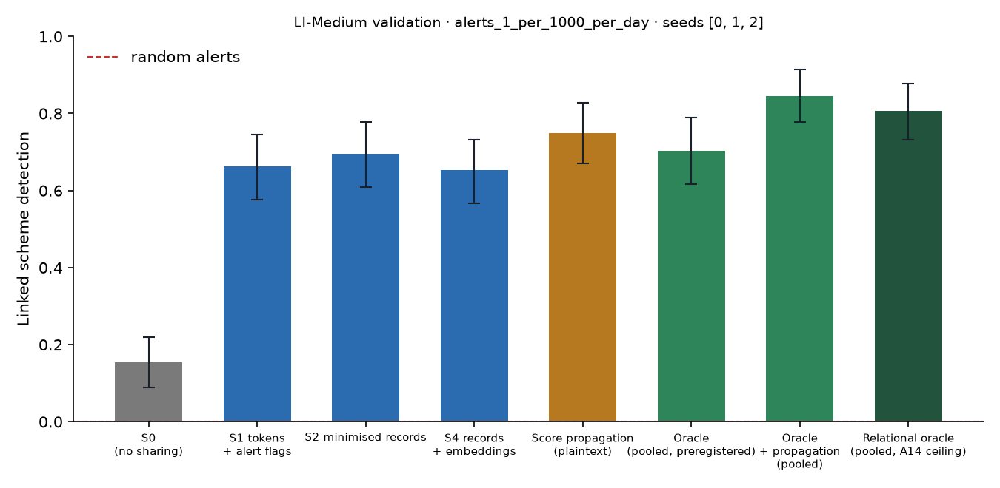

# X1 · sharing ladder on validation · LI-Medium

Seeds [0, 1, 2]; primary budget alerts_1_per_1000_per_day; schemes detected within 12 windows; primary fusion **stacker** (A13); H1b ceiling **oracle-relational** (A14). Per-scheme outcomes are averaged over seeds before the scheme bootstrap. Total 3,599 s, peak memory 1,637 MB. S3 and PD sweeps: `x3_LI-Medium.md`; leakage audit: `audit_LI-Medium.md`.

## Linked detection per configuration (primary fusion)

| Configuration | Linked [95% CI] | Across members | Detected [95% CI] | Gain over S0 [95% CI] | p | AUPRC (mean) |
| --- | --- | --- | --- | --- | --- | --- |
| S0 (no sharing) | 0.1541 [0.0895, 0.2187] | 0.0000 | 0.8530 [0.7849, 0.9176] | — | — | 0.0861 |
| S1 tokens + alert flags | 0.6631 [0.5771, 0.7455] | 0.6452 | 0.8387 [0.7670, 0.9104] | 0.5090 [0.4194, 0.6057] | 0.0000 | 0.0952 |
| S2 minimised records | 0.6953 [0.6093, 0.7778] | 0.6846 | 0.8351 [0.7634, 0.9033] | 0.5412 [0.4479, 0.6380] | 0.0000 | 0.1038 |
| S4 records + embeddings | 0.6523 [0.5663, 0.7312] | 0.6344 | 0.8065 [0.7348, 0.8746] | 0.4982 [0.4086, 0.5950] | 0.0000 | 0.1061 |
| Score propagation (plaintext) | 0.7491 [0.6702, 0.8280] | 0.7312 | 0.8459 [0.7706, 0.9140] | 0.5950 [0.5018, 0.6882] | 0.0000 | 0.1102 |
| Oracle (pooled, preregistered) | 0.7025 [0.6165, 0.7886] | 0.6559 | 0.9104 [0.8495, 0.9642] | 0.5484 [0.4588, 0.6344] | 0.0000 | 0.1188 |
| Oracle + propagation (pooled) | 0.8459 [0.7777, 0.9140] | 0.8065 | 0.8853 [0.8244, 0.9427] | 0.6918 [0.6057, 0.7778] | 0.0000 | 0.1442 |
| Relational oracle (pooled, A14 ceiling) | 0.8065 [0.7312, 0.8781] | 0.7634 | 0.8746 [0.8100, 0.9355] | 0.6523 [0.5662, 0.7384] | 0.0000 | 0.1371 |

Random alerts at the same budget: detected 0.0113, linked 0.0000.

## H1b on validation: share of the ceiling's gain recovered

(level − S0) / (ceiling − S0) in linked detection, scheme bootstrap. The relational oracle (pooled data with the same re-ranking, plaintext) is the ceiling from A14; the preregistered oracle is kept for comparison. Target: at least 0.60 for S2, judged on test.

| Level | Against oracle-relational [95% CI] | Against oracle [95% CI] |
| --- | --- | --- |
| S1 | 0.7802 [0.6878, 0.8549] | 0.9281 [0.8344, 1.03] |
| S2 | 0.8297 [0.7366, 0.9214] | 0.9869 [0.8725, 1.11] |
| S4 | 0.7637 [0.6630, 0.8553] | 0.9085 [0.7986, 1.04] |

## Secondary fusion rules

k-of-n uses only alert flags and noisy-OR only flags and the probability bucket, so their S2 and S4 rows coincide by construction.

| Level / rule | Linked | Detected | Gain over S0 | AUPRC (mean) |
| --- | --- | --- | --- | --- |
| S1/noisy_or | 0.6738 [0.5877, 0.7528] | 0.8423 [0.7742, 0.9032] | 0.5197 [0.4264, 0.6094] | 0.0901 |
| S1/kofn | 0.5520 [0.4588, 0.6417] | 0.7921 [0.7168, 0.8602] | 0.3978 [0.3011, 0.4946] | 0.0844 |
| S2/noisy_or | 0.6882 [0.6022, 0.7671] | 0.8244 [0.7490, 0.8925] | 0.5341 [0.4373, 0.6237] | 0.1023 |
| S2/kofn | 0.5520 [0.4588, 0.6417] | 0.7921 [0.7168, 0.8602] | 0.3978 [0.3011, 0.4946] | 0.0844 |
| S4/noisy_or | 0.6882 [0.6022, 0.7671] | 0.8244 [0.7490, 0.8925] | 0.5341 [0.4373, 0.6237] | 0.1023 |
| S4/kofn | 0.5520 [0.4588, 0.6417] | 0.7921 [0.7168, 0.8602] | 0.3978 [0.3011, 0.4946] | 0.0844 |

## Protocol per seed

Token evaluations are counted by the first level that needs them; later levels reuse the same tokens.

| Seed | Level | Requests | Answered: alert | Record, no alert | Refused | Accounts disclosed | LDP withheld | Max ε per account | Token evaluations | Seconds |
| --- | --- | --- | --- | --- | --- | --- | --- | --- | --- | --- |
| 0 | S1 | 205,502 | 7,450 | 0 | 543 | 0 | 0 | 0.0000 | 254,267 | 119.00 |
| 0 | S2 | 205,502 | 7,450 | 53,662 | 543 | 45,612 | 0 | 0.0000 | 0 | 55.30 |
| 0 | S4 | 205,502 | 7,450 | 53,662 | 543 | 45,612 | 0 | 0.0000 | 0 | 56.40 |
| 0 | S3[eps=0.5] | 205,502 | 7,450 | 53,662 | 543 | 45,612 | 0 | 3.50 | 0 | 72.30 |
| 0 | S3[eps=1] | 205,502 | 7,450 | 53,662 | 543 | 45,612 | 0 | 7.00 | 0 | 77.50 |
| 0 | S3[eps=2] | 205,502 | 7,450 | 53,662 | 543 | 45,612 | 24 | 8.00 | 0 | 73.50 |
| 0 | S3[eps=4] | 205,502 | 7,450 | 53,455 | 543 | 45,612 | 353 | 8.00 | 0 | 70.00 |
| 0 | S3[eps=8] | 205,502 | 7,450 | 50,625 | 543 | 45,612 | 3,988 | 8.00 | 0 | 74.00 |
| 0 | PD[tau=2] | 205,502 | 7,450 | 7,790 | 543 | 8,526 | 0 | 0.0000 | 0 | 52.80 |
| 0 | PD[tau=3] | 205,502 | 7,450 | 467 | 543 | 751 | 0 | 0.0000 | 0 | 51.90 |
| 0 | PD[tau=4] | 205,502 | 7,450 | 214 | 543 | 410 | 0 | 0.0000 | 0 | 49.20 |
| 1 | S1 | 197,151 | 6,758 | 0 | 538 | 0 | 0 | 0.0000 | 241,828 | 89.60 |
| 1 | S2 | 197,151 | 6,758 | 46,417 | 538 | 40,295 | 0 | 0.0000 | 0 | 38.70 |
| 1 | S4 | 197,151 | 6,758 | 46,417 | 538 | 40,295 | 0 | 0.0000 | 0 | 38.40 |
| 1 | S3[eps=0.5] | 197,151 | 6,758 | 46,417 | 538 | 40,295 | 0 | 3.50 | 0 | 59.90 |
| 1 | S3[eps=1] | 197,151 | 6,758 | 46,417 | 538 | 40,295 | 0 | 7.00 | 0 | 57.70 |
| 1 | S3[eps=2] | 197,151 | 6,758 | 46,417 | 538 | 40,295 | 23 | 8.00 | 0 | 55.90 |
| 1 | S3[eps=4] | 197,151 | 6,758 | 46,257 | 538 | 40,295 | 287 | 8.00 | 0 | 62.40 |
| 1 | S3[eps=8] | 197,151 | 6,758 | 43,635 | 538 | 40,295 | 3,618 | 8.00 | 0 | 62.80 |
| 1 | PD[tau=2] | 197,151 | 6,758 | 6,077 | 538 | 6,771 | 0 | 0.0000 | 0 | 41.30 |
| 1 | PD[tau=3] | 197,151 | 6,758 | 639 | 538 | 963 | 0 | 0.0000 | 0 | 39.70 |
| 1 | PD[tau=4] | 197,151 | 6,758 | 128 | 538 | 304 | 0 | 0.0000 | 0 | 36.40 |
| 2 | S1 | 190,467 | 6,767 | 0 | 535 | 0 | 0 | 0.0000 | 234,476 | 87.70 |
| 2 | S2 | 190,467 | 6,767 | 45,345 | 535 | 39,551 | 0 | 0.0000 | 0 | 36.50 |
| 2 | S4 | 190,467 | 6,767 | 45,345 | 535 | 39,551 | 0 | 0.0000 | 0 | 36.80 |
| 2 | S3[eps=0.5] | 190,467 | 6,767 | 45,345 | 535 | 39,551 | 0 | 3.00 | 0 | 58.70 |
| 2 | S3[eps=1] | 190,467 | 6,767 | 45,345 | 535 | 39,551 | 0 | 6.00 | 0 | 53.90 |
| 2 | S3[eps=2] | 190,467 | 6,767 | 45,345 | 535 | 39,551 | 24 | 8.00 | 0 | 55.30 |
| 2 | S3[eps=4] | 190,467 | 6,767 | 45,237 | 535 | 39,551 | 257 | 8.00 | 0 | 62.00 |
| 2 | S3[eps=8] | 190,467 | 6,767 | 42,817 | 535 | 39,551 | 3,422 | 8.00 | 0 | 51.60 |
| 2 | PD[tau=2] | 190,467 | 6,767 | 6,841 | 535 | 7,595 | 0 | 0.0000 | 0 | 35.20 |
| 2 | PD[tau=3] | 190,467 | 6,767 | 583 | 535 | 920 | 0 | 0.0000 | 0 | 36.00 |
| 2 | PD[tau=4] | 190,467 | 6,767 | 124 | 535 | 296 | 0 | 0.0000 | 0 | 35.10 |

## Time per seed

| Seed | s0 | oracle | relational | records | propagation | evaluate | total |
| --- | --- | --- | --- | --- | --- | --- | --- |
| 0 | 24.10 | 82.40 | 16.00 | 30.20 | 0.6000 | 384.60 | 1,440.50 |
| 1 | 30.10 | 79.70 | 5.90 | 29.80 | 0.6000 | 367.80 | 1,096.80 |
| 2 | 29.70 | 51.20 | 6.80 | 30.10 | 0.6000 | 358.40 | 1,025.70 |
