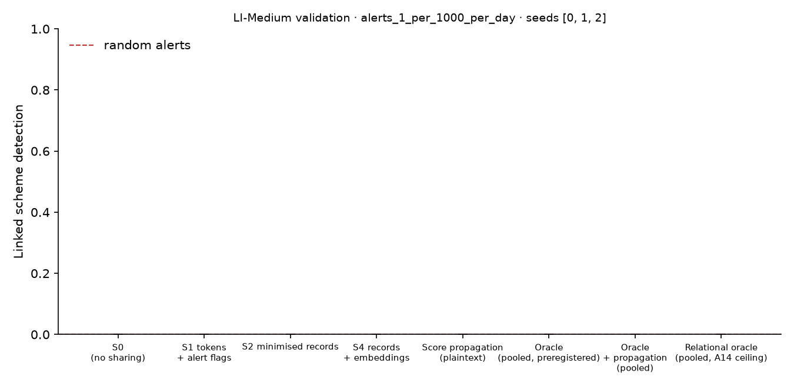

# X1 · sharing ladder on validation · LI-Medium · federation A64

**Secondary analysis (A20): federation A64**, real banks only; accounts at other banks are outside and cannot be asked. No sweeps or audit; decides no hypothesis. Seeds [0, 1, 2]; primary budget alerts_1_per_1000_per_day; schemes detected within 12 windows; primary fusion **stacker** (A13); H1b ceiling **oracle-relational** (A14). Per-scheme outcomes are averaged over seeds before the scheme bootstrap. Total 140 s, peak memory 978 MB.

## Linked detection per configuration (primary fusion)

| Configuration | Linked [95% CI] | Across members | Detected [95% CI] | Gain over S0 [95% CI] | p | AUPRC (mean) |
| --- | --- | --- | --- | --- | --- | --- |
| S0 (no sharing) | 0.0000 [0.0000, 0.0000] | 0.0000 | 0.0394 [0.0108, 0.0753] | — | — | 0.0198 |
| S1 tokens + alert flags | 0.0000 [0.0000, 0.0000] | 0.0000 | 0.0466 [0.0143, 0.0897] | 0.0000 [0.0000, 0.0000] | 1.00 | 0.0159 |
| S2 minimised records | 0.0000 [0.0000, 0.0000] | 0.0000 | 0.0573 [0.0179, 0.1040] | 0.0000 [0.0000, 0.0000] | 1.00 | 0.0169 |
| S4 records + embeddings | 0.0000 [0.0000, 0.0000] | 0.0000 | 0.0502 [0.0143, 0.0968] | 0.0000 [0.0000, 0.0000] | 1.00 | 0.0162 |
| Score propagation (plaintext) | 0.0000 [0.0000, 0.0000] | 0.0000 | 0.0430 [0.0108, 0.0824] | 0.0000 [0.0000, 0.0000] | 1.00 | 0.0207 |
| Oracle (pooled, preregistered) | 0.0000 [0.0000, 0.0000] | 0.0000 | 0.1254 [0.0645, 0.1900] | 0.0000 [0.0000, 0.0000] | 1.00 | 0.1821 |
| Oracle + propagation (pooled) | 0.0000 [0.0000, 0.0000] | 0.0000 | 0.1039 [0.0538, 0.1613] | 0.0000 [0.0000, 0.0000] | 1.00 | 0.0995 |
| Relational oracle (pooled, A14 ceiling) | 0.0000 [0.0000, 0.0000] | 0.0000 | 0.0968 [0.0430, 0.1505] | 0.0000 [0.0000, 0.0000] | 1.00 | 0.0724 |

Random alerts at the same budget: detected 0.0004, linked 0.0000.

## H1b on validation: share of the ceiling's gain recovered

(level − S0) / (ceiling − S0) in linked detection, scheme bootstrap. The relational oracle (pooled data with the same re-ranking, plaintext) is the ceiling from A14; the preregistered oracle is kept for comparison, and `strongest-pooled` uses whichever pooled relational configuration links more (oracle-relational) as a sensitivity check. Target: at least 0.60 for S2, judged on test.

| Level | Against oracle-relational [95% CI] | Against oracle [95% CI] | Against strongest-pooled [95% CI] |
| --- | --- | --- | --- |
| S1 | — | — | — |
| S2 | — | — | — |
| S4 | — | — | — |

## Secondary fusion rules

k-of-n uses only alert flags and noisy-OR only flags and the probability bucket, so their S2 and S4 rows coincide by construction.

| Level / rule | Linked | Detected | Gain over S0 | AUPRC (mean) |
| --- | --- | --- | --- | --- |
| S1/noisy_or | 0.0000 [0.0000, 0.0000] | 0.0394 [0.0108, 0.0753] | 0.0000 [0.0000, 0.0000] | 0.0198 |
| S1/kofn | 0.0000 [0.0000, 0.0000] | 0.0323 [0.0072, 0.0681] | 0.0000 [0.0000, 0.0000] | 0.0187 |
| S2/noisy_or | 0.0000 [0.0000, 0.0000] | 0.0394 [0.0108, 0.0789] | 0.0000 [0.0000, 0.0000] | 0.0185 |
| S2/kofn | 0.0000 [0.0000, 0.0000] | 0.0323 [0.0072, 0.0681] | 0.0000 [0.0000, 0.0000] | 0.0187 |
| S4/noisy_or | 0.0000 [0.0000, 0.0000] | 0.0394 [0.0108, 0.0789] | 0.0000 [0.0000, 0.0000] | 0.0185 |
| S4/kofn | 0.0000 [0.0000, 0.0000] | 0.0323 [0.0072, 0.0681] | 0.0000 [0.0000, 0.0000] | 0.0187 |

## Protocol per seed

Token evaluations are counted by the first level that needs them; later levels reuse the same tokens.

| Seed | Level | Requests | Answered: alert | Record, no alert | Refused | Accounts disclosed | LDP withheld | Max ε per account | Token evaluations | Seconds |
| --- | --- | --- | --- | --- | --- | --- | --- | --- | --- | --- |
| 0 | S1 | 4,514 | 37 | 0 | 0 | 0 | 0 | 0.0000 | 9,965 | 3.30 |
| 0 | S2 | 4,514 | 37 | 1,104 | 0 | 877 | 0 | 0.0000 | 0 | 1.40 |
| 0 | S4 | 4,514 | 37 | 1,104 | 0 | 877 | 0 | 0.0000 | 0 | 1.10 |
| 1 | S1 | 4,350 | 36 | 0 | 0 | 0 | 0 | 0.0000 | 9,213 | 3.00 |
| 1 | S2 | 4,350 | 36 | 1,073 | 0 | 836 | 0 | 0.0000 | 0 | 0.9000 |
| 1 | S4 | 4,350 | 36 | 1,073 | 0 | 836 | 0 | 0.0000 | 0 | 1.00 |
| 2 | S1 | 4,483 | 31 | 0 | 0 | 0 | 0 | 0.0000 | 9,727 | 3.20 |
| 2 | S2 | 4,483 | 31 | 1,148 | 0 | 881 | 0 | 0.0000 | 0 | 1.00 |
| 2 | S4 | 4,483 | 31 | 1,148 | 0 | 881 | 0 | 0.0000 | 0 | 1.40 |

## Time per seed

| Seed | s0 | oracle | relational | records | propagation | evaluate | total |
| --- | --- | --- | --- | --- | --- | --- | --- |
| 0 | 4.80 | 2.80 | 2.50 | 19.60 | 0.0000 | 11.40 | 47.10 |
| 1 | 3.80 | 3.00 | 1.30 | 18.20 | 0.0000 | 11.40 | 42.70 |
| 2 | 3.80 | 3.60 | 2.20 | 19.80 | 0.1000 | 11.60 | 46.60 |
