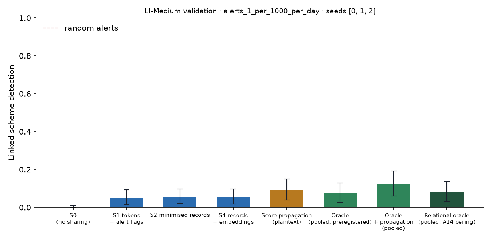

# X1 · sharing ladder on validation · LI-Medium · federation B8c10

**Secondary analysis (A21 coverage curve): federation B8c10**, the largest banks holding 10% of accounts, grouped into 8 members; accounts at other banks are outside and cannot be asked. No sweeps or audit; decides no hypothesis. Seeds [0, 1, 2]; primary budget alerts_1_per_1000_per_day; schemes detected within 12 windows; primary fusion **stacker** (A13); H1b ceiling **oracle-relational** (A14). Per-scheme outcomes are averaged over seeds before the scheme bootstrap. Total 205 s, peak memory 1,060 MB.

## Linked detection per configuration (primary fusion)

| Configuration | Linked [95% CI] | Across members | Detected [95% CI] | Gain over S0 [95% CI] | p | AUPRC (mean) |
| --- | --- | --- | --- | --- | --- | --- |
| S0 (no sharing) | 0.0036 [0.0000, 0.0108] | 0.0000 | 0.3513 [0.2651, 0.4338] | — | — | 0.0746 |
| S1 tokens + alert flags | 0.0502 [0.0143, 0.0932] | 0.0430 | 0.2975 [0.2222, 0.3799] | 0.0466 [0.0108, 0.0896] | 0.0040 | 0.0702 |
| S2 minimised records | 0.0573 [0.0215, 0.0968] | 0.0538 | 0.2724 [0.1971, 0.3513] | 0.0538 [0.0179, 0.0932] | 0.0000 | 0.0649 |
| S4 records + embeddings | 0.0538 [0.0179, 0.0968] | 0.0502 | 0.2724 [0.1935, 0.3477] | 0.0502 [0.0143, 0.0932] | 0.0020 | 0.0642 |
| Score propagation (plaintext) | 0.0932 [0.0394, 0.1505] | 0.0896 | 0.2796 [0.2042, 0.3620] | 0.0896 [0.0394, 0.1470] | 0.0000 | 0.0796 |
| Oracle (pooled, preregistered) | 0.0753 [0.0251, 0.1291] | 0.0645 | 0.4552 [0.3584, 0.5448] | 0.0717 [0.0251, 0.1254] | 0.0000 | 0.1717 |
| Oracle + propagation (pooled) | 0.1254 [0.0609, 0.1935] | 0.1254 | 0.3907 [0.2975, 0.4803] | 0.1219 [0.0609, 0.1900] | 0.0000 | 0.1619 |
| Relational oracle (pooled, A14 ceiling) | 0.0824 [0.0323, 0.1362] | 0.0824 | 0.4373 [0.3404, 0.5269] | 0.0789 [0.0323, 0.1290] | 0.0000 | 0.1481 |

Random alerts at the same budget: detected 0.0018, linked 0.0000.

## H1b on validation: share of the ceiling's gain recovered

(level − S0) / (ceiling − S0) in linked detection, scheme bootstrap. The relational oracle (pooled data with the same re-ranking, plaintext) is the ceiling from A14; the preregistered oracle is kept for comparison, and `strongest-pooled` uses whichever pooled relational configuration links more (oracle+propagation) as a sensitivity check. Target: at least 0.60 for S2, judged on test.

| Level | Against oracle-relational [95% CI] | Against oracle [95% CI] | Against strongest-pooled [95% CI] |
| --- | --- | --- | --- |
| S1 | 0.5909 [0.3122, 0.8667] | 0.6500 [0.2498, 1.40] | 0.3824 [0.1578, 0.6111] |
| S2 | 0.6818 [0.4089, 1.08] | 0.7500 [0.3913, 1.50] | 0.4412 [0.2308, 0.6298] |
| S4 | 0.6364 [0.3200, 1.00] | 0.7000 [0.3042, 1.40] | 0.4118 [0.1739, 0.6552] |

## Secondary fusion rules

k-of-n uses only alert flags and noisy-OR only flags and the probability bucket, so their S2 and S4 rows coincide by construction.

| Level / rule | Linked | Detected | Gain over S0 | AUPRC (mean) |
| --- | --- | --- | --- | --- |
| S1/noisy_or | 0.0789 [0.0323, 0.1255] | 0.2975 [0.2222, 0.3799] | 0.0753 [0.0323, 0.1220] | 0.0771 |
| S1/kofn | 0.0824 [0.0358, 0.1362] | 0.2581 [0.1828, 0.3334] | 0.0789 [0.0323, 0.1326] | 0.0635 |
| S2/noisy_or | 0.0896 [0.0394, 0.1434] | 0.2509 [0.1756, 0.3333] | 0.0860 [0.0358, 0.1398] | 0.0752 |
| S2/kofn | 0.0824 [0.0358, 0.1362] | 0.2581 [0.1828, 0.3334] | 0.0789 [0.0323, 0.1326] | 0.0635 |
| S4/noisy_or | 0.0896 [0.0394, 0.1434] | 0.2509 [0.1756, 0.3333] | 0.0860 [0.0358, 0.1398] | 0.0752 |
| S4/kofn | 0.0824 [0.0358, 0.1362] | 0.2581 [0.1828, 0.3334] | 0.0789 [0.0323, 0.1326] | 0.0635 |

## Protocol per seed

Token evaluations are counted by the first level that needs them; later levels reuse the same tokens.

| Seed | Level | Requests | Answered: alert | Record, no alert | Refused | Accounts disclosed | LDP withheld | Max ε per account | Token evaluations | Seconds |
| --- | --- | --- | --- | --- | --- | --- | --- | --- | --- | --- |
| 0 | S1 | 11,328 | 276 | 0 | 0 | 0 | 0 | 0.0000 | 19,217 | 6.80 |
| 0 | S2 | 11,328 | 276 | 2,337 | 0 | 2,124 | 0 | 0.0000 | 0 | 2.00 |
| 0 | S4 | 11,328 | 276 | 2,337 | 0 | 2,124 | 0 | 0.0000 | 0 | 2.10 |
| 1 | S1 | 11,043 | 287 | 0 | 0 | 0 | 0 | 0.0000 | 18,531 | 5.70 |
| 1 | S2 | 11,043 | 287 | 2,355 | 0 | 2,168 | 0 | 0.0000 | 0 | 1.90 |
| 1 | S4 | 11,043 | 287 | 2,355 | 0 | 2,168 | 0 | 0.0000 | 0 | 1.90 |
| 2 | S1 | 12,156 | 289 | 0 | 0 | 0 | 0 | 0.0000 | 20,726 | 6.30 |
| 2 | S2 | 12,156 | 289 | 2,669 | 0 | 2,402 | 0 | 0.0000 | 0 | 2.10 |
| 2 | S4 | 12,156 | 289 | 2,669 | 0 | 2,402 | 0 | 0.0000 | 0 | 2.10 |

## Time per seed

| Seed | s0 | oracle | relational | records | propagation | evaluate | total |
| --- | --- | --- | --- | --- | --- | --- | --- |
| 0 | 6.60 | 4.50 | 2.50 | 21.50 | 0.1000 | 24.50 | 70.50 |
| 1 | 5.00 | 4.40 | 1.30 | 20.00 | 0.0000 | 23.30 | 63.50 |
| 2 | 3.70 | 6.50 | 1.20 | 19.40 | 0.0000 | 23.60 | 65.00 |
