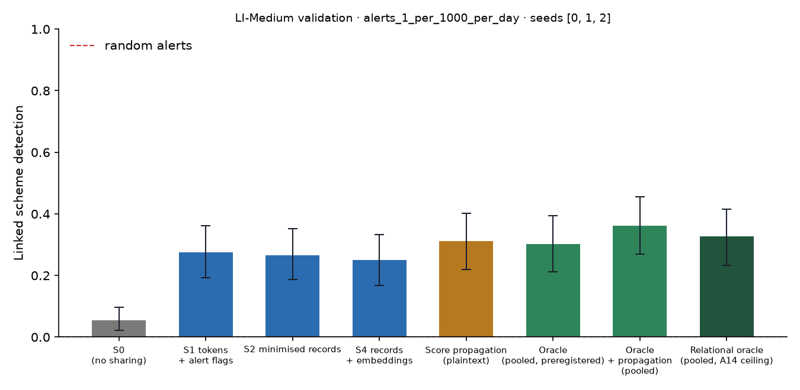

# X1 · sharing ladder on validation · LI-Medium · federation B8c25

**Secondary analysis (A21 coverage curve): federation B8c25**, the largest banks holding 25% of accounts, grouped into 8 members; accounts at other banks are outside and cannot be asked. No sweeps or audit; decides no hypothesis. Seeds [0, 1, 2]; primary budget alerts_1_per_1000_per_day; schemes detected within 12 windows; primary fusion **stacker** (A13); H1b ceiling **oracle-relational** (A14). Per-scheme outcomes are averaged over seeds before the scheme bootstrap. Total 446 s, peak memory 1,026 MB.

## Linked detection per configuration (primary fusion)

| Configuration | Linked [95% CI] | Across members | Detected [95% CI] | Gain over S0 [95% CI] | p | AUPRC (mean) |
| --- | --- | --- | --- | --- | --- | --- |
| S0 (no sharing) | 0.0538 [0.0215, 0.0968] | 0.0000 | 0.6093 [0.5125, 0.6989] | — | — | 0.0953 |
| S1 tokens + alert flags | 0.2760 [0.1935, 0.3620] | 0.2473 | 0.5806 [0.4839, 0.6738] | 0.2222 [0.1470, 0.3047] | 0.0000 | 0.0961 |
| S2 minimised records | 0.2652 [0.1863, 0.3513] | 0.2437 | 0.5663 [0.4731, 0.6596] | 0.2115 [0.1325, 0.2904] | 0.0000 | 0.0942 |
| S4 records + embeddings | 0.2509 [0.1685, 0.3334] | 0.2330 | 0.5806 [0.4875, 0.6774] | 0.1971 [0.1183, 0.2724] | 0.0000 | 0.0907 |
| Score propagation (plaintext) | 0.3118 [0.2186, 0.4014] | 0.2832 | 0.5806 [0.4839, 0.6738] | 0.2581 [0.1720, 0.3405] | 0.0000 | 0.1097 |
| Oracle (pooled, preregistered) | 0.3011 [0.2115, 0.3943] | 0.2330 | 0.6738 [0.5806, 0.7670] | 0.2473 [0.1685, 0.3297] | 0.0000 | 0.1490 |
| Oracle + propagation (pooled) | 0.3620 [0.2688, 0.4553] | 0.3226 | 0.6452 [0.5520, 0.7348] | 0.3082 [0.2222, 0.3978] | 0.0000 | 0.1640 |
| Relational oracle (pooled, A14 ceiling) | 0.3262 [0.2330, 0.4158] | 0.2867 | 0.6416 [0.5448, 0.7348] | 0.2724 [0.1900, 0.3584] | 0.0000 | 0.1501 |

Random alerts at the same budget: detected 0.0039, linked 0.0000.

## H1b on validation: share of the ceiling's gain recovered

(level − S0) / (ceiling − S0) in linked detection, scheme bootstrap. The relational oracle (pooled data with the same re-ranking, plaintext) is the ceiling from A14; the preregistered oracle is kept for comparison, and `strongest-pooled` uses whichever pooled relational configuration links more (oracle+propagation) as a sensitivity check. Target: at least 0.60 for S2, judged on test.

| Level | Against oracle-relational [95% CI] | Against oracle [95% CI] | Against strongest-pooled [95% CI] |
| --- | --- | --- | --- |
| S1 | 0.8158 [0.6437, 0.9861] | 0.8986 [0.7377, 1.08] | 0.7209 [0.5773, 0.8393] |
| S2 | 0.7763 [0.5964, 0.9606] | 0.8551 [0.6500, 1.11] | 0.6860 [0.5316, 0.8228] |
| S4 | 0.7237 [0.5000, 0.9547] | 0.7971 [0.5977, 1.04] | 0.6395 [0.4683, 0.7838] |

## Secondary fusion rules

k-of-n uses only alert flags and noisy-OR only flags and the probability bucket, so their S2 and S4 rows coincide by construction.

| Level / rule | Linked | Detected | Gain over S0 | AUPRC (mean) |
| --- | --- | --- | --- | --- |
| S1/noisy_or | 0.3082 [0.2151, 0.3978] | 0.5771 [0.4803, 0.6667] | 0.2545 [0.1720, 0.3369] | 0.0995 |
| S1/kofn | 0.2652 [0.1827, 0.3548] | 0.5090 [0.4158, 0.5986] | 0.2115 [0.1254, 0.2939] | 0.0839 |
| S2/noisy_or | 0.3190 [0.2258, 0.4086] | 0.5484 [0.4551, 0.6381] | 0.2652 [0.1792, 0.3477] | 0.1016 |
| S2/kofn | 0.2652 [0.1827, 0.3548] | 0.5090 [0.4158, 0.5986] | 0.2115 [0.1254, 0.2939] | 0.0839 |
| S4/noisy_or | 0.3190 [0.2258, 0.4086] | 0.5484 [0.4551, 0.6381] | 0.2652 [0.1792, 0.3477] | 0.1016 |
| S4/kofn | 0.2652 [0.1827, 0.3548] | 0.5090 [0.4158, 0.5986] | 0.2115 [0.1254, 0.2939] | 0.0839 |

## Protocol per seed

Token evaluations are counted by the first level that needs them; later levels reuse the same tokens.

| Seed | Level | Requests | Answered: alert | Record, no alert | Refused | Accounts disclosed | LDP withheld | Max ε per account | Token evaluations | Seconds |
| --- | --- | --- | --- | --- | --- | --- | --- | --- | --- | --- |
| 0 | S1 | 45,924 | 1,153 | 0 | 0 | 0 | 0 | 0.0000 | 66,504 | 22.00 |
| 0 | S2 | 45,924 | 1,153 | 12,239 | 0 | 10,312 | 0 | 0.0000 | 0 | 8.00 |
| 0 | S4 | 45,924 | 1,153 | 12,239 | 0 | 10,312 | 0 | 0.0000 | 0 | 8.10 |
| 1 | S1 | 42,358 | 1,133 | 0 | 0 | 0 | 0 | 0.0000 | 61,432 | 20.60 |
| 1 | S2 | 42,358 | 1,133 | 10,343 | 0 | 9,014 | 0 | 0.0000 | 0 | 7.30 |
| 1 | S4 | 42,358 | 1,133 | 10,343 | 0 | 9,014 | 0 | 0.0000 | 0 | 7.40 |
| 2 | S1 | 47,569 | 1,158 | 0 | 0 | 0 | 0 | 0.0000 | 69,733 | 22.80 |
| 2 | S2 | 47,569 | 1,158 | 13,061 | 0 | 10,949 | 0 | 0.0000 | 0 | 8.60 |
| 2 | S4 | 47,569 | 1,158 | 13,061 | 0 | 10,949 | 0 | 0.0000 | 0 | 8.50 |

## Time per seed

| Seed | s0 | oracle | relational | records | propagation | evaluate | total |
| --- | --- | --- | --- | --- | --- | --- | --- |
| 0 | 11.90 | 13.10 | 2.00 | 23.90 | 0.2000 | 60.20 | 149.50 |
| 1 | 9.00 | 15.60 | 3.10 | 22.60 | 0.2000 | 57.60 | 143.50 |
| 2 | 7.50 | 12.50 | 1.90 | 20.10 | 0.2000 | 58.90 | 141.00 |
