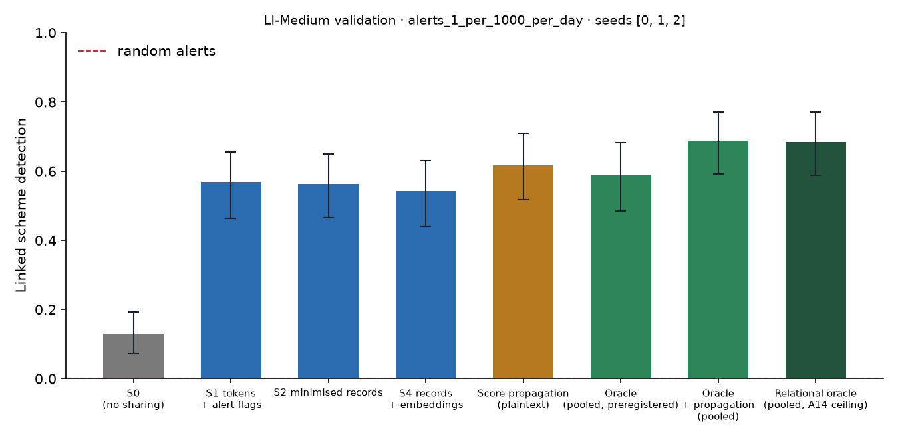

# X1 · sharing ladder on validation · LI-Medium · federation B8c50

**Secondary analysis (A21 coverage curve): federation B8c50**, the largest banks holding 50% of accounts, grouped into 8 members; accounts at other banks are outside and cannot be asked. No sweeps or audit; decides no hypothesis. Seeds [0, 1, 2]; primary budget alerts_1_per_1000_per_day; schemes detected within 12 windows; primary fusion **stacker** (A13); H1b ceiling **oracle-relational** (A14). Per-scheme outcomes are averaged over seeds before the scheme bootstrap. Total 1,379 s, peak memory 1,345 MB.

## Linked detection per configuration (primary fusion)

| Configuration | Linked [95% CI] | Across members | Detected [95% CI] | Gain over S0 [95% CI] | p | AUPRC (mean) |
| --- | --- | --- | --- | --- | --- | --- |
| S0 (no sharing) | 0.1290 [0.0717, 0.1935] | 0.0000 | 0.7706 [0.6846, 0.8459] | — | — | 0.1016 |
| S1 tokens + alert flags | 0.5663 [0.4624, 0.6560] | 0.5448 | 0.7419 [0.6487, 0.8244] | 0.4373 [0.3405, 0.5234] | 0.0000 | 0.1111 |
| S2 minimised records | 0.5627 [0.4659, 0.6487] | 0.5520 | 0.7312 [0.6380, 0.8172] | 0.4337 [0.3297, 0.5305] | 0.0000 | 0.1184 |
| S4 records + embeddings | 0.5412 [0.4409, 0.6308] | 0.5269 | 0.7240 [0.6344, 0.8065] | 0.4122 [0.3117, 0.5019] | 0.0000 | 0.1200 |
| Score propagation (plaintext) | 0.6165 [0.5161, 0.7097] | 0.6022 | 0.7491 [0.6558, 0.8351] | 0.4875 [0.3907, 0.5806] | 0.0000 | 0.1274 |
| Oracle (pooled, preregistered) | 0.5878 [0.4839, 0.6811] | 0.5376 | 0.8423 [0.7778, 0.9068] | 0.4588 [0.3620, 0.5521] | 0.0000 | 0.1409 |
| Oracle + propagation (pooled) | 0.6882 [0.5913, 0.7706] | 0.6416 | 0.7814 [0.7025, 0.8567] | 0.5591 [0.4624, 0.6488] | 0.0000 | 0.1640 |
| Relational oracle (pooled, A14 ceiling) | 0.6846 [0.5878, 0.7706] | 0.6380 | 0.7885 [0.7096, 0.8674] | 0.5556 [0.4624, 0.6452] | 0.0000 | 0.1569 |

Random alerts at the same budget: detected 0.0069, linked 0.0000.

## H1b on validation: share of the ceiling's gain recovered

(level − S0) / (ceiling − S0) in linked detection, scheme bootstrap. The relational oracle (pooled data with the same re-ranking, plaintext) is the ceiling from A14; the preregistered oracle is kept for comparison, and `strongest-pooled` uses whichever pooled relational configuration links more (oracle+propagation) as a sensitivity check. Target: at least 0.60 for S2, judged on test.

| Level | Against oracle-relational [95% CI] | Against oracle [95% CI] | Against strongest-pooled [95% CI] |
| --- | --- | --- | --- |
| S1 | 0.7871 [0.6765, 0.8889] | 0.9531 [0.8426, 1.07] | 0.7821 [0.6800, 0.8712] |
| S2 | 0.7806 [0.6622, 0.8750] | 0.9453 [0.8264, 1.05] | 0.7756 [0.6708, 0.8613] |
| S4 | 0.7419 [0.6148, 0.8506] | 0.8984 [0.7686, 1.02] | 0.7372 [0.6219, 0.8344] |

## Secondary fusion rules

k-of-n uses only alert flags and noisy-OR only flags and the probability bucket, so their S2 and S4 rows coincide by construction.

| Level / rule | Linked | Detected | Gain over S0 | AUPRC (mean) |
| --- | --- | --- | --- | --- |
| S1/noisy_or | 0.5663 [0.4588, 0.6560] | 0.7312 [0.6380, 0.8172] | 0.4373 [0.3297, 0.5341] | 0.1084 |
| S1/kofn | 0.4552 [0.3477, 0.5520] | 0.6631 [0.5662, 0.7527] | 0.3262 [0.2221, 0.4302] | 0.0995 |
| S2/noisy_or | 0.6057 [0.5054, 0.6918] | 0.7168 [0.6201, 0.8029] | 0.4767 [0.3763, 0.5699] | 0.1172 |
| S2/kofn | 0.4552 [0.3477, 0.5520] | 0.6631 [0.5662, 0.7527] | 0.3262 [0.2221, 0.4302] | 0.0995 |
| S4/noisy_or | 0.6057 [0.5054, 0.6918] | 0.7168 [0.6201, 0.8029] | 0.4767 [0.3763, 0.5699] | 0.1172 |
| S4/kofn | 0.4552 [0.3477, 0.5520] | 0.6631 [0.5662, 0.7527] | 0.3262 [0.2221, 0.4302] | 0.0995 |

## Protocol per seed

Token evaluations are counted by the first level that needs them; later levels reuse the same tokens.

| Seed | Level | Requests | Answered: alert | Record, no alert | Refused | Accounts disclosed | LDP withheld | Max ε per account | Token evaluations | Seconds |
| --- | --- | --- | --- | --- | --- | --- | --- | --- | --- | --- |
| 0 | S1 | 131,478 | 3,636 | 0 | 0 | 0 | 0 | 0.0000 | 173,971 | 59.30 |
| 0 | S2 | 131,478 | 3,636 | 41,807 | 0 | 32,928 | 0 | 0.0000 | 0 | 23.50 |
| 0 | S4 | 131,478 | 3,636 | 41,807 | 0 | 32,928 | 0 | 0.0000 | 0 | 23.90 |
| 1 | S1 | 136,110 | 3,839 | 0 | 0 | 0 | 0 | 0.0000 | 181,062 | 64.70 |
| 1 | S2 | 136,110 | 3,839 | 46,374 | 0 | 35,821 | 0 | 0.0000 | 0 | 27.30 |
| 1 | S4 | 136,110 | 3,839 | 46,374 | 0 | 35,821 | 0 | 0.0000 | 0 | 42.20 |
| 2 | S1 | 116,062 | 3,299 | 0 | 0 | 0 | 0 | 0.0000 | 156,564 | 62.30 |
| 2 | S2 | 116,062 | 3,299 | 34,251 | 0 | 28,098 | 0 | 0.0000 | 0 | 25.30 |
| 2 | S4 | 116,062 | 3,299 | 34,251 | 0 | 28,098 | 0 | 0.0000 | 0 | 24.40 |

## Time per seed

| Seed | s0 | oracle | relational | records | propagation | evaluate | total |
| --- | --- | --- | --- | --- | --- | --- | --- |
| 0 | 21.60 | 38.50 | 2.90 | 24.10 | 0.3000 | 119.20 | 313.40 |
| 1 | 16.80 | 38.00 | 4.50 | 25.40 | 0.6000 | 371.70 | 591.10 |
| 2 | 59.50 | 45.10 | 6.80 | 33.60 | 0.6000 | 188.20 | 446.10 |
