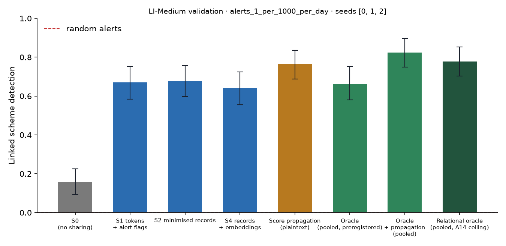

# X1 · sharing ladder on validation · LI-Medium · federation B8c75

**Secondary analysis (A21 coverage curve): federation B8c75**, the largest banks holding 75% of accounts, grouped into 8 members; accounts at other banks are outside and cannot be asked. No sweeps or audit; decides no hypothesis. Seeds [0, 1, 2]; primary budget alerts_1_per_1000_per_day; schemes detected within 12 windows; primary fusion **stacker** (A13); H1b ceiling **oracle-relational** (A14). Per-scheme outcomes are averaged over seeds before the scheme bootstrap. Total 1,512 s, peak memory 1,648 MB.

## Linked detection per configuration (primary fusion)

| Configuration | Linked [95% CI] | Across members | Detected [95% CI] | Gain over S0 [95% CI] | p | AUPRC (mean) |
| --- | --- | --- | --- | --- | --- | --- |
| S0 (no sharing) | 0.1577 [0.0932, 0.2258] | 0.0000 | 0.8459 [0.7742, 0.9176] | — | — | 0.0860 |
| S1 tokens + alert flags | 0.6703 [0.5842, 0.7527] | 0.6631 | 0.8351 [0.7599, 0.9068] | 0.5125 [0.4228, 0.6057] | 0.0000 | 0.0945 |
| S2 minimised records | 0.6774 [0.5985, 0.7563] | 0.6667 | 0.8280 [0.7563, 0.8961] | 0.5197 [0.4265, 0.6057] | 0.0000 | 0.1047 |
| S4 records + embeddings | 0.6416 [0.5555, 0.7240] | 0.6272 | 0.8172 [0.7419, 0.8817] | 0.4839 [0.3943, 0.5699] | 0.0000 | 0.1076 |
| Score propagation (plaintext) | 0.7670 [0.6882, 0.8352] | 0.7599 | 0.8495 [0.7778, 0.9176] | 0.6093 [0.5161, 0.6953] | 0.0000 | 0.1108 |
| Oracle (pooled, preregistered) | 0.6631 [0.5806, 0.7527] | 0.6165 | 0.8961 [0.8351, 0.9534] | 0.5054 [0.4194, 0.5950] | 0.0000 | 0.1192 |
| Oracle + propagation (pooled) | 0.8244 [0.7491, 0.8961] | 0.7814 | 0.8746 [0.8100, 0.9355] | 0.6667 [0.5806, 0.7563] | 0.0000 | 0.1434 |
| Relational oracle (pooled, A14 ceiling) | 0.7778 [0.7025, 0.8530] | 0.7384 | 0.8674 [0.8064, 0.9247] | 0.6201 [0.5305, 0.7097] | 0.0000 | 0.1411 |

Random alerts at the same budget: detected 0.0085, linked 0.0000.

## H1b on validation: share of the ceiling's gain recovered

(level − S0) / (ceiling − S0) in linked detection, scheme bootstrap. The relational oracle (pooled data with the same re-ranking, plaintext) is the ceiling from A14; the preregistered oracle is kept for comparison, and `strongest-pooled` uses whichever pooled relational configuration links more (oracle+propagation) as a sensitivity check. Target: at least 0.60 for S2, judged on test.

| Level | Against oracle-relational [95% CI] | Against oracle [95% CI] | Against strongest-pooled [95% CI] |
| --- | --- | --- | --- |
| S1 | 0.8266 [0.7204, 0.9270] | 1.01 [0.8855, 1.17] | 0.7688 [0.6666, 0.8688] |
| S2 | 0.8382 [0.7486, 0.9355] | 1.03 [0.9019, 1.18] | 0.7796 [0.6959, 0.8579] |
| S4 | 0.7803 [0.6765, 0.8764] | 0.9574 [0.8255, 1.11] | 0.7258 [0.6303, 0.8146] |

## Secondary fusion rules

k-of-n uses only alert flags and noisy-OR only flags and the probability bucket, so their S2 and S4 rows coincide by construction.

| Level / rule | Linked | Detected | Gain over S0 | AUPRC (mean) |
| --- | --- | --- | --- | --- |
| S1/noisy_or | 0.6810 [0.5877, 0.7635] | 0.8387 [0.7706, 0.9068] | 0.5233 [0.4229, 0.6165] | 0.0897 |
| S1/kofn | 0.5197 [0.4229, 0.6129] | 0.7885 [0.7133, 0.8566] | 0.3620 [0.2580, 0.4624] | 0.0859 |
| S2/noisy_or | 0.6703 [0.5806, 0.7492] | 0.8351 [0.7670, 0.9032] | 0.5125 [0.4122, 0.6022] | 0.1016 |
| S2/kofn | 0.5197 [0.4229, 0.6129] | 0.7885 [0.7133, 0.8566] | 0.3620 [0.2580, 0.4624] | 0.0859 |
| S4/noisy_or | 0.6703 [0.5806, 0.7492] | 0.8351 [0.7670, 0.9032] | 0.5125 [0.4122, 0.6022] | 0.1016 |
| S4/kofn | 0.5197 [0.4229, 0.6129] | 0.7885 [0.7133, 0.8566] | 0.3620 [0.2580, 0.4624] | 0.0859 |

## Protocol per seed

Token evaluations are counted by the first level that needs them; later levels reuse the same tokens.

| Seed | Level | Requests | Answered: alert | Record, no alert | Refused | Accounts disclosed | LDP withheld | Max ε per account | Token evaluations | Seconds |
| --- | --- | --- | --- | --- | --- | --- | --- | --- | --- | --- |
| 0 | S1 | 227,914 | 6,543 | 0 | 0 | 0 | 0 | 0.0000 | 288,059 | 102.60 |
| 0 | S2 | 227,914 | 6,543 | 76,516 | 0 | 59,431 | 0 | 0.0000 | 0 | 41.40 |
| 0 | S4 | 227,914 | 6,543 | 76,516 | 0 | 59,431 | 0 | 0.0000 | 0 | 41.60 |
| 1 | S1 | 199,921 | 6,147 | 0 | 0 | 0 | 0 | 0.0000 | 254,159 | 89.20 |
| 1 | S2 | 199,921 | 6,147 | 63,718 | 0 | 51,162 | 0 | 0.0000 | 0 | 37.00 |
| 1 | S4 | 199,921 | 6,147 | 63,718 | 0 | 51,162 | 0 | 0.0000 | 0 | 39.20 |
| 2 | S1 | 230,146 | 6,871 | 0 | 0 | 0 | 0 | 0.0000 | 295,910 | 103.10 |
| 2 | S2 | 230,146 | 6,871 | 84,778 | 0 | 64,201 | 0 | 0.0000 | 0 | 42.20 |
| 2 | S4 | 230,146 | 6,871 | 84,778 | 0 | 64,201 | 0 | 0.0000 | 0 | 42.10 |

## Time per seed

| Seed | s0 | oracle | relational | records | propagation | evaluate | total |
| --- | --- | --- | --- | --- | --- | --- | --- |
| 0 | 22.00 | 29.80 | 6.40 | 25.90 | 0.5000 | 193.70 | 464.10 |
| 1 | 27.50 | 40.20 | 4.60 | 29.90 | 0.6000 | 227.80 | 496.10 |
| 2 | 27.80 | 63.50 | 9.60 | 35.70 | 0.5000 | 193.30 | 518.00 |
