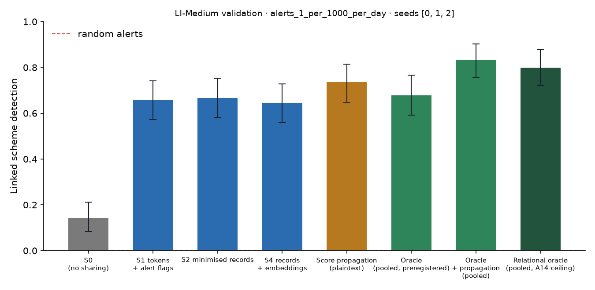

# X1 · sharing ladder on validation · LI-Medium · federation B8c90

**Secondary analysis (A21 coverage curve): federation B8c90**, the largest banks holding 90% of accounts, grouped into 8 members; accounts at other banks are outside and cannot be asked. No sweeps or audit; decides no hypothesis. Seeds [0, 1, 2]; primary budget alerts_1_per_1000_per_day; schemes detected within 12 windows; primary fusion **stacker** (A13); H1b ceiling **oracle-relational** (A14). Per-scheme outcomes are averaged over seeds before the scheme bootstrap. Total 1,758 s, peak memory 1,578 MB.

## Linked detection per configuration (primary fusion)

| Configuration | Linked [95% CI] | Across members | Detected [95% CI] | Gain over S0 [95% CI] | p | AUPRC (mean) |
| --- | --- | --- | --- | --- | --- | --- |
| S0 (no sharing) | 0.1434 [0.0823, 0.2115] | 0.0000 | 0.8459 [0.7814, 0.9140] | — | — | 0.0864 |
| S1 tokens + alert flags | 0.6595 [0.5735, 0.7419] | 0.6523 | 0.8423 [0.7742, 0.9069] | 0.5161 [0.4301, 0.6022] | 0.0000 | 0.0936 |
| S2 minimised records | 0.6667 [0.5806, 0.7527] | 0.6595 | 0.8065 [0.7348, 0.8781] | 0.5233 [0.4301, 0.6129] | 0.0000 | 0.1037 |
| S4 records + embeddings | 0.6452 [0.5591, 0.7276] | 0.6380 | 0.8208 [0.7490, 0.8890] | 0.5018 [0.4121, 0.5914] | 0.0000 | 0.1048 |
| Score propagation (plaintext) | 0.7348 [0.6452, 0.8136] | 0.7312 | 0.8351 [0.7634, 0.9033] | 0.5914 [0.4982, 0.6774] | 0.0000 | 0.1097 |
| Oracle (pooled, preregistered) | 0.6774 [0.5913, 0.7670] | 0.6308 | 0.9068 [0.8530, 0.9570] | 0.5341 [0.4409, 0.6237] | 0.0000 | 0.1199 |
| Oracle + propagation (pooled) | 0.8315 [0.7563, 0.9032] | 0.7921 | 0.8853 [0.8208, 0.9427] | 0.6882 [0.5986, 0.7778] | 0.0000 | 0.1455 |
| Relational oracle (pooled, A14 ceiling) | 0.7993 [0.7203, 0.8781] | 0.7599 | 0.8746 [0.8100, 0.9320] | 0.6559 [0.5662, 0.7491] | 0.0000 | 0.1390 |

Random alerts at the same budget: detected 0.0101, linked 0.0000.

## H1b on validation: share of the ceiling's gain recovered

(level − S0) / (ceiling − S0) in linked detection, scheme bootstrap. The relational oracle (pooled data with the same re-ranking, plaintext) is the ceiling from A14; the preregistered oracle is kept for comparison, and `strongest-pooled` uses whichever pooled relational configuration links more (oracle+propagation) as a sensitivity check. Target: at least 0.60 for S2, judged on test.

| Level | Against oracle-relational [95% CI] | Against oracle [95% CI] | Against strongest-pooled [95% CI] |
| --- | --- | --- | --- |
| S1 | 0.7869 [0.6931, 0.8724] | 0.9664 [0.8597, 1.08] | 0.7500 [0.6559, 0.8358] |
| S2 | 0.7978 [0.6963, 0.9071] | 0.9799 [0.8653, 1.11] | 0.7604 [0.6633, 0.8527] |
| S4 | 0.7650 [0.6579, 0.8689] | 0.9396 [0.8169, 1.07] | 0.7292 [0.6307, 0.8249] |

## Secondary fusion rules

k-of-n uses only alert flags and noisy-OR only flags and the probability bucket, so their S2 and S4 rows coincide by construction.

| Level / rule | Linked | Detected | Gain over S0 | AUPRC (mean) |
| --- | --- | --- | --- | --- |
| S1/noisy_or | 0.6989 [0.6057, 0.7778] | 0.8280 [0.7527, 0.8961] | 0.5556 [0.4588, 0.6453] | 0.0890 |
| S1/kofn | 0.5305 [0.4409, 0.6166] | 0.7706 [0.6882, 0.8459] | 0.3871 [0.2866, 0.4839] | 0.0840 |
| S2/noisy_or | 0.6703 [0.5806, 0.7492] | 0.8172 [0.7455, 0.8853] | 0.5269 [0.4372, 0.6165] | 0.1008 |
| S2/kofn | 0.5305 [0.4409, 0.6166] | 0.7706 [0.6882, 0.8459] | 0.3871 [0.2866, 0.4839] | 0.0840 |
| S4/noisy_or | 0.6703 [0.5806, 0.7492] | 0.8172 [0.7455, 0.8853] | 0.5269 [0.4372, 0.6165] | 0.1008 |
| S4/kofn | 0.5305 [0.4409, 0.6166] | 0.7706 [0.6882, 0.8459] | 0.3871 [0.2866, 0.4839] | 0.0840 |

## Protocol per seed

Token evaluations are counted by the first level that needs them; later levels reuse the same tokens.

| Seed | Level | Requests | Answered: alert | Record, no alert | Refused | Accounts disclosed | LDP withheld | Max ε per account | Token evaluations | Seconds |
| --- | --- | --- | --- | --- | --- | --- | --- | --- | --- | --- |
| 0 | S1 | 208,237 | 6,877 | 0 | 547 | 0 | 0 | 0.0000 | 256,597 | 93.00 |
| 0 | S2 | 208,237 | 6,877 | 54,034 | 547 | 45,250 | 0 | 0.0000 | 0 | 39.60 |
| 0 | S4 | 208,237 | 6,877 | 54,034 | 547 | 45,250 | 0 | 0.0000 | 0 | 39.40 |
| 1 | S1 | 198,689 | 6,615 | 0 | 542 | 0 | 0 | 0.0000 | 246,797 | 88.60 |
| 1 | S2 | 198,689 | 6,615 | 52,542 | 542 | 44,483 | 0 | 0.0000 | 0 | 35.70 |
| 1 | S4 | 198,689 | 6,615 | 52,542 | 542 | 44,483 | 0 | 0.0000 | 0 | 36.00 |
| 2 | S1 | 218,634 | 7,369 | 0 | 566 | 0 | 0 | 0.0000 | 271,968 | 107.70 |
| 2 | S2 | 218,634 | 7,369 | 63,539 | 566 | 51,378 | 0 | 0.0000 | 0 | 54.20 |
| 2 | S4 | 218,634 | 7,369 | 63,539 | 566 | 51,378 | 0 | 0.0000 | 0 | 55.10 |

## Time per seed

| Seed | s0 | oracle | relational | records | propagation | evaluate | total |
| --- | --- | --- | --- | --- | --- | --- | --- |
| 0 | 36.60 | 43.90 | 6.10 | 39.90 | 0.5000 | 280.60 | 579.90 |
| 1 | 43.20 | 91.20 | 6.20 | 40.30 | 0.4000 | 224.00 | 565.90 |
| 2 | 28.10 | 64.50 | 4.30 | 28.10 | 0.6000 | 234.10 | 576.90 |
