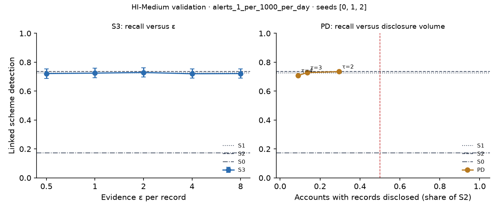

# X3 · evidence-channel privacy on validation · HI-Medium

Seeds [0, 1, 2]; primary budget alerts_1_per_1000_per_day; primary fusion stacker, fitted on evidence released through the same mechanism. S3: every record field but the time bucket and alert flag through k-ary randomised response at ε / 20 per field, memoised per record, at most ε = 8 per account and epoch (over budget: the S1 answer). PD: the S1 answer, plus the S2 record when the requester's score bucket is at least τ.

## S3: recall versus ε

| ε per record | Linked [95% CI] | Gain over S0 | Share of relational-oracle gain | Records withheld (budget), mean per seed | Max ε spent on one account |
| --- | --- | --- | --- | --- | --- |
| 0.5000 | 0.7217 [0.6884, 0.7550] | 0.5481 [0.5082, 0.5874] | 0.9567 [0.9140, 1.00] | 0.0000 | 5.00 |
| 1.00 | 0.7247 [0.6927, 0.7586] | 0.5511 [0.5112, 0.5899] | 0.9620 [0.9173, 1.01] | 19.00 | 8.00 |
| 2.00 | 0.7290 [0.6969, 0.7629] | 0.5554 [0.5172, 0.5953] | 0.9694 [0.9292, 1.01] | 610.33 | 8.00 |
| 4.00 | 0.7205 [0.6897, 0.7550] | 0.5469 [0.5070, 0.5868] | 0.9546 [0.9127, 0.9958] | 2,328.67 | 8.00 |
| 8.00 | 0.7217 [0.6897, 0.7550] | 0.5481 [0.5088, 0.5874] | 0.9567 [0.9157, 0.9989] | 10,649.33 | 8.00 |

## PD: recall versus disclosure volume (H1d)

H1d: at least 0.80 of S2's gain over S0 with records disclosed on fewer than half as many accounts as S2. Judged on test; validation shown here.

| τ (requester bucket) | Linked [95% CI] | Share of S2 gain [95% CI] | Accounts disclosed, share of S2 | Accounts disclosed (mean) | H1d met on validation |
| --- | --- | --- | --- | --- | --- |
| 2.00 | 0.7350 [0.7042, 0.7677] | 0.9989 [0.9774, 1.02] | 0.2955 | 12,557.67 | yes |
| 3.00 | 0.7284 [0.6951, 0.7629] | 0.9871 [0.9613, 1.01] | 0.1359 | 5,783.00 | yes |
| 4.00 | 0.7084 [0.6751, 0.7417] | 0.9516 [0.9231, 0.9794] | 0.0905 | 3,851.33 | yes |

Reference: S1, which discloses no record, reaches 0.9839 [0.9605, 1.01] of S2's gain. When this is itself at least 0.80, H1d holds for any τ and says little about disclosure; the informative comparison is then PD against S1.
