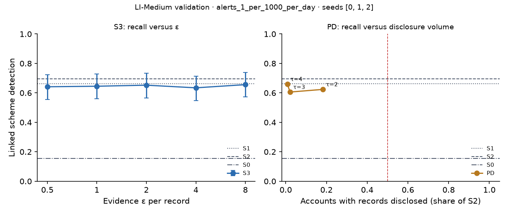

# X3 · evidence-channel privacy on validation · LI-Medium

Seeds [0, 1, 2]; primary budget alerts_1_per_1000_per_day; primary fusion stacker, fitted on evidence released through the same mechanism. S3: every record field but the time bucket and alert flag through k-ary randomised response at ε / 20 per field, memoised per record, at most ε = 8 per account and epoch (over budget: the S1 answer). PD: the S1 answer, plus the S2 record when the requester's score bucket is at least τ.

## S3: recall versus ε

| ε per record | Linked [95% CI] | Gain over S0 | Share of relational-oracle gain | Records withheld (budget), mean per seed | Max ε spent on one account |
| --- | --- | --- | --- | --- | --- |
| 0.5000 | 0.6416 [0.5555, 0.7241] | 0.4875 [0.3978, 0.5878] | 0.7473 [0.6527, 0.8283] | 0.0000 | 3.50 |
| 1.00 | 0.6452 [0.5591, 0.7277] | 0.4910 [0.4014, 0.5914] | 0.7527 [0.6587, 0.8324] | 0.0000 | 7.00 |
| 2.00 | 0.6523 [0.5663, 0.7348] | 0.4982 [0.4050, 0.5950] | 0.7637 [0.6726, 0.8442] | 23.67 | 8.00 |
| 4.00 | 0.6344 [0.5484, 0.7133] | 0.4803 [0.3835, 0.5700] | 0.7363 [0.6353, 0.8192] | 299.00 | 8.00 |
| 8.00 | 0.6559 [0.5734, 0.7384] | 0.5018 [0.4050, 0.5987] | 0.7692 [0.6763, 0.8514] | 3,676.00 | 8.00 |

## PD: recall versus disclosure volume (H1d)

H1d: at least 0.80 of S2's gain over S0 with records disclosed on fewer than half as many accounts as S2. Judged on test; validation shown here.

| τ (requester bucket) | Linked [95% CI] | Share of S2 gain [95% CI] | Accounts disclosed, share of S2 | Accounts disclosed (mean) | H1d met on validation |
| --- | --- | --- | --- | --- | --- |
| 2.00 | 0.6237 [0.5411, 0.7061] | 0.8675 [0.7721, 0.9489] | 0.1823 | 7,630.67 | yes |
| 3.00 | 0.6057 [0.5197, 0.6882] | 0.8344 [0.7391, 0.9225] | 0.0212 | 878.00 | yes |
| 4.00 | 0.6595 [0.5699, 0.7455] | 0.9338 [0.8509, 1.02] | 0.0080 | 336.67 | yes |

Reference: S1, which discloses no record, reaches 0.9404 [0.8620, 1.01] of S2's gain. When this is itself at least 0.80, H1d holds for any τ and says little about disclosure; the informative comparison is then PD against S1.
