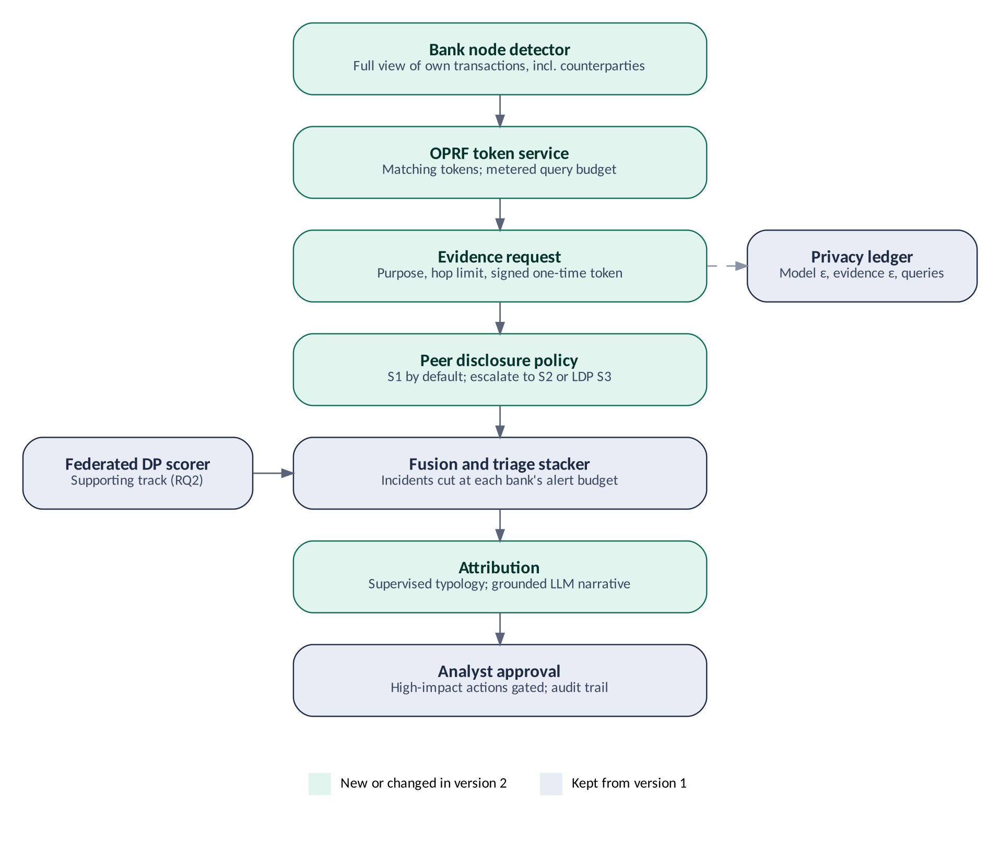

**Document type:** Research and engineering project proposal (revised, final)\
**Domain:** Financial crime (anti-money laundering) · privacy-enhancing technologies · federated learning · differential privacy · retrieval-grounded language models\
**Intended outcomes:** a peer-reviewable research paper and a working, reproducible prototype ("FinMesh")

# 1. Executive Summary

Money laundering is organised to defeat single-institution monitoring. Funds are split, layered and moved across banks so that each bank sees only a fragment that looks unremarkable. Pooling transaction data would expose the whole scheme, but privacy law, commercial confidentiality and data-residency rules block it. Regulators are opening a door: on 12 June 2026 FinCEN replaced its Section 314(b) fact sheet, confirming that institutions may share information in real time and extending the safe harbour explicitly to suspected fraud, and the EU's AML Regulation creates information-sharing partnerships between obliged entities that apply from July 2027. Earlier work, including the AMLworld benchmark itself and the BIS Innovation Hub's Project Aurora, has already shown that collaboration improves detection. What is still missing is evidence on **what exactly banks should share, and what each piece of shared information costs in privacy**.

This project measures that trade-off directly. Its headline result is a **utility–leakage frontier for cross-bank evidence sharing**: for a ladder of sharing levels, from nothing to learned embeddings, it reports how much scheme-level detection improves at a fixed analyst alert budget and how much a curious peer bank can learn under a concrete attack suite. Three design choices make the frontier credible:

- **A realistic visibility model.** Each bank sees every transaction touching its own accounts, including the counterparty account and bank, but not what happens at other banks afterwards.
- **Matching without a shared secret.** Banks link the same entity through tokens issued by an oblivious pseudorandom function (OPRF) under a metered query budget, so no bank can hash candidate account numbers offline.
- **A formally private evidence channel.** One sharing level releases evidence through local differential privacy, which places a stated ε on the evidence channel itself rather than only on model training.

Two supporting studies use the same harness. The first measures what an **account-level** differential-privacy guarantee costs a federated neural detector compared with the usual record-level guarantee. The second measures how much cross-bank evidence improves **typology attribution**, the step that tells an analyst what pattern an incident resembles, with a supervised classifier as the primary attributor and a locally hosted language model used only to draft a grounded analyst narrative.

The study runs on public synthetic AML data (IBM AMLworld), where complete scheme labels exist, under a preregistered protocol with sealed test data, scheme-level metrics, per-bank alert budgets and confidence intervals computed by resampling schemes. It ends in an open prototype with an analyst console and a privacy ledger, packaged to reproduce on one commodity machine. The plan runs for 20 weeks, with a data-readiness go/no-go gate in week 2 and the headline result due in week 9.

# 2. Problem Statement

## 2.1 Context

A bank sees every payment that touches one of its own customers, including the counterparty's account and bank, because that information travels in the payment message. What it cannot see is what happens next: where the money goes after it arrives at another bank, or how that account behaves with its other counterparties. A laundering scheme that fans funds out through accounts at several banks, or cycles them back, is visible in full only to someone who sees all banks at once. Existing responses each fall short:

- **Local monitoring** misses structure beyond the first hop and produces large numbers of false alerts that analysts clear by hand.
- **Data pooling** is legally and commercially unavailable for routine monitoring.
- **Collaboration studies** show that pooling or joint models help, but measure utility only, not what each form of collaboration leaks.
- **Privacy-preserving protocols** each pick one mechanism (gradients, embeddings, secure computation of risk scores or subgroups) and evaluate it alone, without a common utility-and-leakage yardstick.
- **Alerts are not explanations.** An analyst needs to know what pattern an incident resembles and what to do next, and that interpretation is slow and manual.

## 2.2 Formal statement

Given *K* banks, each holding private transaction data with a common schema and seeing only transactions that touch its own accounts, design and evaluate a system that:

- **(P1)** lets banks exchange evidence about alerted accounts at several levels of granularity, and quantifies, for each level, the gain in scheme-level detection at a fixed per-bank alert budget and the leakage measured by a defined attack suite run by an honest-but-curious peer;
- **(P2)** trains a shared neural detector without moving raw data, under an (ε, δ) guarantee whose privacy unit is stated precisely, and measures the cost of an account-level unit against a record-level unit;
- **(P3)** converts fused evidence into a typology attribution and a grounded analyst narrative, with policy-gated actions and a full audit trail;

all under an evaluation protocol that avoids the leakage, lenient success criteria and metric inflation common in the fraud-detection literature.

# 3. Related Work and Research Gap

| **Area** | **What exists** | **Open gap** |
| --- | --- | --- |
| Collaboration-level studies | The AMLworld paper compares private and shared graphs and models per bank and finds large gains from sharing; BIS Project Aurora compares siloed, national and cross-border views and centralised, decentralised and hybrid collaborative analysis on synthetic payments data; Swift's federated trials report detection roughly twice as effective as single-institution models | Utility is measured, leakage is not. No study varies the granularity of what is exchanged and measures both sides on the same data |
| Federated and DP detection | Multi-bank federated AML and fraud detectors with DP-SGD (for example DPxFin, and NVFlare-based federated fraud detection with sample-level DP) report near-centralised accuracy; the UK–US PETs Prize financial-crime track produced privacy-preserving federated solutions on synthetic SWIFT and bank data | Guarantees are record- or sample-level. An account-level unit, which matches how a customer appears in AML data, is not evaluated for AML, and graph-feature dependence between neighbours is rarely acknowledged |
| Cryptographic collaboration | Secure risk propagation across banks with MPC; collaborative subgroup detection across institutions using locality-sensitive hashing and Bloom filters; graph machine learning under fully homomorphic encryption on AMLworld | Each work fixes one mechanism and evaluates it alone. No comparison of sharing levels with a common attack suite |
| Entity matching | Shared-key keyed hashing and private set intersection are both used in practice for linking customers across institutions | Shared-key hashing is open to dictionary attacks by any key holder; the effect of the matching mechanism on leakage is not measured in AML studies |
| Agentic and LLM AML | Agent frameworks that draft suspicious-activity narratives inside one institution; in-context LLM reasoning on AMLworld subgraphs through external APIs on balanced evaluation sets | No locally hosted, grounded attribution evaluated under realistic imbalance against a supervised baseline, and no link between attribution quality and what was shared |
| Explanation and evidence leakage | Feature-based explanations are known to leak training-set membership; clipping, noise and masking defences exist | Not applied to alert-level evidence records exchanged between banks, and no formally private evidence channel has been placed on a utility curve |
| Evaluation practice | Documented leakage, weak temporal validation and recall-at-any-cost reporting in fraud detection | No scheme-level, per-bank alert-budget, sealed-test protocol with a random-alert baseline for cross-bank AML |

**Research gap in one sentence:** no study measures, on one dataset and under one attack suite, how scheme-level detection gain and privacy leakage change as the granularity of exchanged evidence increases, or places a formally private evidence channel on that curve.

# 4. Objectives, Research Questions and Hypotheses

## 4.1 Objectives

- **O1.** Define a ladder of evidence-sharing levels, including a locally differentially private level and a progressive-disclosure policy, and measure detection gain and leakage at each level.
- **O2.** Build an entity-matching layer based on an OPRF with metered queries, and measure its leakage against the shared-key hashing it replaces.
- **O3.** Build a federated, differentially private neural detector with a precisely stated account-level privacy unit and measure its cost.
- **O4.** Measure how cross-bank evidence changes typology-attribution accuracy, and generate grounded analyst narratives with a locally hosted model.
- **O5.** Deliver a reproducible prototype with an analyst console and a privacy ledger, and publish the protocol, results and code.

## 4.2 Research questions and falsifiable hypotheses

RQ1 carries the paper's headline. RQ2 and RQ3 are supporting studies on the same harness.

| **RQ** | **Question** | **Hypotheses** |
| --- | --- | --- |
| **RQ1** (headline) | How do scheme-level detection gain and privacy leakage change across evidence-sharing levels, from no sharing to shared embeddings? | **H1a:** at a fixed per-bank alert budget, the minimised evidence record (S2) raises linked scheme detection over local-only monitoring (S0), with a 95% CI excluding zero, and exceeds a random-alert baseline at the same budget. **H1b:** S2 recovers at least 60% of the gain of a pooled-data oracle. **H1c:** relationship- and attribute-inference attacks against S1 and the LDP level S3 stay within a stated margin of their prior-only baselines at 1% FPR, while attacks on shared embeddings (S4) succeed significantly more often; S3 traces a monotone recall-versus-ε curve. **H1d:** progressive disclosure achieves at least 80% of the S2 gain while disclosing full evidence on fewer than half as many accounts |
| **RQ2** | What detection quality does federated training with DP-SGD retain against centralised and local-only training, and what does an account-level privacy unit cost compared with a window-level unit? | **H2a:** at ε ≤ 10 the federated DP neural scorer reaches at least 70% of the centralised non-private AUPRC and exceeds the mean local-only AUPRC. **H2b:** at the same ε, the account-level unit loses measurably more AUPRC than the window-level unit; the gap is reported with a confidence interval |
| **RQ3** | How much does cross-bank evidence improve typology attribution, and can a locally hosted language model produce narratives that stay grounded in the evidence? | **H3a:** pattern accuracy of a supervised attributor on fused evidence increases with sharing level (S0 < S2), above the majority-class and rule-based baselines. **H3b:** in the constrained narrative step, at least 95% of raw model outputs cite only typology IDs and evidence fields actually present in the input, before validation |

Thresholds in H1b, H1d and H2a are provisional. They may be revised once, using validation data only, at Gate G1, and are then frozen. Every result is reported whether or not a hypothesis holds.

# 5. Contributions

- **C1: Utility–leakage frontier.** The first systematic comparison, on one dataset and under one attack suite, of scheme-level detection gain against measured leakage across evidence-sharing levels for cross-bank AML, including a locally differentially private evidence level with a stated ε.
- **C2: Leakage-aware matching and disclosure.** An OPRF-based entity-matching layer with metered queries, measured against shared-key hashing, and a progressive-disclosure policy that escalates evidence only when the requester's own evidence justifies it.
- **C3: Account-level privacy for federated AML.** An account-level DP training scheme, a precise statement of what it does and does not cover in graph-featured data, and its measured cost against a window-level unit.
- **C4: Rigorous protocol.** Sealed temporal test data, scheme-level and linked-detection metrics, per-bank alert budgets, a random-alert baseline and confidence intervals from resampling schemes, released as reusable code.
- **C5: Open prototype.** A reproducible system with an analyst console, a privacy ledger covering both the model and the evidence channel, and an audit trail in which every reported number traces to a stamped artifact.

# 6. Scope

| **Category** | **Included** |
| --- | --- |
| **Research core** (carries claims) | Sharing ladder, progressive disclosure and leakage audit; OPRF matching; cross-bank fusion; federated DP detection; attribution versus sharing level; experiments X1–X6 |
| **Engineering support** (acceptance-tested, no research claims) | Bank-node and orchestration services, durable sessions and idempotency, signed request tokens, structured tracing, analyst console, resource benchmark, containerised packaging |
| **Out of scope** | Malicious or colluding banks, collusion between a bank and the token service, and update poisoning; production-grade cryptographic deployment; real customer data; live bank deployment; legal or compliance claims; sanctions screening and KYC; multi-jurisdiction regulatory mapping; delayed-label modelling |

# 7. Data

## 7.1 Primary dataset: IBM AMLworld

AMLworld is a synthetic financial-transaction world with individuals, companies and banks, in which laundering is generated and tracked through its full cycle. Its authors publish six datasets on Kaggle: higher-illicit (HI) and lower-illicit (LI) variants at small, medium and large sizes. The project uses the small sets as its primary data.

| **Set** | **Transactions** | **Accounts** | **Days spanned** | **Laundering rate** |
| --- | --- | --- | --- | --- |
| HI-Small | about 5 M | about 515 K | 10 | about 1 per 981 |
| LI-Small | about 7 M | about 705 K | 10 | about 1 per 1,942 |
| HI-Medium (fallback only) | tens of millions | about 2.1 M | 16 | higher-illicit regime |

The generator models eight laundering patterns (fan-out, fan-in, gather-scatter, scatter-gather, simple cycle, random, bipartite, stack) and provides pattern files linking schemes to transactions. Three properties shape the design:

- **The time span is short.** Ten dense days (1–10 Sep 2022), followed by a sparse tail in which licit traffic has stopped and about 60% of rows are laundering, limit the number of windows per account, the length of the test period and the realism of any delayed-label simulation. Modelling and evaluation use the dense period only; windows are sub-daily (4, 6 or 12 hours, fixed at Gate G0); delayed-label modelling is out of scope. *(Amended A1, 24 Oct 2026.)*
- **Pattern-labelled schemes are few.** A large share of laundering transactions carry no pattern label (38% in HI-Small, 71% in LI-Small), and there are only 370 and 117 schemes. *(Corrected A3, 24 Oct 2026.)* Scheme-level results are therefore reported with confidence intervals from resampling schemes, and the counts are a go/no-go criterion (Section 7.3).
- **Schemes cross banks.** A scheme can be an event observed by several nodes, which is what the sharing study needs.

The licence variant is confirmed on the dataset page before any derived data is redistributed.

## 7.2 Bank visibility model and federation

Each bank node holds every transaction in which one of its accounts is the sender or the receiver. For each such transaction it sees the full record, including the counterparty's account and bank, as it would in a real payment message. It does not see transactions between two accounts that are both held at other banks. Its graph features therefore include first-hop cross-bank edges but nothing beyond them.

The federation is chosen at Gate G0 by a label-free rule fixed in advance, so that the choice of clients cannot leak test labels. Banks are ranked by number of accounts, not transaction volume (a hub bank with 15 accounts carries 9% of HI-Small traffic). Because AMLworld has tens of thousands of small bank IDs, two membership families are compared on train and validation schemes only: the top *k* real banks, and all bank IDs grouped into *k* institutions balanced by accounts; At Gate G0 the primary federation was fixed to eight grouped institutions (B8), with real-bank federations as a secondary partial-participation analysis, and the headline moved to HI-Medium. *(Amended A2, A4, A5, A6; see CHANGES.md and docs/gates/G0.md.)* Accounts at banks outside the federation form an "outside world": their transactions with federation members are visible to the member involved, but they cannot be queried for evidence. The share of scheme legs that leave the federation is reported. HI-Small and LI-Small run as two independent federations that never share parameters. All nodes use one feature schema, while their distributions differ by bank size and behaviour.

## 7.3 Data-readiness gate (go/no-go at Gate G0)

Before any design is frozen, a data analysis records: bank counts and volumes; laundering share per bank; how pattern files link to transactions; the proportion of laundering transactions with a pattern label; the number of schemes in each planned split; the number of test schemes that touch two or more federation banks; and the share of scheme legs that leave the federation. The analysis uses only scheme membership and bank identifiers, not detector outputs. The decision rule is preregistered:

| **Multi-bank pattern-labelled schemes in the test split** | **Decision** |
| --- | --- |
| 100 or more (per federation) | Proceed with RQ1 as the headline on the small sets |
| 40 to 99 | Proceed, pool both federations for headline estimates, and report RQ1 with wide intervals as a case study alongside RQ2 |
| Fewer than 40 | Move to HI-Medium with chunked processing if it fits the memory budget at G0; otherwise make RQ2 and RQ3 the headline and report RQ1 as exploratory |

A secondary public set with richer typology labels (SAML-D) is an optional second site for detector-only and attribution checks if it carries bank identifiers and a compatible licence.

## 7.4 Knowledge base

- **Candidate typologies:** a catalogue authored from the AMLworld pattern descriptions, one entry per pattern, with a mapping to placement, layering and integration stages. Because AMLworld patterns are mostly layering structures, stage-level accuracy is reported only if the stage distribution in the test split is not degenerate.
- **Supplementary context:** FATF typology and red-flag guidance and FinCEN advisories, chunked for retrieval as narrative context but never offered as candidate labels.
- **Review actions:** a small authored table mapping each typology to recommended analyst actions, looked up deterministically and never generated by the language model.
- **Optional extension:** MITRE's Fight Fraud Framework for a cyber-enabled fraud track.

The mapping protocol is written and frozen before any attribution result exists, with two review passes.

# 8. Proposed Solution and System Design

**Design rationale.** The architecture follows what published and deployed systems report, not a preference for one model family. Where a choice is expensive to train, it is a comparison and not a dependency.

| **Design choice** | **Evidence from published and deployed systems** | **Consequence here** |
| --- | --- | --- |
| Graph features feeding a gradient-boosted model as the primary detector | IBM's Graph Feature Preprocessor with GBDT reports higher minority-class F1 than standard GNNs, and higher CPU throughput than GNNs run on a V100 GPU | Primary model; a GNN is kept as an optional offline benchmark |
| Relational signal built in, not left to a per-user sequence model | Revolut's PRAGMA encoder reads each user in isolation and scored 47.1% worse on AML F0.5 | No sequence foundation model; graph features carry cross-account structure |
| A neural component kept for the federated DP track | NVIDIA's blueprint feeds GNN embeddings to XGBoost; Booking.com reports tabular transformers beating GBDT in an A/B test; Nubank needed several tabular-specific parts before its deep model matched GBDT | MLP with numerical embeddings, compared against the GBDT and not assumed better |
| A triage stage after detection | An ML triage model downstream of bank rules cut false positives by 80% while keeping over 90% of true positives on real bank data | Triage stacker scored on alert budget |
| Collaboration beyond sharing weights | Swift's federated trials and BIS Project Aurora both report large gains from collaborative analysis on synthetic data | Evidence-sharing layer compared against weight sharing and against pooling |
| Matching without exchanging identifiers | Shared-key keyed hashing is open to dictionary attacks by any key holder; OPRFs are standardised (RFC 9497) | OPRF token service with metered queries; shared-key hashing kept only as a positive control in the audit |

## 8.1 Architecture

| **Layer** | **Components** | **Responsibility** |
| --- | --- | --- |
| Bank node (one per bank) | Local data store, graph feature extractor, GBDT and neural detectors, calibrator, evidence store, disclosure policy, node API | Scores account-windows, writes evidence records, answers authorised evidence requests at the level its policy allows |
| Token service | OPRF evaluator with per-epoch keys and per-bank query budgets | Issues matching tokens without learning identifiers; meters and logs evaluations |
| Federation | Aggregation server, DP-SGD clients, federated evaluation, privacy accountant | Private training and evaluation per federation |
| Orchestration | Triage, Investigator, Attribution and Dispatcher components; supervised attributor; local language model | Incidents, cross-bank evidence requests, attribution and narratives, action gating |
| Prototype services | Analyst console, privacy ledger, audit log, tracing | Human oversight and reproducibility |

The system has two execution paths that share message schemas but not a runtime. The **research harness** runs every experiment in-process, with banks simulated as isolated objects that exchange only allowlisted messages; it is vectorised so that the full grid of seeds, levels and datasets finishes on one machine. The **demo path** runs each bank node, the token service and the orchestration layer as separate processes, so that authentication, failure handling and leakage controls are exercised end to end. Contract tests check that both paths emit identical messages for the same inputs.

{width=4.7in}

**Figure 1. Revised evidence workflow.** One alert travels from the bank that raised it, through tokenisation and a purpose-bound evidence request, to the peer bank's disclosure policy, fusion, attribution and analyst approval. The federated DP scorer is a supporting input to fusion.

## 8.2 Module 1: Local detection

- **Windows.** Per-account behaviour over fixed, non-overlapping sub-daily windows (length fixed at G0), computed from the bank's own view of each transaction.
- **Graph feature extractor.** A streaming, per-bank extractor keeps a time-windowed directed multigraph of everything the bank can see, including first-hop edges to accounts at other banks, and emits for each account-window: in- and out-degree and fan-in and fan-out statistics, share of new counterparties, counts of short cycles visible to the bank (lengths 2 to 4), scatter-gather and gather-scatter indicators, pass-through ratio, the delay between inbound and outbound legs, and cross-bank and cross-currency shares. It is exact, deterministic and label-free, so it costs computation time but no training and no privacy budget. IBM's Graph Feature Preprocessor is the design reference; the project implements a defined subset with polars and numpy and measures its throughput at Gate G0.
- **Primary detector: gradient-boosted trees.** LightGBM trained locally on behaviour and graph features with class weighting. It anchors every comparison and trains in minutes.
- **Federated neural scorer.** An MLP with numerical feature embeddings (piecewise-linear or periodic) and no batch normalisation, so that DP-SGD applies. It is trained collaboratively in Module 2 and tested against the local GBDT, not assumed to beat it.
- **Label-free complement.** A small autoencoder whose reconstruction error serves label-scarce regimes and supplies a per-feature deviation vector for the evidence record.
- **Reference baselines.** Isolation Forest and PCA reconstruction, local only, as an unsupervised floor.
- **Calibration and thresholds.** Isotonic calibration on validation data. Thresholds come from validation data at per-bank alert-budget operating points (Section 11), never from test data.
- **Optional comparator.** An edge-feature graph network (GIN with edge features, reverse message passing, ego IDs and port numbering) on sampled time-sliced subgraphs, when GPU access exists. It is an offline benchmark outside the serving path.

**Model stack and training feasibility.** Cost classes are planning estimates for one 8 GB, CPU-only machine. Gate G0 measures them, and any component that cannot finish a run in about an hour is simplified or moved to the optional list.

| **Component** | **Role** | **Federated** | **Expected training cost** | **Status** |
| --- | --- | --- | --- | --- |
| Graph feature extractor | Relational and behaviour features | No, local | No training; one pass over the data | Core |
| LightGBM detector | Primary local detector | No, local | Minutes to tens of minutes per run | Core |
| MLP with numerical embeddings | Neural scorer under DP | Yes, DP-SGD | Small network; hours across the ε sweep | Core |
| Autoencoder | Label-free complement and deviation vector | Optional | Small network | Core reference |
| Triage stacker (logistic or shallow GBDT) | Combines scores and fused evidence | No | Seconds | Core |
| Supervised typology attributor (multinomial GBDT) | Pattern attribution from fused evidence | No | Seconds to minutes | Core |
| Edge-feature GNN | Offline benchmark | No | Needs GPU access or heavy subsampling | Optional |
| Pre-trained transaction foundation model | Excluded | None | Needs billions of events | Out of scope |

## 8.3 Module 2: Private federated learning

**Federated model.** Only the neural scorer, and optionally the autoencoder, is federated. DP-SGD applies directly to neural networks, and the project does not claim a differentially private federated tree ensemble. The graph-feature GBDT stays local and joins the federation indirectly, through the triage stacker and the evidence layer. The comparison of local GBDT, federated DP neural scorer and the stacked ensemble is itself a result (X4).

- **Aggregation.** FedAvg as the primary algorithm, with a minimum participation rule and per-round timeouts. FedProx is an optional arm under identical seeds and partitions.
- **Privacy unit.** Two units are compared. Under the **window unit**, one training example is one account-window. Under the **account unit**, one training example is one account's bag of at most *k* windows, so per-sample clipping in DP-SGD equals per-account clipping.
- **What the account unit covers.** The guarantee bounds the influence of an account's own feature windows on the trained model. It does not bound the account's indirect influence on its neighbours' graph features (for example, a counterparty's fan-in count), because those features are computed from shared transactions. The project states this scope explicitly, measures the indirect influence empirically by recomputing neighbour features with an account removed, and reports a degree-capped variant in which each account's contribution to neighbour counts is clipped. Because one AMLworld entity can hold accounts at several banks, an account-level guarantee is also not a customer-level guarantee; this is stated, with user-level methods across silos (ULDP-FL) cited as the route to it.
- **Class imbalance under DP.** Positives are about one in a thousand, and DP noise tends to wash out the minority-class gradient. The scorer uses a class-weighted loss with Poisson sampling so that standard accounting applies; positive oversampling is used only if its effect on the sampling rate is accounted for. H2a is set below the original target for this reason.
- **Accounting.** The noise multiplier is calibrated once for the planned total number of steps with an RDP accountant; accountant state persists across rounds and restarts and is never reset; a budget guard refuses training that would exceed the target. δ is set below the inverse of the client's number of training units. ε is swept over {1, 3, 10} against a non-private reference.
- **Normalisation.** Clients release noisy normalisation statistics whose privacy cost is added to the budget. Heavy-tailed amounts are log-transformed and clipped.
- **Federated evaluation.** Clients evaluate the global model locally and return aggregate metrics and binned score histograms; the server never holds evaluation data. A centralised oracle exists only as a labelled baseline.

## 8.4 Module 3: Matching, evidence sharing, fusion and attribution

**Entity matching through an OPRF.** Banks need to recognise that an account they paid is the account a peer is asking about, without exchanging account numbers in the clear and without holding a key that lets them tokenise arbitrary identifiers. Each bank blinds an identifier and sends it to a token service, which evaluates a pseudorandom function under its epoch key without seeing the identifier; the bank unblinds the result to obtain the token. No bank holds the key, so tokenising a candidate identifier requires an online, logged query, and each bank has a per-epoch query budget sized to its alert volume. The implementation follows RFC 9497 over a prime-order group. Shared-key keyed hashing, the design in version 1 of this proposal, is retained only as a positive control in the leakage audit. Collusion between the token service and a bank is out of scope; a threshold OPRF split across two non-colluding parties is future work.

**Evidence record.** When an account-window exceeds the node threshold, the node writes a record containing the account's token and time bounds; a calibrated-probability bucket; at most three top deviating feature names with direction and a coarse magnitude bucket; and bucketed behaviour counters (fan-in and fan-out degree, pass-through ratio, new-counterparty flag, cross-bank share, cross-currency flag, amount bucket, burst level). It contains no raw values, reconstructions or latent vectors. Received evidence carries a retention period after which it is deleted automatically.

**Sharing-level ladder.**

| **Level** | **What a responding bank shares about the queried account** |
| --- | --- |
| S0 | Nothing (local-only) |
| S1 | Alert flag, time bucket and token only |
| S2 | Full minimised evidence record |
| S3 | S2 released through local differential privacy: each bucketed field through k-ary randomised response at a per-field ε, composed per record, swept over a total ε in {0.5, 1, 2, 4, 8} |
| S4 | S2 plus a learned embedding of the window (leakage upper reference) |
| PD | Progressive disclosure: S1 by default, escalating to S2 (or S3) only when the requester's own calibrated score bucket and declared purpose clear a threshold τ, swept to trace a disclosure-volume curve |
| Oracle | Pooled data (utility upper reference only) |

Fusion models for S3 are fitted on validation evidence released through the same mechanism, so that they learn to read noisy fields, and the per-account evidence ε accumulated across records in an epoch is capped and recorded in the privacy ledger. An additional baseline re-implements score propagation across banks without cryptography, to compare against published secure-propagation results.

**Evidence requests.** Every request carries a declared purpose, a hop limit, the requester's score bucket (used by PD) and a one-time, scoped, signed token. Responding banks rate-limit requests per token per epoch. All requests and responses are written to both banks' audit logs and to the privacy ledger.

**Fusion.** The triage component groups alerts and returned evidence by token and time window into incidents and computes a fused incident score (noisy-OR, k-of-n and a small stacker fitted on validation data).

**Triage stacker.** A small logistic or shallow gradient-boosted stacker takes the calibrated scores of the GBDT, neural scorer and autoencoder, the graph features and the fused cross-bank evidence features, and returns the final alert score. It is fitted on a later validation window than the base models, so it never sees the data they trained on. Each bank's queue is cut at its own alert budget, so sharing cannot raise recall simply by adding alerts.

**Leakage audit.** An honest-but-curious peer bank attacks everything it legitimately receives. Success is reported as true-positive rate at low false-positive rates against a prior-only baseline, not only as AUC.

| **Attack** | **Target** | **Question** |
| --- | --- | --- |
| A1 Token re-identification | Matching tokens under shared-key hashing (control) and under the OPRF with budgets | How many tokens can a peer link to known account numbers using candidate lists drawn from its own counterparties? |
| A2 Relationship inference | S1–S4 and PD responses, and the pattern of requests | Can a peer infer that an account is a customer of another bank, or that two accounts transacted? |
| A3 Attribute inference | S2, S3 and S4 | Can a peer recover a queried account's amounts, degrees or pass-through behaviour beyond the bucket prior? |
| A4 Linkability across epochs | Tokens and records | Can records about the same account be linked after key rotation? |
| A5 Membership inference | Global DP model and S4 embeddings | Can a peer tell whether an account was in another bank's training data? |
| A6 Query leakage | Incoming evidence requests | How much does being asked about an account reveal that the requester suspects it? (Inherent to any 314(b)-style exchange; measured, not prevented) |

**Orchestration components.** Three of the four components are deterministic; the term "agent" is kept in the prototype, not used as a research claim.

| **Component** | **Implementation** | **Responsibility** |
| --- | --- | --- |
| Triage | Deterministic | Deduplicate alerts, form incidents, compute fused score, open an idempotent session |
| Investigator | Deterministic | Request evidence from peer banks under a declared purpose, a hop limit and the query budget; persist every hop |
| Attribution | Supervised attributor plus one constrained language-model call | Assign a typology from fused evidence; draft a grounded narrative for the analyst |
| Dispatcher | Policy table | Run low-impact actions automatically; queue high-impact actions for human approval |

**Attribution flow.** Fused incident evidence is converted to a feature vector and scored by a multinomial GBDT trained on validation incidents, which outputs a typology and a confidence; incidents below a confidence threshold are marked "unattributed". Baselines are the majority class, a rule-based shape detector over the same features, and retrieval-only matching against the typology catalogue. The language model is then called once: it receives the evidence rendered by a deterministic template, the assigned typology entry and up to three retrieved FATF context passages, and returns JSON constrained to a schema whose typology field must equal the assigned typology and whose cited evidence fields must exist in the input. Output is validated for schema, typology agreement and field membership; failures fall back to a template narrative and are logged. Review actions come from the authored table. Attribution is evaluated at each sharing level, so RQ3 measures what sharing adds to explanation as well as to detection.

**Action policy.**

| **Action** | **Impact** | **Execution** |
| --- | --- | --- |
| Analyst alert with attribution, narrative and trace link | Low | Automatic |
| Raise monitoring or extend evidence retention within policy | Low | Automatic |
| Place a hold or escalate an account for filing review | High | Human approval required |
| Change a node's detection threshold or disclosure threshold | High | Human approval required |

# 9. Methodology

- **Splits.** Time-based train, validation and test per bank with a one-window gap at each boundary; windows are generated after splitting. Each scheme is assigned to the partition in which it starts and is never divided across partitions; its transactions that fall in another partition are masked there.
- **Sealed test.** Test data is readable only through a final-run entry point that logs every access with the configuration hash. Each frozen configuration is evaluated once per seed.
- **Labels.** An account-window is positive if it contains a laundering transaction. A **scheme event** is one laundering scheme instance from the pattern files.
- **Detection definitions.** A scheme is **detected** if any of its account-windows at any node raises an alert within the allowed delay. It is **linked** if at least two of its accounts, at two different banks where possible, end up in the same incident within the allowed delay. Linked detection is the primary RQ1 metric, because it is what sharing is supposed to buy; any-alert detection is secondary.
- **Random-alert baseline.** For each bank and budget, alerts drawn uniformly at random at the same rate give the chance level of every detection metric.
- **Seeds and statistics.** Five seeds per headline configuration and three elsewhere. Confidence intervals are 95% intervals from a cluster bootstrap over schemes (and over account-windows for window-level metrics), combined across seeds; paired comparisons use the paired bootstrap with Holm correction across multiple comparisons.
- **Provenance.** Every artifact records the data manifest hash, split, seed, parameters, ε, δ, noise multiplier, clipping norm, step count and, for S3, the evidence ε. Results from fixture or synthetic test data cannot pass any gate.

# 10. Threat Model and Privacy Claims

| **ID** | **Adversary** | **Capability** |
| --- | --- | --- |
| ADV-1 | Honest-but-curious aggregation server | Follows the protocol, inspects all updates |
| ADV-2 | Curious peer bank | Follows the protocol; inspects the global model, every token, response and request it receives; holds candidate account lists from its own payments; runs attacks A1–A6 |
| ADV-3 | Honest-but-curious token service | Sees blinded queries and their timing; does not collude with banks |
| ADV-4 | Network attacker | Observes, replays or injects on service links |
| ADV-5 | Faulty or compromised orchestration component | Issues node requests with the credentials it holds |
| ADV-6 | External exfiltration | Investigation content sent to a third-party model |

**Mechanisms.** DP-SGD at an explicitly scoped unit with persistent accounting; OPRF tokens with per-epoch keys and metered query budgets; minimised evidence with an LDP option and per-account evidence budgets; progressive disclosure; rate limits per token; retention periods on received evidence; federated evaluation; signed, expiring, one-time request tokens checked by every node; a purpose declaration and hop limit on every evidence request; a startup check that refuses any non-local language-model endpoint; human approval for high-impact actions.

**Claims.** The model guarantee is stated as (ε, δ) per client at the defined unit, with the neighbour-feature exclusion stated alongside it. The S3 evidence channel carries a local-DP guarantee per record at the stated ε, with per-account composition within an epoch tracked in the ledger. S1, S2 and PD responses are minimised and audited but are not differentially private; the audit quantifies the residual risk. No legal or regulatory-compliance claim is made: keeping raw data on the node reduces transfer exposure and supports compliance work, and does not replace legal review. Out of scope: poisoning, collusion among banks or between a bank and the token service, compromised hosts and side channels.

# 11. Evaluation Plan

## 11.1 Metrics

- **Detection.** Linked scheme detection (primary) and any-alert scheme detection at fixed per-bank budgets; AUROC and AUPRC at account-window level; precision at k; time to detect; and false alerts per 1,000 accounts per day. Every detection metric is reported next to its random-alert baseline.
- **Operating points.** At roughly one laundering transaction per thousand, a 1% false-positive rate would yield about ten false alerts per true one. Operating points are therefore per-bank alert budgets (0.1% and 0.01% window FPR, and fixed alerts per 1,000 accounts per day), chosen on validation data only.
- **Disclosure.** Accounts on which full (S2-level) evidence was disclosed per 1,000 accounts per day; tokens issued; requests answered per level.
- **Privacy.** Model ε, δ and noise settings per client; evidence ε for S3; attack success A1–A6 as TPR at 0.1% and 1% FPR or accuracy above the prior-only baseline.
- **Attribution.** Pattern accuracy and macro-F1 on pattern-labelled test schemes, against majority-class, rule-based and retrieval-only baselines; abstention rate; stage-level accuracy where the stage distribution allows.
- **Narrative.** Grounding rate (share of raw model outputs whose typology and cited fields are all present in the input, before validation); validation-failure rate; latency.
- **Systems.** Latency by segment, session terminal rate, duplicate-dispatch count, peak memory per stage, training time per model.

## 11.2 Experiments

| **ID** | **Experiment** | **Answers** |
| --- | --- | --- |
| X1 | Sharing ladder: S0–S4, PD and oracle at fixed per-bank budgets, with fusion variants and the random-alert baseline, both federations | RQ1, H1a, H1b |
| X2 | Leakage audit A1–A6 across S1–S4 and PD, and across shared-key hashing versus OPRF with budgets | RQ1, H1c |
| X3 | Evidence-channel privacy: S3 ε sweep and the PD threshold sweep, giving recall-versus-ε and recall-versus-disclosure-volume curves | RQ1, H1c, H1d |
| X4 | Detection utility and architecture: behaviour-only versus graph features; local GBDT, local autoencoder, centralised GBDT, federated DP neural scorer and the stacked ensemble across the ε sweep | RQ2, H2a |
| X5 | Privacy unit: window versus account unit, with and without the degree cap; bank-partitioned versus IID data | RQ2, H2b |
| X6 | Attribution by sharing level (S0, S1, S2, S3): supervised attributor against majority, rule-based and retrieval-only baselines; narrative grounding | RQ3, H3a, H3b |
| X7 | End-to-end latency, fault and chaos tests, resource benchmark on the demo path | Prototype acceptance |

## 11.3 Success criteria

**Completion criteria (all must pass).**

- CC1: no label ever reaches scoring code (type-level guard and tests).
- CC2: thresholds, calibration, fusion and disclosure parameters come from validation data only; test access is logged and happens once per frozen configuration and seed.
- CC3: every reported number comes from a provenance-stamped artifact built on real data, not fixtures.
- CC4: privacy accounting is correct: per-client model ε including normalisation cost is at or below target, per-account evidence ε is at or below its cap, the accountants persist, and nothing resets.
- CC5: only allowlisted message types leave a node, and no bank process ever holds the OPRF key, both enforced by contract tests.
- CC6: X1–X6 complete with the specified seeds and confidence intervals.
- CC7: a clean checkout reproduces the smoke pipeline in CI.

**Performance targets (preregistered at Gate G1, reported either way).**

- PT1: at fixed per-bank budget, S2 raises linked scheme detection over S0 with a CI excluding zero and above the random-alert baseline, and recovers at least 60% of the oracle gain (provisional).
- PT2: A1 re-identification under the OPRF with budgets is at least an order of magnitude below shared-key hashing; A2 and A3 success against S1 and S3 at ε ≤ 2 is within the stated margin of the prior-only baseline at 1% FPR; S4 is significantly higher.
- PT3: progressive disclosure reaches at least 80% of the S2 gain with full evidence disclosed on fewer than half as many accounts (provisional).
- PT4: federated DP neural scorer AUPRC at ε ≤ 10 at least 70% of centralised non-private and above the mean local-only neural scorer (provisional). PT4b: the graph-feature GBDT exceeds the behaviour-only GBDT on AUPRC, which justifies the extractor's cost.
- PT5: supervised attribution accuracy at S2 exceeds S0 and all baselines with a CI excluding zero; narrative grounding rate at least 0.95 before validation.
- PT6: p95 latency of 3 s on the demo path for the model-free route from session opened to action recorded; the language-model route gets a target measured at Gate G0.

A missed target is a finding, not a project failure.

**Engineering acceptance.** Every session reaches a terminal state under fault scenarios and a replayed alert never dispatches twice; unauthenticated, expired, replayed, over-budget or out-of-scope requests are rejected; no high-impact action runs without approval; each action links to its evidence and trace; the research harness and the demo path emit identical messages for the same inputs; CI passes lint, type checks, tests with at least 80% coverage on core packages, and a secret scan; the containerised smoke pipeline runs end to end.

# 12. Prototype: FinMesh

## 12.1 Goal

A working, reproducible, end-to-end system that replays held-out synthetic transactions through bank nodes, raises alerts, matches entities through the token service, exchanges evidence at a chosen sharing level, fuses incidents across banks, attributes them to typologies with a grounded narrative and lets an analyst approve actions, while showing what each bank has disclosed and how much privacy budget it has spent.

## 12.2 Components

- **Bank node services:** graph feature extractor, frozen GBDT and neural detectors, calibrator, evidence store, disclosure policy and an authenticated evidence API.
- **Token service:** OPRF evaluation with per-epoch keys, per-bank budgets and an evaluation log.
- **Training pipeline:** federated DP training with persisted accounting and experiment tracking.
- **Orchestration:** the four components above, with durable sessions, idempotency keys and a circuit breaker per node.
- **Analyst console:** an incident queue cut at the bank's budget; a cross-bank evidence view showing which sharing level each response used; the attribution with its confidence and the grounded narrative; approve or reject controls for high-impact actions; and a **privacy ledger** showing model ε per bank, evidence ε per account and epoch, OPRF queries against budget, and every evidence request and response.
- **Audit and tracing:** one structured trace per session, recoverable by session ID.

## 12.3 Technology stack

| **Component** | **Role** |
| --- | --- |
| Python 3.12, uv | Runtime and locked dependencies |
| polars, pyarrow | Data preparation and windowed graph-feature extraction on multi-million-row files |
| LightGBM | Primary local detector, triage stacker and supervised attributor |
| PyTorch (CPU), Opacus | Neural scorer, autoencoder and DP-SGD with RDP accounting |
| Flower (simulation) | FedAvg (and optional FedProx) and federated evaluation |
| scikit-learn | Baselines, isotonic calibration, metrics |
| An RFC 9497 OPRF implementation (Ristretto255) | Token service |
| Ollama with a 3–4B instruction model | Local model with schema-constrained JSON output |
| sentence-transformers with in-memory numpy retrieval | Retrieval over the small typology catalogue and FATF passages |
| SQLite | Registry, sessions, actions, message outbox and inbox, privacy ledger |
| FastAPI, uvicorn | Node, token-service and orchestration APIs, console backend |
| MLflow, structured JSON logs | Experiment tracking, traces keyed by session ID |
| Docker Compose, GitHub Actions, Ruff, mypy, pytest | Packaging and quality gates |

Compared with version 1, the stack drops LangGraph (the orchestration is a small state machine on SQLite), a separate vector database (the catalogue has eight entries), a dedicated tracing server and DVC (data manifests are hashed and recorded in each artifact).

## 12.4 Resource design

The system targets a single machine with 8 GB of RAM. Training and operation never run at the same time; the language model uses a short context window; peak memory per stage is measured and recorded. The production path (a message broker, a relational database, a threshold OPRF and a hardware-backed key store) is described as future work and shares the same message schemas.

# 13. Delivery Strategy and Timeline

**Strategy.** Evaluation first, and headline first. The sharing study (RQ1) does not depend on federated training: it runs on local GBDT detectors, so it is built and measured before the DP track. The harness, sealed test set and baselines come before any collaborative component. A thin end-to-end slice of the demo path (one bank node, one alert, one evidence request, one attribution) runs by week 8 so integration risk appears early. Decision gates have fallbacks, and the paper is drafted while experiments run.

| **Weeks** | **Phase** | **Key outputs** | **Gate** |
| --- | --- | --- | --- |
| 1–2 | Data and literature | Data-readiness analysis and go/no-go decision; bank selection; window length; literature matrix; language-model latency check; memory budget per stage | **G0** |
| 3–5 | Evaluation harness and baselines | Splits, sealed test, metrics including linked detection and random-alert baseline, graph feature extractor, local and pooled GBDT, per-bank operating points | **G1** (preregister targets) |
| 6–9 | Evidence sharing and leakage (headline) | OPRF token service, evidence records, S1–S4, LDP S3, progressive disclosure, fusion, triage stacker, attacks A1–A6, X1–X3 on validation; thin demo slice | **G2** |
| 10–12 | Federated DP detection | Federated DP neural scorer, window and account units, degree cap, ε sweep, membership inference on the model, X4–X5 on validation | **G3** |
| 13–14 | Attribution and narrative | Typology catalogue and mapping protocol, supervised attributor, rule-based and retrieval baselines, constrained narrative, X6 on validation | |
| 15–17 | Demo path and console | Node, token and orchestration services; sessions, signed tokens, fault tests; analyst console and privacy ledger; X7 | |
| 18 | Full runs and freeze | All seeds and ablations on sealed test; configurations frozen | **G4** |
| 19–20 | Packaging, writing and release | Containerised pipeline, final figures, paper, artifact release, demo video | |

**Cut order if time slips:** the optional GNN comparator; FedProx; the IID arm of X5; attack A6; the language-model narrative (the supervised attributor is always kept); the full container profile (the smoke profile is always kept). If the schedule is held to 16 weeks, the first four cuts are taken in advance and weeks 15–20 compress to 13–16.

# 14. Research Publication Strategy

## 14.1 Narrative

The paper's claim: *what banks exchange matters as much as whether they exchange. Minimised evidence recovers most of the benefit of pooling at a measured leakage, a locally private evidence channel and progressive disclosure trace a usable frontier below it, and matching through an OPRF closes a re-identification hole that shared-key hashing leaves open.* The detector and the attribution step are supporting results, because federated DP detection on this dataset is already published and the gain from collaboration in general is already known.

## 14.2 Paper outline

- Introduction and the regulatory moment for information sharing.
- Related work: collaboration-level studies, privacy-preserving protocols and the sharing-granularity gap.
- Problem formulation, visibility model and threat model.
- System: detectors, OPRF matching, sharing ladder with LDP and progressive disclosure, fusion.
- Evaluation protocol: sealed test, linked detection, per-bank budgets, random-alert baseline, attack suite.
- Results: X1–X3 (headline), X4–X5 (privacy unit), X6 (attribution by sharing level).
- Discussion, limitations and ethics.
- Conclusion and artifact availability.

Planned figures: the system workflow (Figure 1); the utility–leakage frontier across S0–S4 and PD; recall versus evidence ε for S3; recall versus disclosure volume for PD; attack success per level and per matching mechanism; utility versus model ε for window and account units; and attribution accuracy by sharing level.

## 14.3 Venues and sequencing

Target a workshop or conference track on privacy-enhancing technologies, federated learning or AI in finance (for example the ACM International Conference on AI in Finance, privacy-focused venues and workshops at the major machine-learning conferences); confirm current deadlines, scope and page limits during the first month, since they change. Sequence: a workshop draft built on X1–X3 after Gate G2 if a deadline falls in weeks 10–14; a preprint at Gate G4; a conference submission by week 20 or the next deadline; a journal extension with additional datasets and a larger leakage study. A main-track venue would normally require real bank data, so the paper states the synthetic-data limitation openly.

## 14.4 Anticipated reviewer concerns

| **Concern** | **Response** |
| --- | --- |
| Collaboration is already known to help (AMLworld, Project Aurora, Swift) | Agreed and cited; the contribution is the leakage side of the curve and the granularity of what is shared, not the existence of a gain |
| Synthetic data | Complete labels are the reason to use it; leakage on synthetic accounts may differ from real risk, stated as a limitation; optional detector-only check on a second public dataset |
| Both federations share a generator | Stated; HI and LI differ in illicit rate and are framed as two regimes, not independent worlds |
| Few cross-bank schemes | Counted and decided at the preregistered G0 gate; intervals from resampling schemes; claims scoped to what the data supports |
| Lenient detection metric | Linked detection is primary, every metric is shown against a random-alert baseline, and budgets are per bank |
| Account-level DP ignores graph dependence | The neighbour-feature exclusion is stated, measured and mitigated with a degree cap |
| Evidence records are not private | S3 provides a formal local-DP channel; S1, S2 and PD are audited with a concrete attack suite |
| LLM adds little | The language model is not the attributor; a supervised model is, and the narrative is evaluated only for grounding |
| Reproducibility | Stamped artifacts, pinned dependencies, containerised smoke pipeline, released code and configurations |

## 14.5 Ethics and licensing

Only public synthetic data is used and no real customer data is touched. The dataset licence terms are followed, derived data is released only if permitted, and the code is released under a permissive licence with a data card and a model card. The attack code is released with the paper because it measures leakage in the project's own design; it targets no real system.

# 15. Risk Register

| **Risk** | **Likelihood** | **Impact** | **Mitigation** | **Decision point** |
| --- | --- | --- | --- | --- |
| Too few multi-bank schemes | Medium | High | Preregistered go/no-go thresholds; pool federations; HI-Medium fallback; refocus headline on RQ2 and RQ3 | G0 |
| Short time span limits windows and test length | High | Medium | Sub-daily windows; scheme-aware splits; delayed-label work out of scope | G0 |
| Few pattern-labelled schemes for attribution | Medium | Medium | Report subset size; secondary typology dataset; frame attribution as a case study if small | G0, G1 |
| LDP noise destroys the fusion signal | Medium | Medium | Fit fusion on noisy validation evidence; coarser buckets; report the full ε curve, including where it fails | G2 |
| OPRF integration takes longer than planned | Low | Medium | Use an existing RFC 9497 library; if blocked, run the audit against a token oracle that enforces the same budget semantics and state this | G2 |
| Leakage attacks too weak to be credible | Medium | High | Several attack types; prior-only baselines; shared-key hashing and S4 embeddings as positive controls | G2 |
| DP utility far below centralised under extreme imbalance | High | High | Class-weighted loss, tuned clipping and model size on validation; report the full curve | G3 |
| Account-level unit too costly | Medium | Medium | Cap windows per account; report both units; state the cost as a finding | G3 |
| Neural scorer underperforms the GBDT, so federation adds little | Medium | Medium | Report it as a finding; RQ1 does not depend on it | G3 |
| Language model too slow or produces invalid JSON | High | Low | Constrained decoding; smaller model; template narrative fallback; attribution unaffected | G0, week 14 |
| Out of memory on 8 GB | Medium | High | Stage isolation, chunked loading, short context, measured budget | G0, G4 |
| Graph-feature extraction too slow or too large | Medium | High | Bounded cycle length, time-bucketed windows, chunked processing; drop the costliest pattern if needed | G0 |
| Compute exceeds schedule | Medium | Medium | Time one run early; three seeds for non-headline configurations; overnight runs | G1 |
| Fast-moving literature | High | Medium | Re-run the literature search before submission; keep the claim to the measured frontier | G4 |
| Schedule slip | Medium | High | Headline-first ordering, gates, buffer in week 18, cut order | Every gate |

# 16. Deliverables and Resources

**Deliverables:** the research paper and preprint; the FinMesh prototype with analyst console and privacy ledger; a reproducible evaluation harness with the attack suite; a data card, model card and mapping protocol; a project report; a demo video and slide deck.

**Resources:** one development machine (8 GB RAM, CPU only), public datasets, open-source libraries and a local language model. No paid cloud or proprietary data is required.

# 17. Limitations and Future Work

**Limitations:** the data is synthetic, generated by a single simulator and spans only ten days in the primary sets; the federations are simulated on one machine; S1, S2 and PD evidence carries no formal DP guarantee, and S3's guarantee is local and per record; the account-level model guarantee does not cover indirect influence through neighbours' graph features or customers holding accounts at several banks; the token service is trusted not to collude with banks; poisoning and collusion are not addressed; with a handful of banks, secure aggregation would offer limited anonymity; language-model narratives are grounded and validated but their faithfulness is not guaranteed.

**Future work:** threshold OPRF and private set intersection for matching; central or shuffle-model DP for the evidence channel; node-level and cross-silo user-level DP for graph features; robust aggregation against poisoning; delayed-label and analyst-feedback modelling on longer data; real-bank pilots through a regulated sandbox; a cyber-enabled fraud track using the MITRE Fight Fraud Framework; cross-jurisdiction sharing; and a production profile with a message broker, a relational database and a hardware-backed key store.

# 18. Conclusion

Banks are being permitted to share more, and prior work already shows that collaboration helps. What is missing is evidence on what is safe and useful to share. This project supplies it: a measured ladder of sharing levels from nothing to embeddings, a locally private evidence channel and a progressive-disclosure policy placed on the same curve, OPRF-based matching that removes an easy re-identification route, an account-level DP detector with an honestly scoped guarantee, an attribution study that shows what sharing adds to explanation, and an open prototype with an analyst console and privacy ledger. Whatever the results, they are reproducible, scheme-level and reported against explicit baselines, which makes the project both publishable and a credible demonstration of production-minded AI engineering.

# Appendix A. Changes from Version 1

| **Area** | **Version 1** | **Version 2 (this document)** |
| --- | --- | --- |
| Headline | Sharing study as RQ2, after federated DP | Sharing study is RQ1 and is delivered first, on local detectors |
| Visibility model | Each bank sees only its own side of each leg | Each bank sees full records for transactions touching its accounts, including counterparties; outside-world banks defined |
| Data facts and gate | Data gate without thresholds | Ten-day span stated; sub-daily windows; preregistered go/no-go thresholds; HI-Medium fallback |
| Entity matching | Keyed hash with per-epoch rotation | OPRF token service with metered budgets; shared-key hashing kept as a positive control |
| Evidence privacy | Minimised records, no formal guarantee; DP for evidence listed as future work | S3 is a local-DP channel with an ε sweep; progressive disclosure; per-account evidence budget; retention periods |
| Leakage audit | Membership inference on evidence records | Attack suite A1–A6 matched to each target; membership inference only on models and embeddings |
| Account-level DP | Account unit stated without scope | Neighbour-feature exclusion stated, measured and mitigated with a degree cap; account versus customer distinction stated |
| Detection metrics | Any-alert scheme recall | Linked detection primary; per-bank budgets; random-alert baseline; cluster bootstrap over schemes |
| Attribution | LLM chooses among top-5 of 8 retrieved typologies | Supervised attributor evaluated by sharing level; LLM drafts grounded narratives only; trivial Recall@5 target removed |
| Related work | — | AMLworld multi-bank results, BIS Project Aurora, UK–US PETs Prize, collaborative AML (WWW 2025) and FHE graph ML on AMLworld added |
| Experiments | X1–X7 including label delay | X1–X7 reorganised around the headline; label-delay experiment removed |
| Engineering | Single runtime; LangGraph, Qdrant, Phoenix, DVC | Research harness separated from demo path; stack trimmed |
| Timeline | 16 weeks | 20 weeks, headline due in week 9, with a 16-week compression path |

# References

- Abadi, M. et al. (2016). Deep Learning with Differential Privacy. *ACM CCS*.
- Altman, E. et al. (2023). Realistic Synthetic Financial Transactions for Anti-Money Laundering Models. *NeurIPS Datasets and Benchmarks*.
- Anti-Money Laundering Alert Optimization Using Machine Learning with Graphs. *arXiv:2112.07508*.
- Bank for International Settlements Innovation Hub (2023). Project Aurora: the power of data, technology and collaboration to combat money laundering across institutions and borders.
- Beutel, D. et al. (2020). Flower: A Friendly Federated Learning Research Framework. *arXiv:2007.14390*.
- Blanuša, J. et al. (2024). Graph Feature Preprocessor: Real-time Subgraph-based Feature Extraction for Financial Crime Detection. *ACM ICAIF; arXiv:2402.08593*.
- Davidson, A. et al. (2023). Oblivious Pseudorandom Functions (OPRFs) Using Prime-Order Groups. *IETF RFC 9497*.
- DPxFin: Adaptive Differential Privacy for Anti-Money Laundering Detection via Reputation-Weighted Federated Learning (2026). *arXiv:2603.19314*.
- Egressy, B. et al. (2024). Provably Powerful Graph Neural Networks for Directed Multigraphs. *AAAI*.
- European Union (2024). Regulation (EU) 2024/1624 on the prevention of the use of the financial system for money laundering or terrorist financing (AMLR).
- Financial Action Task Force. Money laundering typology and red-flag guidance; Partnering in the Fight Against Financial Crime: Data Protection, Technology and Private Sector Information Sharing.
- FinCEN (2026). Section 314(b) Fact Sheet, 12 June 2026.
- Hayat, K. (2025). Data Leakage and Deceptive Performance: A Critical Examination of Credit Card Fraud Detection Methodologies. *arXiv:2506.02703*.
- Kato, F. et al. (2024). ULDP-FL: Federated Learning with Across-Silo User-Level Differential Privacy. *arXiv:2308.12210*.
- Kim, S. et al. (2022). Towards a Rigorous Evaluation of Time-Series Anomaly Detection. *AAAI*.
- Krutikov, S. et al. (2024). Challenging Gradient Boosted Decision Trees with Tabular Transformers for Fraud Detection at Booking.com. *arXiv:2405.13692*.
- Li, T. et al. (2020). Federated Optimization in Heterogeneous Networks. *MLSys*.
- McMahan, B. et al. (2017). Communication-Efficient Learning of Deep Networks from Decentralized Data. *AISTATS*.
- Mironov, I. (2017). Rényi Differential Privacy. *IEEE CSF*.
- MITRE Center for Threat-Informed Defense (2026). MITRE Fight Fraud Framework (F3).
- Naik, P. V. et al. (2025). Co-Investigator AI: The Rise of Agentic AI for Smarter, Trustworthy AML Compliance Narratives. *arXiv:2509.08380*.
- Nubank (2025). nuFormer: transformer representations of transaction sequences. *arXiv:2507.23267*.
- NVIDIA. AI Blueprint for Financial Fraud Detection (GNN embeddings with XGBoost).
- Privacy-preserving Anti-Money Laundering using secure risk propagation (2024). *IACR ePrint 2024/065*.
- Privacy-Preserving Federated Fraud Detection (2026). *arXiv:2603.13617*.
- Privacy-Preserving Graph-Based Machine Learning with Fully Homomorphic Encryption for Collaborative Anti-Money Laundering (2024). *arXiv:2411.02926*.
- Revolut Research and NVIDIA (2026). PRAGMA: Revolut Foundation Model. *arXiv:2604.08649*.
- Shokri, R., Strobel, M. and Zick, Y. (2021). On the Privacy Risks of Model Explanations. *AIES; arXiv:1907.00164*.
- Swift (2025). AI innovation creates blueprint for banks to stop fraud faster through cross-border collaboration. Press release, 15 September 2025.
- Tatbul, N. et al. (2018). Precision and Recall for Time Series. *NeurIPS*.
- Tian, Z. et al. (2025). Towards Collaborative Anti-Money Laundering Among Financial Institutions. *The Web Conference (WWW); arXiv:2502.19952*.
- UK and US Governments (2023). PETs Prize Challenges, Track A: Financial Crime Prevention (synthetic SWIFT and partner-bank data).
- Wang, T. et al. (2017). Locally Differentially Private Protocols for Frequency Estimation. *USENIX Security*.
- Yousefpour, A. et al. (2021). Opacus: User-Friendly Differential Privacy Library in PyTorch. *arXiv:2109.12298*.

*— End of Proposal —*
